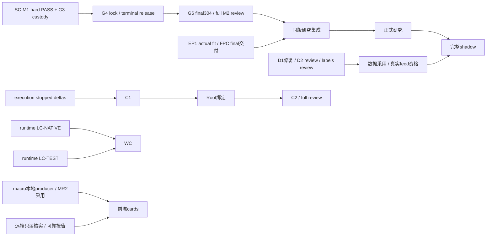

# 当前现状审核与总体蓝图修改计划

版本20261010-r1；证据读取日2026-10-10（Asia/Shanghai）。当前入口：[PROJECT-STATUS.md](../../PROJECT-STATUS.md)；机器台账：[workstreams.json](workstreams.json)。本轮独立ZCode文档审核的实际结论另存于 [zcode-review/](zcode-review/)（预留输出，生成后供读取），不在本蓝图预写PASS，也不靠回执修改这三个冻结文件。

项目已有多项有限实现和局部独立PASS，但最终同版集成、完整数据/运行资格、采用与部署仍有实物缺口。四项当前scoped审核已经齐备，**共享研究依赖交付链尚未闭合**，应沿已有G3 custody → G4 → G6交付。机械接收四份PASS不等于整批开发完成。DATA、execution、runtime与macro可以依各自写集并行推进。

本轮是原32条工作线与补充工作单的证据/状态审核和修改规划，**不是全仓库逐行硬审核，也没有重跑所有产品测试**。测试数字属于原reviewer/owner对应日期、版本和范围，这里核对文档依据，不冒充本轮实測。缺新证据保持UNKNOWN/STALE，旧NOT_RUN不能自动变成今天运行监测。原32条ID、阶段及依赖保留；support_slices和operational_findings不计新增项目工作量。

旧“15–25%”没有工作量权重、统一基线和一致出口，不能作为可信总体进度。本版不虚构新百分比，分别追踪实现、独立接受、采用/部署与实际lock、source/run、fit、窗口、真实feed、完整shadow交付。

## 蓝图与工作方式

主链保持data → M1 → M2 → M3A/M3B/M3C → M4连续账本 → M5 → execution。合法历史冻结研究和新实时feed/PostgreSQL资格各自推进，在完整shadow验收汇合。正式研究仍需60个成熟决策交易日加至少20日成熟尾段，原统计阈值/留出/embargo/成本口径不放宽。真实分钟feed仍须原品种/会话/活跃合约范围20个实际交易日，历史查询、SYNTHETIC、SCENARIO和单tick不能顶替。日历缺口照实记录，部分真实fixture不升为完整历史PIT资格。

当前默认Sol/max规划与开发，未参与实现的独立ZCode审核。用户许可本轮Astra；旧model/route文档是历史记录。本轮没有改model、provider、baseURL、key、effort或其他LLM配置。授权覆盖文档调整与修改规划，旧STOP不阻塞本轮文档；**计划内容不自动授权产品开发、one-use重放、DB/SDK访问、远端写入、部署或真实交易**。

最小证据要求为版本、明确write-set、必要验证、独立报告；已有合同强制的custody/终态门保留。审核source写冻结，FAIL回原owner用新revision修复并fresh独立复审，原bytes保留。生产进程结束后才封stdout/stderr，一次性命令不因补证据重跑。递归封包、全仓库seal或强制git commit不追加为一般关键路径。有效计划的审核、必要处置与真实前置就绪后，进入实施/产品硬审，不增加第二轮 unchanged 规划。

## 原32条工作线

三态按“实现 / 独立验收 / 采用部署”排列。表内E编号标证据日，**本轮读取日全部为2026-10-10**。date_basis、原依赖/外部门、历史记录和精确范围在JSON内。日期UNKNOWN是精确原证据时间未建立，不把10-10读文件日充作运行日。

| 工作线 | 实现 / 独立验收 / 采用部署 | 最新依据及证据日 | 范围与限制 | 下一真实交付与依赖 |
|---|---|---|---|---|
| ACQD1 采集数值转换 | 有限实现历史记录 / finite PASS接收 / UNKNOWN | E01 2026-10-01 | 采集数值转换finite历史源；164P=141原+23probe仅历史有限范围；真实源/当前采用未知 | 在DATA采用节点选择已通过版本；依赖：本项原门 |
| APUB3 有来源证明的发布器 | F1 guard修复完成 / guard scoped PASS；product NOT_ISSUED / UNKNOWN | E10 2026-10-09 | guard有限实现；真实malformed preflight native1/FAIL_ARTIFACT_PREFLIGHT、JSON解析失败；F2 metadata缺口保留 | 原owner新revision修复实际publisher包并独立审核；依赖：本项原门 |
| P05O2 分钟输入消费者 | 有限实现历史记录 / finite PASS接收 / UNKNOWN | E02 2026-10-01 | 分钟消费者finite历史源；112原+104probe与原handover skip保留；实时接入/采用未知 | 选通过版本并按原R8/producer合同接入；依赖：本项原门 |
| WAL2 执行日志及恢复 | 有限实现历史记录 / finite PASS接收 / UNKNOWN | E03 2026-10-01 | WAL finite历史源；408+103是历史有限范围；执行采用/部署未知 | 在EX06选版候选中绑定已接受版本；依赖：本项原门 |
| SHCP5 影子恢复消费语义 | E9实现冻结 / E9 unconditional scoped PASS / 完整shadow未建立 | E12 2026-10-09 | E9 external support origin/literal与关闭证据；E8失败保留；one-use命令未重放；非ordinary shadow/真实feed/formal资格 | 满足formal/feed原门后进入完整shadow；依赖：本项原门 |
| MR2 宏观报告PIT与乱序恢复 | 本地finite实现完成 / 独立原98/修订50/4probe PASS / 主线采用UNKNOWN | E07 2026-10-08 | 有限本地PIT/乱序恢复；滞后wrapper PENDING_RESPONSE_PARSE不能覆盖PASS；不接受producer/远端 | 采用本地已接受版；producer另审；依赖：本项原门；关联消费者（非本项前置）：MACRO-PRODUCER, MACRO-CARDS |
| FPC 正式运行原始证据身份 | P2实现冻结 / P2 unconditional scoped PASS / 报告final production NOT_RUN | E11 2026-10-10 | P2 adapter/route/admission与151/22语义证据；final run/copy/publication/deployment/full-node acceptance均报告NOT_RUN；作者UTC原值与supervisor观察时间差异保留，不推定完成顺序 | 复用现有有效plan完成其最终交付及适用独立审核；依赖：本项原门 |
| RUNTIME-R5 运行监督 | source修复未获接受；10-09 transfer plan立即生效 / 原whole finite SOURCE_STATIC FAIL保留；transfer plan已采纳，非product PASS / isolated branch按有效Root actions待实物推进 | E24 2026-10-09, E31 2026-10-09 | 原source四反例保留；有效transfer + Root actions已给321成员隔离路线；旧mutable tree不再写，历史native closure信用仍0；以行政撤销替代等待失联旧producer终态。精确321快照与custody后fresh admission，无重复plan approval；driver两literal/WCmetadata原限制保留，WC实施继actual stopped finalLCrefs | Root行政撤销旧LC grants/取消WC prepared route→exact321 supervised isolated snapshot/detached custody→LC-NATIVE与LC-TEST立即并行fresh Sol admission；WCprepare，actual finalLCrefs后实施；依赖：本项原门 |
| MH02 主目录采用与交付一致性 | UNKNOWN / UNKNOWN / UNKNOWN | E06 2026-10-01 | 仅旧蓝图successor review线索；未得新独立判决/选版，不复制旧interrupted作今天事实 | 限定核对source verdict和client/integration/dual-hash缺项；依赖：本项原门 |
| MH03 实际资源与运行窗口 | 静态实现历史记录 / static finite PASS接收 / actual runtime UNKNOWN | E04 2026-10-01 | 历史静态finite范围；不接受resource/affinity/seed/postchecks或新窗口；实际资格未知 | 按消费原要求取得实际窗口，非全局native门；依赖：本项原门 |
| MH04S3 线程收尾与首因保护 | r4-003 source实现 / unconditional scoped PASS / product NOT_ISSUED | E09 2026-10-09 | SOURCE_STATIC/STATIC_INPUT_ELIGIBILITY/admitted limited execution；53primary+17regression+8probe；不等于通用native资格 | 保留通过版，只补消费原要求实际资格；依赖：本项原门 |
| MH05 运行附件与收尾证据 | UNKNOWN / UNKNOWN / UNKNOWN | E06 2026-10-01 | 仅旧static-axis/whole-reception线索；没有新whole verdict/terminal/运行资格 | 核对当前判决后补原计划运行附件；依赖：本项原门 |
| KEYSET 固定集合与运行身份 | UNKNOWN / UNKNOWN / UNKNOWN | E06 2026-10-01 | 仅旧lease线索；旧过期lease/run存在性不证明当前执行 | 选当前版和有效窗口验证原集合/identity；依赖：本项原门 |
| EP1 正式研究正向分区与训练入口 | source/capacity实现 / scoped source/capacity PASS / 报告fit/product NOT_RUN | E08 2026-10-09 | source phase+8/8capacity regression；generation/registration/lock/product/fit未在该PASS执行；不是统计资格 | 按现有plan交付实际分区/训练/fit并独立适用审核；依赖：本项原门 |
| P4 退出机会成本与continuation | convergence历史记录 / 收敛接收 / 当前发布UNKNOWN | E05 2026-10-01 | 四模块continuation收敛；收敛提案非发布合同修订；四原阶段门当前未知 | 选版后绑定原四门；共享lock不能替代P4阶段；依赖：本项原门 |
| SNAPSHOT 执行客户端快照生命周期 | source存在历史记录 / UNKNOWN / UNKNOWN | E06 2026-10-01 | 旧AKExecutionBridge线索；未逐行审核source或核对今天UI/部署字节 | 按EX06 selected candidate核对snapshot同版接受；依赖：EX06 |
| DP-RELEASE DP01–08来源组合 | D2原8+2完成 / source-intake scoped PASS；full NOT_RUN / 采用UNKNOWN | E17 2026-10-06 | D2 r3原8+2 owner证据；558=547P+11原批准PGskip；BUILD/VERIFY native0 CLEAN117/117；D1独立阻塞 | 独立full D2审核后选明确DP release；依赖：DATA-D2, DATA-D1 |
| DATA-ADOPTION 采集发布与消费者接入 | UNKNOWN / UNKNOWN / UNKNOWN | E17 2026-10-06, E10 2026-10-09 | 有限D2与APUBguard；不证明ACQD/APUB/P05/DP同版组合；需明确selected source | 组合经接受的数据来源/消费者，验证原clock/producer合同；依赖：ACQD1, APUB3, P05O2, DP-RELEASE |
| RESEARCH-INTEGRATION 离线M1–M4/M3C与M5实验入口同版集成 | M1支持/M2准备实现 / scoped PASS only；full UNKNOWN / G4/G6权威产出尚缺 | E13 2026-10-09, E14 2026-10-09, E15 2026-10-09, E32 2026-10-07, E33 2026-10-07 | 四scoped审齐，共享依赖未真交付；不证明full M1/M2/M3A/B/C/M4同版；FPC/EP1局部PASS不补足；M3A十二文件仍review-preparation/admission pending，M3B仅plan PASS且P0 lock reconciliation/作者来源门保留，两者无新product PASS | G3custody→G4→G6后绑定selected研究组合；依赖：EP1, SC-M1, SC-M2 |
| EXECUTION-INTEGRATION 无限易同版离线交付 | 137source冻结；C2有失败 / full同版hard PASS未建立 / S3未建立 | E22 日期UNKNOWN | EX06 56phase54native0；4630JUnit含1F+58skip；NP02aggregate guard/NP06stalehash失败 | 按r7-005外部stopped deltas→C1→Rootbind→C2→full review；依赖：WAL2, MH02, SNAPSHOT, EX06 |
| DATA-QUALIFICATION 实际数据和PostgreSQL资格 | 窄有限证据 / full资格UNKNOWN / UNKNOWN | E17 2026-10-06, E25 2026-10-07, E26 2026-10-07 | recent-data/D2批准skip/labels隔离自测；窄pair/免费10000行/回填非provider完整；这些证据不执行DB/SDK/realfeed | 按原DP/P02执行获授权DB/SDK实际资格；依赖：DP-RELEASE, DATA-D1, DATA-D2, SESSION-LABELS |
| RUNTIME-QUALIFICATION 正式工具与实际运行资格 | 有限static/tools实现 / scoped PASS并存R5source FAIL / general runtime UNKNOWN | E11 2026-10-10, E09 2026-10-09, E24 2026-10-09, E21 2026-10-06, E31 2026-10-09 | FPC/MH04局部PASS、QMHtoolsPASS、R5FAIL；actual158node/原窗口/postchecks未建立；不能设全局万能native门；R5按有效321隔离transfer推进，非等待失联producer终态 | 修对应source，再按每个原消费节点补真实运行；依赖：FPC, RUNTIME-R5, MH03, MH04S3, MH05, KEYSET, QMH |
| FEED-QUALIFICATION 真实分钟feed | UNKNOWN / UNKNOWN / UNKNOWN | E06 2026-10-01, E25 2026-10-07 | 旧原要求和窄snapshot；无新完整20日接受；historical查询/合成/单tick不替代 | 选数据采用版后完成原品种/会话/活跃合约真实20日接受；依赖：DATA-ADOPTION, DATA-QUALIFICATION |
| FORMAL-RESEARCH 正式验证与留出 | 有限支持可用；full run UNKNOWN / UNKNOWN / UNKNOWN | E08 2026-10-09, E11 2026-10-10, E15 2026-10-09 | EP1/FPC支持和共享合同；局部测试不证明60成熟决策日+至少20日尾段/留出/统计合格 | 绑定研究组合/合法冻结输入和所需运行资格，产出原M5正式结果；依赖：RESEARCH-INTEGRATION, RUNTIME-QUALIFICATION, RESEARCH-INPUT |
| SHADOW-ACCEPTANCE 完整前瞻影子与恢复 | SHCP5有限恢复实现 / SHCP5 scoped PASS only / UNKNOWN | E12 2026-10-09 | E9有限消费恢复；ordinary完整run_shadow/真实feed/formal资格不由局部PASS建立 | formal与feed门后跑原前瞻/重启/账本恢复完整路径；依赖：FORMAL-RESEARCH, FEED-QUALIFICATION, SHCP5 |
| NP06-S3 同版部署模拟 | UNKNOWN / 同版integration hard PASS待成立 / UNKNOWN | E22 日期UNKNOWN | EX06失败尚待关闭；无新同版实际S3；客户端UI由用户操作 | 同版硬审后按原计划部署模拟，真实send/cancel=0；依赖：EXECUTION-INTEGRATION, RUNTIME-QUALIFICATION |
| NP07 限定首单 | UNKNOWN / UNKNOWN / UNKNOWN | E06 2026-10-01 | 本轮只读旧首单门线索；旧NOT_RUN不升级为今日监测；本轮无首单授权 | 同版hardPASS+真实S3+用户明确首单授权/UI开启后按原限额；依赖：NP06-S3 |
| ECON-PRODUCTION 远端长期报告生产 | UNKNOWN / UNKNOWN / UNKNOWN | E29 2026-10-01 | 10-01历史7active/7pending/0report；今天远端版本/runtime/report UNKNOWN；不得盲重启/重登记 | 先在获授权范围取得只读版本与首份可追溯报告；依赖：本项原门 |
| MACRO-CARDS 前瞻宏观研究卡与日志 | 本地MR2finite PASS only / cards full接受UNKNOWN / UNKNOWN | E07 2026-10-08, E23 2026-10-07, E29 2026-10-01 | 本地/producer owner证据，远端历史；backendUNKNOWN/narrativeUNVERIFIED/historicalPIT false；無当前cards接受 | producer和可靠报告源接受后交付前瞻卡/合同摘要/日志；依赖：MR2, ECON-PRODUCTION, MACRO-PRODUCER |
| MACRO-VALIDATION 宏观过滤价值 | UNKNOWN / UNKNOWN / UNKNOWN | E06 2026-10-01, E23 2026-10-07 | 原宏观验证要求；报告confidence非胜率；无完整有/无过滤样本外比较 | cards与正式研究接受后产出原消融/样本外比较；依赖：MACRO-CARDS, FORMAL-RESEARCH |
| NF-DELIVERY API/基准/风险说明交付 | 旧蓝图称存在实现 / UNKNOWN / UNKNOWN | E06 2026-10-01 | NF10/20/21/22/23/30旧线索；不凭旧PLAN_DELIVERED判未实现；未核对当前版本/性能/交付 | 选已有候选，补原API/基准/风险说明接受；依赖：本项原门 |
| RESEARCH-INPUT 有界历史冻结输入资格 | M1支持fixture可用 / 完整selected-input资格UNKNOWN / UNKNOWN | E13 2026-10-09, E25 2026-10-07 | 1795=368VERIFIED+1427SCENARIO与窄recent-data；SCENARIO及9late close_today费不提升historical PIT；calendar gaps保留 | 按M1/P04绑定合法有界冻结输入，补原源范围/资格；依赖：本项原门 |

## 补充工作单与支持切片

这些条目映射到既有32线或是交付工具，不增加项目分母。不能遗漏DATA D1/D2、DISPATCH、MASTER-B-TOOLS、Q00、QMH、EX06、MACRO producer和session labels。

| 切片/工作单 | 当前确认状态 | 范围与限制 | 下一交付 | 依据 |
|---|---|---|---|---|
| SC-M1 | HARD_PASS_G3_CUSTODY_G4_PENDING | M2reg120/120、M3B209/209；reviewer tooling235/235；full8 reviewer原路径87/88；最后项用carried bytes+owner88/88+独立等价probe，不能声称原路径独立88/88；非full M1 | 当前G3custody绑定后Root执行既有G4 | E13, E15 |
| SC-M2 | PREPARATION_PASS_G6_PENDING | tooling194/194；regeneration16/16 population byte identity；final accepted-lock/full H01-H08/D02/copy/run/publication未执行；full M2 hardPASS=false | G4后exact304copy+final run+原full requirements+新独立full M2 review | E14, E15 |
| DATA-D1 | BLOCKED_COLLISION_ONE_USE_CONSUMED | ACQD_FULL r3 continuation native1；自capture preparation/COMMAND.json触发absence collision；11helper未materialize/34输出absent；3旧native0suite仅partial，不复跑旧one-use | 原owner新bounded revision真materialize并验证原full阶段 | E16 |
| DATA-D2 | ORIGINAL_8_PLUS_2_DONE_FULL_REVIEW_NOT_RUN | 8suites558=547P+11原批准PGskip；BUILD/VERIFY native0 CLEAN117/117；原DP08失败保留且owner修复；fullreview只有prepare无START/RESULT；PG/SDK/feed NOT_RUN | 独立full D2 hard review，不把合法skip变PASS | E17 |
| DISPATCH | FAIL_H3_H12 | r2 verdict H3/H12/read_ack partial；owner5/5+10/10+42/42不覆盖FAIL；continuation plan称无usable verdict与实际矛盾 | 原owner修行为，原计划作者限定处置矛盾，fresh review | E18 |
| MASTER-B-TOOLS | FAIL_SIX_DEFECTS | 三工具/三测试工程范围；partial first_failure null、junction被接收、blocked raw1非3、skipreason替代、unobserved deselection捏造空、cwd越release；84P不覆盖 | 按已有r2修六文件，工具PASS后做原真实8scenario | E19 |
| Q00 | FAIL_Q_H09 | 183行manifest遗漏两个existing payload；final-state-verification.txt与handoff/q00/r5/owner-report-r5.md；disposition未授权metadata-only repair；不作其他线万能门 | 原owner新revision完整包/原适用接受，保留旧FAIL | E20 |
| QMH | TOOLS_PASS_RUNTIME_NOT_RUN | 29 controls native0；11probe中10P/1 reviewer out-of-scope不是owner缺陷；t01FAIL/t02 reportedPASS PARTIAL_UNVERIFIED保留；ABC/CBA/MH03/04/05 actual NOT_RUN | 按原消费门补获准真实窗口/158-node闭环 | E21 |
| EX06 | C2_FAILURE_FULL_REVIEW_PENDING | 56phase54native0；4630JUnit1F+58skip；NP02collect2 aggregate guard与NP06 1/249 stale NP03gates hash；执行D1不是DATA-D1；旧handoff未授repair lease | r7-005外部stopped deltas→C1exact137→Rootbind→C2 31命令/13组/56phase→full review | E22 |
| MACRO-PRODUCER | R5_OWNER_FROZEN_R3_INDEPENDENT_FAIL | 32source=26exact+6delta；Q01 98/Q02 50/Q03 83/QJ4 owner绿；MR2 finitePASS不覆盖producer；Q05/economic/backend/PIT incomplete，backendUNKNOWN/narrativeUNVERIFIED/historicalPIT false | 独立r5实际write-set review，FAIL回原owner；远端分开核对 | E23, E30 |
| SESSION-LABELS | IMPLEMENTED_SELF_TEST_PARTIAL_PG_NOT_RUN_G3_PASS_HARD_REVIEW_PENDING | 正式42P+6PGskip/24P+3PGskip；mapper实际sealed3150keys；9skip=PGtransaction，无DB授权/配置；G0gap保留；三canonical目标当时absent；G5/runner prepare/apply/realmarket_bars NOT_RUN；4200候选不是3150输入 | 复用G3冻结successor独立hardreview；PG/主线采用/apply继原G4/G5门 | E26, E27, E28 |
| M3A-PREPARATION | REVIEW_PREPARATION_ONLY_ADMISSION_PENDING | M3A continuation r2十二文件review preparation；不可回填pre-development baseline/unique author attribution和原M1/M2依赖仍需实际证据；未执行测试/产品hard review | 沿已有M3A原门补source attribution/完整review admission，再独立产品审核 | E32 |
| M3B-PLAN | PLAN_PASS_P0_RECONCILIATION_PRODUCT_NOT_ACCEPTED | M3B continuation plan独立可执行性审核；P0 lock ownership/H10 reconciliation与作者来源原门保留；产品PASS未签发，产品测试NOT_RUN | 原作者/合同owner解决P0 lock/source attribution，按有效plan后续原阶段交付 | E33 |
| MASTER-BASE | PLAN_ADOPTED_ACTUAL_INTAKE_PRODUCT_PASS_NOT_ESTABLISHED | MASTER-BASE continuation r2 source selection/ownership/requirements/dependencies计划；已采纳ready-for-Root-intake不等于四个实际selection/ownership/requirements/dependencies产物、owner实施或产品接受 | 复用已存MASTER-BASE计划执行其真实intake/原必要验证和独立接受 | E34 |

MR2独立原98/修订50均复跑PASS，producer/cards是其关联消费者而非本地有限采用的前置，滞后wrapper PENDING_RESPONSE_PARSE不覆盖实际判决。D2原8+2确已完成，547PASS与11个原批准PGskip分别报告；source-intake PASS不是full D2。session-label并非只有准备packet：24文件隔离实现、自测、Root G3新冻结都有证据，独立产品hard review尚未启动；9PGskip仍为NOT_RUN。STATE-048的4200候选与实际mapper3150 sealed keys是两个范围。

APUB guard F1获有限PASS，实际publisher包仍JSON解析preflight失败/F2缺metadata。MR2本地finite PASS不接受MACRO producer/远端/cards，producer r5 owner绿也不能覆盖独立r3 FAIL。DISPATCH实际FAIL H3/H12优先于计划“无usable verdict”，后者需原作者限定处置。Q00遗漏已有payload，补manifest两行不是自动修复许可或产品PASS。

## 共享研究依赖交付链

权威合同：[ARBITRATION.json](D:/Projects/AK-trading/docs/parallel-development-20261004-r1/plans/M2/current-lock-support-arbitration-20261009-r1-001/ARBITRATION.json)。G3要求SC-M1实际hardPASS加当前terminal custody；G4要求Root实际publisher/full verifier/supervisor终态证据、detached release/STOP和新lock绑定；G6在G4后交付exact final304copy、final source/run、原full H01–H08/D02、新独立full M2 review及publication/custody。G5 M2 preparation独立于G4，已有scoped PASS，不能当G6 full验收。

Root本轮按权威路径程序化检查（chunk715305/native0）时，六个prospective输出absent：m1_candidate_lock、m1_terminal.receipt、m1_terminal.stop、m2_final_source、m2_final_run、m2_copy_receipt。它们是待生成输出，不是必须现存的Read输入；JSON记录实际路径。缺口不能靠接收四报告补齐。FPC3 P2/SHCP5 E9保留独立范围；本轮未执行G3/G4/G6。

## 修改工作单

以下12组以实际交付和修复为主，复用既有有效plan/write-set，真正合同缺口仅窄澄清。plan/lease链接是权威归属入口，**不是本文件授予的新写权限**。P0聚焦MW01核心共享交付、MW04真实DATA-D1阻塞、MW06与MW10已就绪冻结成果立即硬审；labels后续DB/apply、MACRO远端/cards仍按自身原门。DISPATCH、MASTERtools、Q00列并行P1，仅对应消费者实际依赖时成为该消费者前置，未设全项目统一串行门。每项产品审核仍为独立ZCode，无条件PASS/FAIL。

| 工单/优先级 | 问题 → 真正交付 | owner与独立接受 | 文件归属/复用计划/窄澄清 | 必要验证 | 依赖与并行组 |
|---|---|---|---|---|---|
| MW01 P0 | 四scoped PASS未闭合G3/G4/G6 → G4实际新lock/terminal release/STOP，G6 exact304copy/run与full M2独立接受 | Root G3custody/G4；原SC-M1/SC-M2 owner各归属；独立ZCode；现有SC-M1/SC-M2 prep PASS保留范围；G6真实最终M2新独立full硬审PASS/FAIL | [ARBITRATION.json](D:/Projects/AK-trading/docs/parallel-development-20261004-r1/plans/M2/current-lock-support-arbitration-20261009-r1-001/ARBITRATION.json) [produce_scoped_lock.py](D:/AKF261009/M1/shared-dependency-support-r2/tools/produce_scoped_lock.py) [supervise_scoped_publication.py](D:/AKF261009/M1/shared-dependency-support-r2/tools/supervise_scoped_publication.py) [test_scoped_publication.py](D:/AKF261009/M1/shared-dependency-support-r2/tools/test_scoped_publication.py) [produce_dependency_run.py](D:/AKF261009/M2/shared-dependency-r1/tools/produce_dependency_run.py) [verify_dependency_package.py](D:/AKF261009/M2/shared-dependency-r1/tools/verify_dependency_package.py) [test_dependency_tools.py](D:/AKF261009/M2/shared-dependency-r1/tools/test_dependency_tools.py) 既有G1-G6不重规划；仅custody/path/input pins实际不符需原作者窄澄清 | G4原publisher/full verifier/supervisor与terminal绑定；G6原full H01-H08/D02；one-use不重放 | G3 current custody; G4 before G6 SC-G3→G4→G6 |
| MW02 P1 | DISPATCH H3/H12 FAIL且plan状态矛盾 → 修read_ack/原H3/H12行为、作者限定处置、fresh review | 原DISPATCH owner修；原计划作者处置；独立ZCode；独立ZCode依原H-clauses/窄disposition接受真实修复，无条件PASS/FAIL | [PLAN.md](D:/Projects/AK-trading/docs/parallel-development-20261004-r1/plans/DISPATCH/continuation-20261007-r2/PLAN.md) §79既有write-set继承新revision；“无usable verdict”须据实际FAIL处置 | 原required commands+H3/H12最小复现和修复验证；保留raw失败 | 无跨模块前置 PAR-DISPATCH |
| MW03 P1 | MASTERtools六反例未修；8真实scenario未跑 → r2六文件修复/工程接受后按真实selected release跑原8场景 | 原MASTER tools owner；独立ZCode；工具独立hardPASS后才进实际8scenario；84历史自测不替代判决 | [repair-plan.json](D:/Projects/AK-trading/docs/parallel-development-20261004-r1/plans/MASTER/b-tools-repair-r2/repair-plan.json) [materialize_release.py](D:/AKF261004/MASTER/b-tools-r2/integration/materialize_release.py) [verify_release.py](D:/AKF261004/MASTER/b-tools-r2/integration/verify_release.py) [run_release_scenarios.py](D:/AKF261004/MASTER/b-tools-r2/integration/run_release_scenarios.py) [test_materialize_release.py](D:/AKF261004/MASTER/b-tools-r2/integration/tests/test_materialize_release.py) [test_release_identity.py](D:/AKF261004/MASTER/b-tools-r2/integration/tests/test_release_identity.py) [test_release_scenarios.py](D:/AKF261004/MASTER/b-tools-r2/integration/tests/test_release_scenarios.py) 复用已存r2plan；真实scenario只等自身selected release | 原tool suite+6精确反例，blocked raw3/junction/cwd/skip/deselection真实观测 | selected releases only for actual scenarios PAR-MASTER-TOOLS |
| MW04 P0 | DATA-D1 self-capture collision，old one-use消耗 → 新revision修capture/absence归属，真实11helper/34outputs与full阶段交付 | 原DATA-D1 owner；独立ZCode；独立ZCode审真实新write-set/原D1 full requirements，旧3suite只partial | [PLAN.md](D:/Projects/AK-trading/docs/parallel-development-20261004-r1/plans/DATA/d1-full-stage-continuation-r1/PLAN.md) [LEASE.json](D:/Projects/AK-trading/docs/parallel-development-20261004-r1/coordination/model-routing-sol-20261006-r1/DATA/d1-materialize-002-candidate-r2/LEASE.json) [LEASE.json](D:/Projects/AK-trading/docs/parallel-development-20261004-r1/dispatch/zcode-owner-data-d1-r3-continuation-materialize-001/LEASE.json) candidate只是库存非launch；source_write_set=[]；按权威write_files_exact新批准窄修，不复跑旧command | 实际materialization身份/存在性+原full suites；native1保留失败 | 无跨模块前置 PAR-DATA-D1 |
| MW05 P1 | Q00 Q-H09遗漏existing payload，disposition未授metadata-onlyrepair → fresh bounded revision完整包及原适用接受 | 原Q00 owner；计划作者窄修；独立ZCode；独立ZCode新包原全适用条款PASS/FAIL；非其他领域通用前置 | [PLAN.md](D:/Projects/AK-trading/docs/parallel-development-20261004-r1/plans/QUALIFICATION/r2/PLAN.md) [DISPOSITION.json](D:/Projects/AK-trading/docs/parallel-development-20261004-r1/plans/QUALIFICATION/q00-r6-review-disposition-r1/DISPOSITION.json) [plan.json](D:/Projects/AK-trading/docs/parallel-development-20261004-r1/plans/QUALIFICATION/r2/plan.json) 原r2 plan section9/Q-H09和disposition为权威归属入口；新revision由原作者窄授权。两个相对payload名沿权威包root映射，不推断绝对路径；旧r5只读；补两行不自动授权 | 新包完整性、原required commands和Q-H09counterexample | 无跨模块前置 PAR-Q00 |
| MW06 P0 | D2full review未启动；labels实施/G3后product review/PG未跑 → 两条独立冻结review，labels后续获准PG与原G5采用/apply | 独立ZCode分别审；FAIL回各原owner；数据owner归属后续PG/apply；分别独立scope PASS/FAIL；source-intake/self-test/Root G3不替代product hardreview | [PLAN.md](D:/Projects/AK-trading/docs/parallel-development-20261004-r1/plans/DATA/continuation-20261007-r4/PLAN.md) [REQUEST-CANDIDATE.json](D:/Projects/AK-trading/docs/parallel-development-20261004-r1/coordination/model-routing-sol-20261006-r1/DATA/market-data-session-label-repair-20261007-r1/hard-review-prepare-r3-ready/REQUEST-CANDIDATE.json) [HANDOFF.md](D:/AKF261004/DATA/D2/r3/evidence/HANDOFF.md) [VERDICT.json](D:/AKF261004/R/DATA/D2/source-intake-r2-r1/VERDICT.json) [IMPLEMENTATION-ADMISSION.json](D:/Projects/AK-trading/docs/parallel-development-20261004-r1/coordination/model-routing-sol-20261006-r1/DATA/market-data-session-label-repair-20261007-r1/owner-launch-r4-prepare-r2/IMPLEMENTATION-ADMISSION.json) [PATCHSET.json](D:/Projects/AK-trading/docs/maintenance/market-data-session-label-repair-20261007-r1/integration-candidates/PATCHSET.json) D2沿原full要求；labels已有successor只需实际launch绑定，历史candidate不授配置变更 | D2原8+2合法skip要求；labels必要独立复跑；9PGskip保持NOT_RUN直到获准disposable DB | D2 frozen selected r3; labels Root G3及原review admission; DB授权配置仅后续PG PAR-D2 ∥ PAR-SESSION-LABEL |
| MW07 P1 | APUBguard PASS，真实publishermalformed/F2仍失败 → 实际publisher fresh包修复/完整适用接受，再selected DATA组合 | 原APUBpublisher owner；数据采用owner；独立ZCode；独立真实publisher产品review；guardPASS保范围；采用另验收 | [WO-APUB-REPAIR-R3.md](D:/Projects/AK-trading/docs/development-completion-20260930-r1/WO-APUB-REPAIR-R3.md) [ROOT-REPAIR-ADMISSION.json](D:/Projects/AK-trading/docs/parallel-development-20261004-r1/plans/APUB3/seal-guard-f1-repair-20261009-r3-001/ROOT-REPAIR-ADMISSION.json) guard写集仅guard；真实publisher沿原plan freshrevision，malformed/F2窄输入处置 | 实际JSON/preflight、原publishercommands、F1/F2反例；采用原producer/clock验证 | DATA adoption needs selected accepted ACQD/P05/DP versions PAR-APUB |
| MW08 P1 | EX06 NP02aggregate guard/NP06 stale hash，full同版未接受 → r7-005 stopped external delta→C1exact137→Rootbind→C2exact31/13/56→full review | EX-SIM/EX-CLIENT各原owner修自文件；EX06owner C1/C2；Rootbind；独立ZCode；独立full同版review；后再S3；当前brokerNOT_RUN/enable_tradingFalse | [PLAN.md](D:/Projects/AK-trading/docs/parallel-development-20261004-r1/plans/EXECUTION/continuation-20261007-r7-005/PLAN.md) 固定顺序；执行D1非DATA-D1；C1仅2actual stopped D1文件+5identitycarriers，最多6differences；不越owner | C1exact137/identity差异、Rootbind后C2 31commands/13groups/56phases与两最小反例 | external stopped EX-SIM/EX-CLIENT deltas; C1→Rootbind→C2 PAR-EXECUTION |
| MW09 P1 | 原R5 source四反例未获修复接受；10-09 transfer已立即生效，旧tree不得再写 → Root行政撤销LC旧writegrants/取消unused WCprepared route、精确321-member supervised snapshot及detached custody；fresh LC-NATIVE/LC-TEST并行实施、WCprepare后继actualLCrefs实施，最终whole-contract接受 | Root行政撤销/snapshot/fresh admission；新Sol/max successor LC/WC seats各自写集；独立ZCode；原SOURCE_STATIC FAIL保留；全契约实现/必要验证完成后freeze真实write-set并立即独立ZCode whole-contract hard review，无条件PASS/FAIL；FAIL回same new successor owner | [PLAN.md](D:/Projects/AK-trading/docs/parallel-development-20261004-r1/plans/RUNTIME-R5/continuation-20261007-r3/PLAN.md) [UPDATED-PLAN.json](D:/Projects/AK-trading/docs/parallel-development-20261004-r1/plans/RUNTIME-R5/dependency-fix-transfer-adoption-20261009-r1-001/UPDATED-PLAN.json) [ROOT-ACTIONS.json](D:/Projects/AK-trading/docs/parallel-development-20261004-r1/plans/RUNTIME-R5/dependency-fix-transfer-adoption-20261009-r1-001/ROOT-ACTIONS.json) 有效transfer无需追加批准/unchanged plan review，不能继续等待历史producer STOP。UPDATED-PLAN successor_roles为exact isolated写集；driver仅Root先枚举/hash两literal，WCmetadata沿原限制；不改旧copy/不捏历史终态 | 按ROOT-ACTIONS exact321 allowlist（每成员bytes/hash、exact-set、排除aliases/reparse/hardlinks、source前后pin），监督新snapshot进程退出/closed streams后detached custody；successor先failure intake，原source反例/必要命令；LC/WC引用按原门 | Root行政撤销旧writegrant/取消unused prepared route（非旧producer native STOP）; successful exact321 supervised snapshot terminal/detached custody before fresh admissions; LC-TEST实际successor STOP→Root LCfinal assembly；WC实施继actual stopped finalLCrefs PAR-LC-NATIVE ∥ PAR-LC-TEST → WC |
| MW10 P0 | MACRO r5 owner绿但独立r3FAIL；本地MR2非remote接受 → 独立r5实际32source/6delta review，FAIL原owner修；可靠report源/cards另交付 | 独立ZCode审producer；原MACROowner；获授权remote只读观察；独立producer实际write-setPASS/FAIL；MR2有限PASS、remote/cards各自范围 | [PLAN.md](D:/Projects/AK-trading/docs/parallel-development-20261004-r1/plans/MACRO/continuation-20261007-r2/PLAN.md) [FILE-LEASE.json](D:/Projects/AK-trading/docs/parallel-development-20261004-r1/plans/MACRO/continuation-20261007-r2/FILE-LEASE.json) 按FILE-LEASE各source/root/evidence/handoff/commandcarriers精确写集；remote当前UNKNOWN先只读，不改config | 原Q01/Q02/Q03/QJ4+F01反例；Q05/economic/PIT沿原要求 | local selected MR2 only for its consumers; reliable remote source only for cards/production PAR-MACRO-LOCAL ∥ authorized REMOTE-OBSERVATION |
| MW11 P1 | EP1仅source/capacity，FPC3仅P2；正式research未真集成 → EP1 actual partition/train/fit、FPC既定final交付；G6后同版research组合 | 原EP1/FPC/研究模块owners各自归属；独立ZCode；独立实际最终write-set/适用产品review；source/capacity≠fit/fullnode/统计资格 | [PLAN.md](D:/Projects/AK-trading/docs/parallel-development-20261004-r1/plans/FPC3/continuation-20261007-r5/PLAN.md) [ROUTE-ARBITRATION.json](D:/Projects/AK-trading/docs/parallel-development-20261004-r1/plans/FPC3/scope-clarification-route-arbitration-20261009-r5-005-002-p2/ROUTE-ARBITRATION.json) [LEASE.json](D:/AKF261008/EP1/ep1-capacity-r1/evidence/owner-source-r1/LEASE.json) [PLAN.json](D:/Projects/AK-trading/docs/parallel-development-20261004-r1/plans/FPC3/continuation-20261007-r5/PLAN.json) [PLAN.md](D:/Projects/AK-trading/docs/parallel-development-20261004-r1/plans/FPC3/scope-clarification-successor-20261009-r5-005-002/PLAN.md) 已PASS容量/P2不重复same-scope审；EP1actual fit写集/研究selected-input缺口先原作者窄澄清，不能由capacitylease扩权；M3A十二文件review-prep/作者baseline与M3B plan PASS后的P0 lock/source-attribution原门明确保留 | 各现有required commands与实际generation/fit/final-run；旧ep1_t7malformed保留；正式60成熟日+≥20尾段/原M5阈值 | EP1/FPC preparation independent; G6+selected researchinput before fullintegration PAR-EP1 ∥ PAR-FPC → RESEARCH |
| MW12 P2 | 旧MH02/MH05/KEYSET/SNAPSHOT/NF及remote/采用UNKNOWN，完整资格缺新证据 → 逐consumer选版/缺项台账，原plan实际资格/20日feed/formal/shadow与获准S3交付 | Sol/max规划，各原owner分属；独立ZCode；UI由用户；独立各原plan实际write-set；阶段PASS不代采用/部署/统计；不新增通用Q00/native/PG门 | [workstreams.json](D:/Projects/AK-trading/docs/development-blueprint-20261001-r1/workstreams.json) [PLAN.md](D:/Projects/AK-trading/docs/parallel-development-20261004-r1/plans/MASTER/continuation-20261007-r2/PLAN.md) [01-architecture.md](D:/Projects/AK-trading/docs/development-blueprint-20261001-r1/01-architecture.md) 这是原合同/选版入口非全仓writelease；逐项登记selected source+既有owner writeset，UNKNOWN窄澄清；不强制commit/fullseal；优先复用已采纳MASTER-BASE intake计划，现有plan不是实物intake/PASS | 原功能/性能资格；20actualdayfeed、60+≥20formal、完整shadow、S3真实send/cancel0，各等原授权/门 | per-consumer accepted sources; historical and realfeed routes merge at fullshadow; NP07 explicit user authorization PAR-VERSION-RECONCILIATION then per-consumer gates |

MW03六文件限定b-tools-r2候选根：integration/materialize_release.py、integration/verify_release.py、integration/run_release_scenarios.py及integration/tests/test_materialize_release.py、integration/tests/test_release_identity.py、integration/tests/test_release_scenarios.py。MW08严格按external EX-SIM/EX-CLIENT stopped deltas → C1 exact137 → Root detached binding → C2 31命令/13组/56阶段 → 独立full review；执行D1与DATA-D1不同。MW09按10-09立即生效transfer：Root行政撤销旧grants/取消WC unusedprepared route→exact321 supervised snapshot/custody→fresh LC-NATIVE/LC-TEST立即并行、WCprepare；WC实施继actual stopped finalLCrefs，不等失联旧producer终态、不改旧copy、不重复计划批准。

DISPATCH、MASTERtools、DATA-D1、Q00、D2/labels审核、APUB、execution、runtime LC、macro和EP1/FPC的分离工作可以同时准备。相同文件并发写、active-review写冻结与原交付顺序仍严格约束。准备先行、实物交付不跳门；Q00、通用native、PG不追认为所有历史研究/执行模块额外前置。

## 操作观察与审核限制

- STATE-048为10-07窄data snapshot，不是今日全项目状态；保留pair/row限制；labels按实际owner/G3替换旧prelaunch态。
- Root git raw128源于继承的GIT_CONFIG_KEY_0缺失；child-only GIT_CONFIG_COUNT=0得native0：master无commit且大量source untracked；未改持久config；不称HEAD/diff全仓审核，不加mandatory commit，按已有冻结manifest选版。
- codebase-memory root index 2026-08-05/65files；当前docs not_tracked/metadata_changed/coverage unavailable；结论依直接文件读取，不声称结构图覆盖全部代码。
- 真实MR2 PASS、DISPATCH FAIL优先于滞后wrapper/错误plan态；MR2不接受MACRO producer；保留矛盾，原作者窄处置；owner自测不能盖独立FAIL。
- 旧15–25%缺工作量权重/统一出口，不可信总体进度；无新百分比，分别追踪实现/独立接受/采用实物门。
- 本轮授权文档与修改计划；旧STOP不挡文档，新plan不自动授产品执行；默认Sol/max规划开发+独立ZCode；Astra本轮许可；无modelconfig更改。

本轮没有全仓代码穷尽、HEAD/diff审核、所有当前进程或remote运行状态断言。QUALIFICATION Q01完整路径证据本轮未核实，不赋接受信用（不同于MACRO自测suite Q01）。首次文档超长命令被Windows CreateProcess os206拒绝，短stdin试验因EOF raw1，均未写文件；改短批次完成文档。这是文档工具限制，不是产品判决，也不新增事故封包层。

## 保留的最终出口与安全边界

退出标准依各原计划的独立接受、选版采用、完整数据/运行资格、正式研究、完整shadow和同版部署模拟。static/tools/source/capacity PASS保留有限范围。observer始终hold，enable_trading=False；本轮broker=NOT_RUN，无凭证访问。真实提交/撤单须同时具备同版执行hardPASS、部署模拟真实send/cancel=0、用户明确授权且UI启用，客户端UI由用户操作。首单/远端今天缺完整证据的状态仍UNKNOWN，规划不补发交易授权。

新workorder继续携带native-exit规则和两份incident：rg只有optional discovery raw1且空stderr可记NO_MATCH，其他为ERROR；tests/watchdog/agent CLI native1不是NO_MATCH。Grok native0/end_turn、工具结果、artifact完成、product verdict分别判断；未解决失败、explicit rejection/input-pin不符停止对应命令，不能改命令绕过。prospective输出先声明，cwd/argv/hash程序化取自权威记录，使用已授权精确单次确认，禁止改配置。事故入口：

- [rg exit规则](../maintenance/20261004-rg-no-match-r1/INCIDENT.md)
- [Grok诊断与既有精确授权](../maintenance/20261004-grok-headless-cancel-r1/INCIDENT.md)

## 证据入口

记录日期、Root接收日、mtime换算日与revision日按basis分别标注；本轮读取日统一10-10，不作本轮重执行证据。只引用旧蓝图的工作线没有新的当前产品判决。

| 编号 | 证据日及basis | 文件 | 已核对范围及日期限制 |
|---|---|---|---|
| E01 | 2026-10-01 / root_receipt_observation | [ACQD1-PASS-R1-RECEIVED.json](D:/Projects/AK-trading/docs/development-completion-20260930-r1/resume-20261001-r1/ACQD1-PASS-R1-RECEIVED.json) | ACQD1有限历史PASS接收；接收不是本轮新独立复审，当前采用未证明 |
| E02 | 2026-10-01 / root_receipt_observation | [P05O2-PASS-R2-RECEIVED.json](D:/Projects/AK-trading/docs/development-completion-20260930-r1/resume-20261001-r1/P05O2-PASS-R2-RECEIVED.json) | P05O2有限历史PASS接收，保留原handover skip；接收不是本轮新独立复审，当前采用未证明 |
| E03 | 2026-10-01 / root_receipt_observation | [WAL2-PASS-R2-RECEIVED.json](D:/Projects/AK-trading/docs/development-completion-20260930-r1/resume-20261001-r1/WAL2-PASS-R2-RECEIVED.json) | WAL2有限历史PASS接收；接收不是本轮新独立复审，当前采用未证明 |
| E04 | 2026-10-01 / root_receipt_observation | [MH03B2-STATIC-R3-RECEIVED.json](D:/Projects/AK-trading/docs/development-completion-20260930-r1/resume-20261001-r1/MH03B2-STATIC-R3-RECEIVED.json) | MH03静态finite PASS接收；接收不是本轮新独立复审，当前采用未证明 |
| E05 | 2026-10-01 / root_receipt_observation | [P4-CONVERGENCE-R2-RECEIVED.json](D:/Projects/AK-trading/docs/development-completion-20260930-r1/resume-20261001-r1/P4-CONVERGENCE-R2-RECEIVED.json) | P4收敛接收，非阶段发布门通过；接收不是本轮新独立复审，当前采用未证明 |
| E06 | 2026-10-01 / historical_blueprint_snapshot | [workstreams.json](D:/Projects/AK-trading/docs/development-blueprint-20261001-r1/workstreams.json) | 原32线历史规划线索；不作为当前产品状态 |
| E07 | 2026-10-08 / record_date | [REVIEW-VERDICT-R3.json](D:/AKF261001/R/MR2/attempts/review-r3-20261008-001/REVIEW-VERDICT-R3.json) | 原98/修订50/4 public probes由reviewer复跑，unconditional finite PASS |
| E08 | 2026-10-09 / filesystem_mtime_local_date | [VERDICT.json](D:/AKF261009/EP1/development-hard-review-20261009-r1-002/review-001/VERDICT.json) | EP1 source/capacity scoped PASS，8/8容量回归；mtime UTC 2026-10-08T18:41:35Z；非精确运行起止证明 |
| E09 | 2026-10-09 / filesystem_mtime_local_date | [HARD-REVIEW-REPORT.json](D:/AKF261009/R/MH04S3/continuation-20261009-r4-003-hard-review-002/HARD-REVIEW-REPORT.json) | SOURCE_STATIC + STATIC_INPUT_ELIGIBILITY + admitted limited execution PASS；product NOT_ISSUED；mtime UTC 2026-10-08T23:37:10Z；采用实际verdict_scope |
| E10 | 2026-10-09 / record_date | [OWNER-REPORT.md](D:/AKF261001/R/APUB3/continuation-20261009-r3-repair-002-hard-review-001/OWNER-REPORT.md) | guard F1 implementation PASS；真实malformed publisher仍FAIL |
| E11 | 2026-10-10 / terminal_observation_day | [REVIEW-REPORT.json](D:/Projects/AK-trading/docs/parallel-development-20261004-r1/plans/FPC3/aktr-zcode-fpc3-implementation-hard-review-20261009-r5-005-002-p2-001/reviewer/REVIEW-REPORT.json) | FPC3 P2 adapter/route/admission/semantic evidence scoped hard PASS；reviewed_at_utc原文=2026-10-09T16:55:00+00:00（上海换算2026-10-10 00:55），与supervisor本轮00:05观察存在时间差异；原string与差异保留，不单用作者时间赋完成先后信用 |
| E12 | 2026-10-09 / record_date | [HARD-REVIEW-RESULT.json](D:/AKF261001/R/SHCP5/continuation-20261009-r4-hard-review-007/HARD-REVIEW-RESULT.json) | SHCP5 E9 owner009 unconditional scoped hard PASS |
| E13 | 2026-10-09 / revision_date | [REVIEW-REPORT.json](D:/Projects/AK-trading/docs/parallel-development-20261004-r1/plans/M2/sc-m1-support-implementation-review-20261009-r2-001/reviewer/REVIEW-REPORT.json) | SC-M1 source304 + 三工具unconditional scoped hard PASS；不据任务目录名推导精确完成时刻 |
| E14 | 2026-10-09 / revision_date | [REVIEW-REPORT.json](D:/Projects/AK-trading/docs/parallel-development-20261004-r1/plans/M2/sc-m2-preparation-review-20261009-r4-001/reviewer/REVIEW-REPORT.json) | SC-M2 tooling/synthetic preparation only hard PASS；不是full M2 hard PASS |
| E15 | 2026-10-09 / record_date | [ARBITRATION.json](D:/Projects/AK-trading/docs/parallel-development-20261004-r1/plans/M2/current-lock-support-arbitration-20261009-r1-001/ARBITRATION.json) | 既有G1-G6及SC-A11/SC-A14和权威prospective路径 |
| E16 | 2026-10-06 / attempt_record_day | [ACTUAL-MATERIALIZATION-REPORT.md](D:/AKF261004/DATA/D1/r3-continuation-r1/evidence/ACTUAL-MATERIALIZATION-REPORT.md) | DATA-D1 materializer native1自身COMMAND.json absence collision |
| E17 | 2026-10-06 / record_date | [HANDOFF.md](D:/AKF261004/DATA/D2/r3/evidence/HANDOFF.md) | 原8+2 owner DONE；558=547PASS+11原批准PGskip；BUILD/VERIFY native0 |
| E18 | UNKNOWN / precise_date_unknown | [VERDICT.json](D:/AKF261004/R/DISPATCH/r2/VERDICT.json) | 独立FAIL H3/H12；read_ack partial；实际r2判决已读，精确证据日期本轮未建立；不能赋10-10新执行信用 |
| E19 | UNKNOWN / precise_date_unknown | [REVIEW.md](D:/AKF261004/REVIEWS/MASTER-B-TOOLS/b-tools-r1-review-r1/REVIEW.md) | 工具工程FAIL六项反例；84自测不覆盖 |
| E20 | UNKNOWN / precise_date_unknown | [VERDICT.json](D:/AKF261004/QREV/q00r6/review/VERDICT.json) | Q00 FAIL Q-H09，183行manifest遗漏两份existing payload |
| E21 | 2026-10-06 / filesystem_mtime_local_date | [VERDICT.json](D:/AKF261004/QMR/t03/review/VERDICT.json) | QMH QMR01-06/tools-only PASS；158-node closure false；mtime UTC 2026-10-06T02:51:45Z |
| E22 | UNKNOWN / precise_date_unknown | [HANDOFF.md](D:/AKF261004/EXECUTION/ex06-rootbind-r1/EXI-C2-R1/HANDOFF.md) | EX06 C2 56phase54native0，NP02/NP06有失败；无full同版PASS；r7-005继任计划日期10-07不作为旧C2运行日期 |
| E23 | 2026-10-07 / handoff_revision_day | [HANDOFF.md](D:/AKF261004/MACRO/impl-r5/HANDOFF.md) | MACRO producer r5 owner frozen/19native0；r5 hard review未跑；不能推定当前远端runtime/PIT资格 |
| E24 | 2026-10-09 / created_utc | [UPDATED-PLAN.json](D:/Projects/AK-trading/docs/parallel-development-20261004-r1/plans/RUNTIME-R5/dependency-fix-transfer-adoption-20261009-r1-001/UPDATED-PLAN.json) | R5有效transfer plan已逐项采纳、立即生效，无需再次计划批准；原whole finite SOURCE_STATIC FAIL保留；旧mutable tree仍受限；新isolated branch可按已生效Root actions推进，不等待历史producer native STOP；本轮未执行snapshot/admission |
| E25 | 2026-10-07 / snapshot_day | [STATE-048.json](D:/Projects/AK-trading/docs/parallel-development-20261004-r1/STATE-048.json) | 窄recent-data audit：150 pairs；811324 missing keys；110回填40无缺；4200labels候选；不是当前global state；窄pair/免费10000row限制保留 |
| E26 | 2026-10-07 / record_date | [OWNER-REPORT.md](D:/Projects/AK-trading/docs/parallel-development-20261004-r1/coordination/model-routing-sol-20261006-r1/DATA/market-data-session-label-repair-20261007-r1/owner-launch-r4-prepare-r2/OWNER-REPORT.md) | labels24隔离文件实现；42P+6PGskip/24P+3PGskip；主线/DBapply未跑 |
| E27 | 2026-10-07 / created_utc | [G3-VERIFICATION.json](D:/Projects/AK-trading/docs/parallel-development-20261004-r1/coordination/model-routing-sol-20261006-r1/DATA/market-data-session-label-repair-20261007-r1/root-g3-verification-20261007-r1/G3-VERIFICATION.json) | PASS_ROOT_G3_RECHECK；新冻结，不回填pre-G0gap；2026-10-07T01:49:28.303364Z；非产品hard review |
| E28 | 2026-10-07 / successor_revision_day | [REQUEST-CANDIDATE.json](D:/Projects/AK-trading/docs/parallel-development-20261004-r1/coordination/model-routing-sol-20261006-r1/DATA/market-data-session-label-repair-20261007-r1/hard-review-prepare-r3-ready/REQUEST-CANDIDATE.json) | READY_POST_G3_SUCCESSOR_NONEXECUTABLE_ROOT_ADMISSION_PENDING；静态candidate模型路由是历史记录，不授配置更改/launch权 |
| E29 | 2026-10-01 / root_receipt_observation | [ECON-OBSERVATION-R5-RECEIVED.json](D:/Projects/AK-trading/docs/development-completion-20260930-r1/resume-20261001-r1/ECON-OBSERVATION-R5-RECEIVED.json) | 当时7active/7pending/0报告；今天远端状态UNKNOWN |
| E30 | UNKNOWN / precise_date_unknown | [VERDICT.json](D:/AKF261004/R/MACRO/impl-r3-review-r1/VERDICT.json) | MACRO producer最新已知独立r3 FAIL F01；r5 owner不能覆盖；r5 handoff日期不是r3独立判决日期 |
| E31 | 2026-10-09 / created_utc | [ROOT-ACTIONS.json](D:/Projects/AK-trading/docs/parallel-development-20261004-r1/plans/RUNTIME-R5/dependency-fix-transfer-adoption-20261009-r1-001/ROOT-ACTIONS.json) | Root行政撤销旧LC write grants/取消unused WC prepared route，精确321-member supervised snapshot/custody后LC两seat立即并行，WCprepare；原native closure credit仍0，不伪造旧STOP；plan package未执行行政撤销/snapshot/fresh admission，WC implementation继实际stopped finalLCrefs |
| E32 | 2026-10-07 / plan_revision_date | [PLAN.md](D:/Projects/AK-trading/docs/parallel-development-20261004-r1/plans/M3A/continuation-20261007-r2/PLAN.md) | M3A十二文件existing-source review preparation only/ADMISSION_PENDING；需不可回填的baseline/作者来源、原M1/M2依赖和实际review包；未发产品PASS，prepare未执行测试 |
| E33 | 2026-10-07 / reviewed_plan_revision_date | [OWNER-REPORT.md](D:/Projects/AK-trading/docs/parallel-development-20261004-r1/dispatches/M3B/aktr-zcode-plan-review-m3b-continuation-20261007-r1-269a16b1d499/OWNER-REPORT.md) | M3B continuation plan独立unconditional PASS，仅plan-executability；P0 lock reconciliation/H10与ownership遗漏、原作者来源门仍需解决；未发产品PASS，未跑产品测试 |
| E34 | 2026-10-07 / plan_revision_date | [PLAN.md](D:/Projects/AK-trading/docs/parallel-development-20261004-r1/plans/MASTER/continuation-20261007-r2/PLAN.md) | MASTER-BASE plan已采纳、ready for Root intake；未来source selection/ownership/requirements/dependencies实物intake与independent product PASS未由plan交付 |
