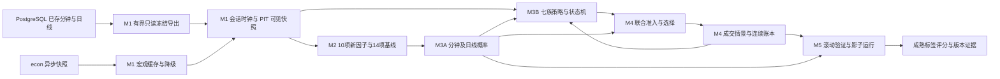
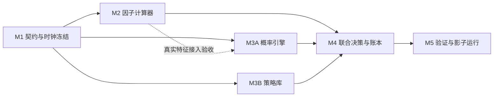

# 行情概率分析与策略库 v2.1：开发总纲

文档版本：`devplan-v2.1.5`。编制日期：2026-09-14。需求基线：[已确认总规划](../probability-strategy-v2-plan.md)。本目录是后续实现与独立硬审核的规格，不是已经实现、测试通过或获准实盘的声明。

本次文档工作仅写入 `D:/Projects/AK-trading/docs/devplan-v2/`，没有运行测试、训练、数据库查询或联网操作，没有读取 `.env`。下文的新代码、测试和运行产物路径是**后续实施的最终指定路径**，本次不创建这些文件。所有相对路径均相对于 `D:/Projects/AK-trading/`；文件清单中的路径完整到文件名，不允许实施时自行改名。

## 1. 建设目标与真实起点

在同一次首版交付中，对螺纹、铜、黄金、豆粕、铁矿、原油的合格具体合约，形成分钟预测、日线背景、行情判断、七族策略候选、联合准入、连续资金账本和无实盘订单的影子记录。候选品种使用 `SHFE.RB/SHFE.CU/SHFE.AU/DCE.M/DCE.I/INE.SC` 的正规化品种键；具体行情 `raw_symbol` 保持数据库原始大小写。品种目录不等于当前可交易清单。

分钟历史已在 PostgreSQL：80 主连及全合约分钟历史是项目已确认的数据现状。本次没有重新查询数量、范围或完整率。主连可用于覆盖盘点和另行声明的背景分析，**成交、因子价格收益和标签按具体合约实例隔离**。先按合约和有界时间区间冻结导出，计算节点只读冻结包，禁止并发扫描行情大表。实时分钟链路仍未验收，不能用下载成功、有限 tick 回执或 MCP 历史查询替代实时验收。

实际阅读的依据及接口如下；文档中的复用边界来自源码，而非仅来自旧说明。

| 现有文件 | 已核对接口或事实 | v2 处理 |
| --- | --- | --- |
| `docs/probability-strategy-guide.md`；`src/ak_trading/probability/contracts.py` | `FactorRow`、`PathScenario`、`ProbabilityPrediction`、`ActionOutcome`；按事件独立重置资金 | 保留为 v1 研究对照，不把事件损益累计成 NAV |
| `src/ak_trading/probability/factors.py` | `factor_registry() -> tuple[FactorSpec, ...]`；`build_factor_rows(contract_id, symbol, product, bars)`；14 项版本 1 | 日线通过只读适配对照；分钟计算使用独立 v2 实现 |
| `src/ak_trading/probability/labels.py` | `label_paths(observation, bars, scenario)`；下一存储观察开盘锚定、OHLC 歧义单列 | v2 改用明确交易时钟和决策时参考价；不改旧标签含义 |
| `src/ak_trading/probability/models.py` | `fit_probability_model(training, calibration, *, min_samples=30, smoothing=1.0)`；`predict_probability(model, event, scenario_id)`；`fit_payoff_model(...)` | 保留条件频率、校准分离和缺证据阻断原则；不复用旧未来状态作为区间持续事件 |
| `src/ak_trading/probability/routing.py` | `choose_strategy(...)`；v1 固定基准绕过模型门槛 | v2 所有新增风险政策统一准入，固定策略也不绕过 |
| `src/ak_trading/futures/spec.py` | `ContractBar`、`StrategySpec` 显式限制日线；资金与费用使用 `Decimal` | 不扩展旧类型，新增 `ak_trading.v2.contracts` |
| `src/ak_trading/futures/strategies.py` | `FuturesStrategy.evaluate(context, previous)`；`DonchianTrend/MATrend/ZScoreReversion/TermStructureCarry`；`default_registry()` | 保持纯策略接口风格；七族 v2 使用独立注册表，carry 不冒充首批七族 |
| `src/ak_trading/futures/portfolio.py` | `admission_review`、`quantize_lots`、`build_portfolio_targets` | 保留资格先行、整数手数、减仓独立原则；不把方向单位当手数 |
| `src/ak_trading/futures/backtest.py` | `LedgerEngine.execute_intent(...)`、`mark_day(...)`、`run_replay(...)`；按日会话执行与容量 | 新建分钟连续账本，不把旧每日容量直接套到每分钟 |
| `src/ak_trading/futures/scenario_backtest.py` | `ScenarioConfig`、`run_scenario_backtest(bundle, *, symbol, strategy, config)` | 旧入口仍是显式经济假设下的单合约情景回测 |
| `src/ak_trading/futures/io.py` | `InputBundle`、`read_input_bundle`、`publish_input_bundle`；`futures_bundle_v1` | v2 发布新 schema，不把普通 CSV 或分钟包伪装成旧包 |
| `src/ak_trading/persistence/query.py` | `query_market_bars(engine, *, symbol, duration_seconds, start_nano, end_nano, limit, settings)`；记录价格为十进制字符串 | 有界查询可作诊断；训练节点不建立连接 |
| `src/ak_trading/persistence/futures_research.py` | `begin_read_only_snapshot(connection)`、`select_contract_bars(connection, symbols, duration_seconds, start_nano, end_nano, page_size)` | M1 新导出器可复用两项底层只读接口；绕开旧日线记录构造的限制 |
| `docs/factor-library.md`；`src/ak_trading/factor_library.py` | `FactorLibrary.factor(factor_id)`、`search(...)`；SQLite 只读和哈希核验；605 项定义、10 项首批 | 只读取定义，不执行公式文本、不改目录状态、不填造原始值 |
| `docs/econ-mcp.md`；`src/ak_trading/mcp_server/server.py`、`queries.py` | econ 9 工具的发布/降级限制；本地 `ReadOnlyMarketData.minute_bars(..., limit=3000)` 与 8 项历史查询工具 | econ 异步注入缓存；行情 MCP 不具备已验收实时推送语义 |
| `docs/data-and-backtesting.md`；`README.md`；`pyproject.toml` | 离线启动器 `scripts/test_offline.py`；仓库当前 Python 下限为 3.10 | v2 的开发/审核运行环境固定 Python 3.12；本计划不修改旧项目配置 |

旧知识图谱只覆盖较早模块；已先尝试图谱检索，目标代码结果不足后直接读取以上源码。实现审核仍须对实际文件和冻结哈希核验，不能把图谱旧索引当当前源码。

## 2. 架构与职责

图中的账本回流仅提供截至决策时已发生的成交、持仓和资金。成熟标签只进入后续合法训练窗口或事后评分，不回流到原决策。分钟循环不得同步等待 econ 问答。

## 3. 里程碑依赖与并行结论

**可以多节点、多模块并行开发，前提是 M1 完成独立硬审核并冻结契约。** M1 前不并行发明数据结构；M1 后 M2、M3A、M3B 在独占文件中实现。M3A 先用 M1 合成特征 fixture 开发，接入验收等待 M2。M3B 用冻结概率 fixture 开发，不等待真实模型达到交易门槛。M4 可提前按契约写自己的账本单元实现，但 M4 节点完整验收必须串行等待 M2、M3A、M3B。M5 可预编写本节点验证工具，完整研究与影子验收必须等待 M4。

| 节点 | 独占代码范围 | 独占测试文件前缀 | 依赖产物 |
| --- | --- | --- | --- |
| M1 | `src/ak_trading/v2/` 下的 `__init__.py/contracts.py/schemas.py/clock.py/data.py/export.py/macro.py/artifacts.py/policy.py` | `tests/test_v2_m1_`；共用 fixture 见 M1 文件表 | 总规划与现状接口 |
| M2 | `src/ak_trading/v2/factors.py/factor_specs.py/seasonality.py/baseline.py` | `tests/test_v2_m2_` | 冻结行情、时钟、因子类型与 fixture |
| M3A | `src/ak_trading/v2/probability/` | `tests/test_v2_m3a_` | M1 标签/预测/校准证据契约；M2 用于集成 |
| M3B | `src/ak_trading/v2/strategies/` | `tests/test_v2_m3b_` | M1 策略、风险预算、状态与模拟反馈契约 |
| M4 | `src/ak_trading/v2/decision/` | `tests/test_v2_m4_` | M2、M3A、M3B 的审核通过产物 |
| M5 | `src/ak_trading/v2/validation/`；`scripts/research_probability_v2.py` | `tests/test_v2_m5_` | M4 完整回放接口和冻结实验方案 |

每个节点文档逐项列出完整新文件路径，上表仅作导航。公共 fixture 的唯一写入者为 M1；各节点用自己的测试文件构造局部变体，不编辑 `tests/conftest.py`。每个目录的 `__init__.py` 归其节点；顶层 `v2/__init__.py` 不重新导出子模块，以免后续集成修改公共文件。集成代码归 M4/M5，不能借“接线”修改其他节点。

## 4. 公共约定与冻结变更控制

1. **版本显式**：应用命名空间 `ak_trading.v2`；文档 `devplan-v2.1.5`；契约 `ak_probability_strategy_contract_v2.1.0`；数据包 `ak_probability_input_v2.1.0`。各算子、参数、标签、模型、策略、成本、时钟、策略资格政策独立版本，身份包含源码与参数哈希。`v2.1` 不是修改 agent 模型配置的授权。
2. **Python 3.12**：测试与报告记录精确补丁版本。核心计算仅用标准库，避免为首版实现强制修改 `pyproject.toml`。已有 PostgreSQL 库仅在 M1 注入式导出边界使用。不得导入 TqSdk 来启动离线计算。
3. **数值**：价格、ATR 点数、费用、保证金、现金、尾损和 EV 使用 `Decimal`；概率、回归系数、标准差等统计量使用有限 `float`，转换经济金额时用 `Decimal(str(value))`。禁止 `Decimal(float)`，禁止布尔冒充数值，禁止 NaN/Infinity。空值必须有原因，未知费用不能等于零。
4. **时点**：UTC 纳秒整数为权威排序，交易日为 `date`，展示为带时区 ISO-8601；不可用自然日期推导夜盘交易日。`available_at_nano`、市场事件时点、导入时点分开。所有运行时间由显式时钟参数注入，纯函数不调用墙上时钟。
5. **首版频率**：1 分钟为基本时钟，聚合 5/15/30/60 分钟，按连续会话切段，不跨午休拼 bar。分钟预测 1/5/15/30/60 个交易分钟；日线预测 1/5/20 个交易日，分别训练、校准和评估。
6. **因果性**：盘中禁用本交易日最终日线、未完成高周期、盘后排名及尚未首见的宏观信息。训练的标准化、季节性、标签和经济模型只使用合法时间分区；追加未来输入不改变已发布历史特征、预测、决策和账本前缀。
7. **输入现实**：历史 OHLC 的完成可见时间可在明确的重建政策下研究，标记 `reconstructed`；导入时间保留为审计字段，不当作历史首发证据。宏观没有历史 PIT 证据时只做前瞻影子，不沿用这一价格重建豁免。
8. **账户与权限**：无凭据、无实盘订单、无后台任务安装。测试都在 `tests/`，全部离线，用 `python scripts/test_offline.py`。不改任何现有代码、配置、`.env` 或 v1 产物；v2 只新增本计划分配的文件。当前文档任务不执行文中命令。
9. **可复现产物**：规范 JSON、固定 CSV 列序、稳定排序和种子，输出目录必须不存在，manifest 最后原子发布；SHA-256 绑定输入、版本、政策和输出。影子追加日志有序号及哈希链，重启不得重放成交或重置马丁层数。

全部v2模块使用`from __future__ import annotations`；公共类型按M1声明显式导入，生产者私有句柄按其节点所定模块导入。DataQuality.input_hash、稳定snapshot/forecast/decision/checkpoint身份只哈希**实际已消费的历史前缀与依赖**，不把整个包含未来数据的FrozenInput.manifest_sha256放入历史身份。整包hash留在运行manifest溯源，既保证原包可复现，也保证追加未来不改变历史输出。

并行冻结范围还包含StrategySetup、RunPolicy、StrategyQualification、StressPolicy、事件/几何匹配和检查点依赖字段。观察状态允许所有策略逐bar保存；只有被选候选可提交预算与待成交执行状态。模型按登记的折边界滚动，不能扩大既有整轮风险；影子运行必须消费真实统计资格，研究回放独立标记purpose。公共契约变更仍回到M1，不由后续节点临时补字段。

M1 硬审核通过时发布 `data/research_runs/v2/contracts-2.1.2/contract-lock.json`，精确结构见 M1。它冻结公共文件字节哈希、导出的类型/函数签名、schema、fixture、测试清单、所有权表与评估政策。此路径是未来产物，当前不存在也不得宣称已冻结。

M1 在既有 public_signatures 中记录完整新 fit_forecast_models、baseline_registry_v2、004 哈希接口与 005 全部必填签名；更新 schemas/required_tests/required_check_ids/ownership 的适用内容，不新增 lock 根字段。01 §7、00 §4 及 02/03/04/05/06 的本次修订标记按 devplan-v2.1.5 统一；只有上述实际变化的 schema 改版本，不全库替换字符串。首锁目录继续为 data/research_runs/v2/contracts-2.1.2/，已发布目录不得覆盖。

变更必须提交本目录 `变更申请-<编号>.md`（`<编号>` 为递增三位数，例如 `001`），列出字段前后差异、原因、兼容性、受影响节点和重跑命令。公共文件只由 M1 维护者修改；主集成者确认影响范围、独立审核者通过后发布新契约版本及新 lock，所有消费者一起升级。破坏性变化不得继续使用旧 schema ID；禁止下游临时加动态字段、改名或用 `dict` 私传约定绕过冻结。涉及已确认领域范围、风险门槛或模型配置的变化另需项目所有者明确授权。所有节点每次审核先核对 lock，旧 hash 不匹配直接 FAIL。

## 5. 行情、策略与准入的统一底线

行情表示由基础状态 `UP_TREND/DOWN_TREND/ORDERED_RANGE/WIDE_RANGE/COMPRESSION/UNKNOWN` 加 `PULLBACK/BREAKOUT/EVENT_SHOCK/ILLIQUID` 标记构成，不把重叠标记硬凑成概率和为 1。未来事件定义与当前描述分离。横盘必须有冻结边界、路径效率、振幅覆盖成本和维持/突破概率证据，不能由上涨概率接近 50% 推导。

七族为趋势跟随、突破、回踩、区间均值回归、固定库存网格、有限马丁均值回归、等待。各有独立分钟/日线 ID 与验收状态；未知状态的应对是 `NO_TRADE`。门槛失败时无新增风险；已有仓立即取消新增/加仓意图，转入预定退出，平不掉必须记录 `EXIT_PENDING`。

普通策略状态持续校准概率研究初始门槛为 **0.70**；有限马丁区间持续概率 **0.85**，相同持有期限内触及其冻结止损边界概率 **≤0.10**。还必须同时通过数据、校准误差、分块样本量、分布外检查、触发、扣费保守 EV、尾损、容量和账户预算。不同事件概率、模型熵、样本量、抽样权重分别报告。有限马丁固定 1/2/4 共 3 层、总 7 个基础单位，整轮风险和全部加仓资源先冻结，浮亏本身不是加仓理由，止损不得外移，不能跨轮追回亏损。

## 6. 硬审核流程与完成定义

顺序为：开发者提交本节点文件、完整测试记录、契约 lock 和产物 → 未参与该节点实现的独立子代理重读节点文档 → 独立重跑规定命令并做逐条证据检查 → 输出 PASS/FAIL → FAIL 返回原节点修复 → 同一提交重新审核。具体协议见 [07-硬审核协议](07-硬审核协议.md)。当前只编写该协议，不将文档静态检查冒充实施硬审核。

工程、统计和运行资格是三条轴：`engineering=PASS/FAIL`；`statistics=PASS/FAIL/INSUFFICIENT`；`runtime=OFFLINE_ONLY/SHADOW_PENDING/SHADOW_ACCEPTED`。工程 PASS 不自动允许策略参与；统计失败的策略保留研究记录并 `NO_TRADE`。实时链路没验收时可完成离线阶段，但 **M5 完整验收、v2.1 首版总体完成不得标 PASS**。日线 20 日未成熟时记录等待成熟，不能拿分钟样本补足。

最终留出冻结60个可成熟决策交易日，额外保留至少20日的只评分成熟尾段；全局已观察区间账本阻止改数据hash/合约集合后重新评相同行情。宏观首版以版本化事实标签做风险门控，量价概率不被远端意见数值改写；两分支的参与与净收益差只做PIT合格历史或前瞻配对验证。实时按每品种/会话及活跃合约分别审核20日覆盖、完成率、接收延迟和按时发布，不用总体平均遮盖失败。

## 7. 阅读与交付导航

| 文档 | 后续执行者应获得的决定 |
| --- | --- |
| [01-M1-共用基础与时钟契约](01-M1-共用基础与时钟契约.md) | 全部跨节点记录、schema、时钟、输入、政策及冻结条件 |
| [02-M2-因子计算器](02-M2-因子计算器.md) | 10 项公式与分钟/日线参数、14 项对照、季节性和手算 |
| [03-M3A-概率引擎](03-M3A-概率引擎.md) | 标签、方向/路径/幅度/时间/状态模型及校准证据 |
| [04-M3B-策略库](04-M3B-策略库.md) | 行情矩阵、七族规则、状态机、冻结马丁预算 |
| [05-M4-联合决策与账本](05-M4-联合决策与账本.md) | 完整路径 EV、共同准入、选择、组合风控、成交与对账 |
| [06-M5-验证与影子运行](06-M5-验证与影子运行.md) | 滚动分区、一次留出、统计、前瞻宏观和实时证据 |
| [07-硬审核协议](07-硬审核协议.md) | 独立审核输入、重跑命令、PASS/FAIL 和禁止事项 |

## 文档完成自检清单

本轮完成八份规格文档、88个计划路径的单一所有权核对、接口声明与schema/链接静态检查，并经两名独立只读审阅者复核已报告问题。编写前记录的250个现有代码/文档/脚本/测试文件内容哈希未变；未执行项目测试。这里的静态检查不发布M1 contract lock，也不替代后续任何节点硬审核。

收尾时共享工作区已出现本轮文档操作之外新增的M1实现文件。因此各节点“新文件”按本轮规划起点的基线定义，仍归表中唯一节点维护；文件已出现不代表其字段与最终文档一致或已通过测试。后续实施/审核须重新固定自己的代码基线，使用本版最终契约核对，不把本次文档完成当作M1实现PASS。

- [x] 先完整阅读已确认的 v2.1 规划；指定四份专题现状文档及 README 已核对。
- [x] 已实际查看 probability、futures、factor_library、persistence、mcp_server 的接口与关键实现边界。
- [x] 八份中文交付齐备，节点均有目标/不做、依赖、文件所有权、类型/函数/schema、任务、命令、测试、审核和交付物。
- [x] 明确 M1 冻结前置、可并行实施与串行集成验收的区别，公共文件只允许一个维护者。
- [x] 分钟与日线同时首发，5/15/30/60 会话聚合、交易分钟、夜盘、午休、节假日、盘中日线隔离及日内退出均有规格。
- [x] 行情矩阵覆盖上下趋势、两类震荡、压缩、回踩、突破、事件和未知；横盘不等于 50% 方向概率。
- [x] 七族策略、0.70/0.85/0.10 联合门槛、有限马丁 1/2/4 整轮预算及三类尾部压力不可弱化。
- [x] 宏观异步缓存、发布/降级/过期、禁止回填、PIT 不足时前瞻对照已落实。
- [x] 成本、平今、容量、停板、跳空、保证金、换月、连续账本与未完成退出有显式记录。
- [x] purge/embargo、分块有效样本、最终留出只评一次、实时未验收和不承诺盈利均有验收条款。
- [x] 本轮只写本文档目录，未执行测试或训练，未联网，未读 `.env`，未修改现有代码与配置。
- [x] 已完成文档静态交叉核对；本清单不代表代码实现、统计效果或实时链路已通过硬审核。
- [x] 跨bar观察态、剩余期限、事件/障碍/几何证据、统计资格、压力数值和重启依赖已有显式接口与反例。
- [x] 留出重叠防绕过、成熟尾段、宏观实际干预、分组统计传播、可信接收时间与影子分段实体记录已闭合。
- [x] 独立文档审阅已闭环；共享工作区后续出现的实施文件未被本轮写入或冒充审核通过。
