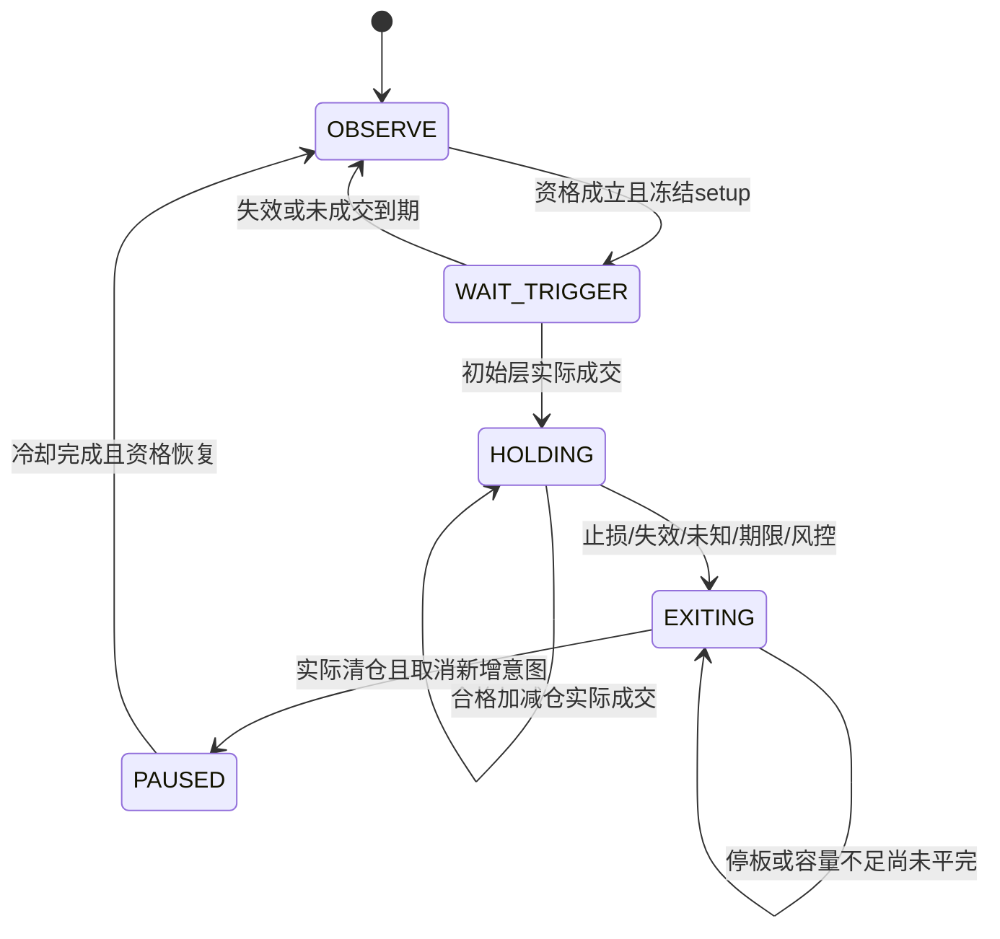

# M3B：策略库

文档版本：`devplan-v2.1.5`。节点版本：`M3B-v2.1.0`。本节点按 [M1契约](01-M1-共用基础与时钟契约.md) 独立开发，可用冻结概率fixture运行；真实模型由M3A提供，完整经济准入及账户执行由M4负责。

## 1. 目标与不做清单

登记趋势跟随、突破、趋势回踩、区间均值回归、固定库存网格、有限马丁均值回归、空仓等待七族，每族都有分钟和日线独立规格、触发/退出、失效、冷却、最大持有期及验证阶段。任何行情都有应对，允许的应对包含等待、停止加仓和退出。

不改旧 `futures/strategies.py` 或 `probability/episodes.py`；不把旧carry算进七族；不调用数据库、econ、TqSdk或交易账户；不根据未成交意图更新真实持仓；不算测试未来路径的EV后选策略；不实现无上限网格/翻倍、跨episode追回已实现亏损、移动止损或实盘启用。

## 2. 前置依赖与并行方式

依赖M1全部策略/持仓/预算/成交反馈类型、置信度政策、持有窗口、价格单位、shared fixture和lock。与M2、M3A实现并行：从fixture构造 `StrategyContext`，覆盖高概率、低概率、未知、过期和冲突，不要求真实模型先通过统计门槛。

沿用已核对的 `FuturesStrategy.evaluate(context, previous)` 风格，但命名空间为v2，输出 `StrategyProposal`。已有v1 `StrategyResult.target_position`是方向风险单位，v2 `target_lots`是整数目标手数；不可直接赋值迁移。

## 3. 独占文件清单

所有路径相对于 `D:/Projects/AK-trading/`，均为新文件：

| 文件 | 职责 |
| --- | --- |
| `src/ak_trading/v2/strategies/__init__.py` | 子包版本 |
| `src/ak_trading/v2/strategies/registry.py` | Strategy协议、十四规格注册和统一评估 |
| `src/ak_trading/v2/strategies/state.py` | 状态推进、成交反馈、预算冻结和恢复校验 |
| `src/ak_trading/v2/strategies/trend.py` | 趋势跟随 |
| `src/ak_trading/v2/strategies/breakout.py` | 突破确认 |
| `src/ak_trading/v2/strategies/pullback.py` | 顺势回踩/反抽 |
| `src/ak_trading/v2/strategies/reversion.py` | 区间高抛低吸 |
| `src/ak_trading/v2/strategies/grid.py` | 固定库存网格 |
| `src/ak_trading/v2/strategies/martingale.py` | 有限马丁均值回归 |
| `src/ak_trading/v2/strategies/wait.py` | 空仓/等待 |
| `src/ak_trading/v2/strategies/replay.py` | 独立逻辑回放，不生成财务收益 |
| `tests/test_v2_m3b_registry.py` | 七族×两频率规格和所有权 |
| `tests/test_v2_m3b_matrix.py` | 行情—策略全矩阵 |
| `tests/test_v2_m3b_directional.py` | 趋势、突破、回踩镜像规则 |
| `tests/test_v2_m3b_reversion_grid.py` | 回归/网格、成本、库存和区间破坏 |
| `tests/test_v2_m3b_martingale.py` | 三层冻结、预算、加仓、压力 |
| `tests/test_v2_m3b_state.py` | 状态机、部分成交、冷却与重启 |
| `tests/test_v2_m3b_causality.py` | 未来追加、持有窗口、独立回放 |

M3B不能修改M1 fixture；合成反馈和局部场景写在本节点测试文件中。

## 4. 公共接口契约

公共字段以M1为唯一权威。`StrategySpec`明确数据需求、允许状态/标记、confidence_policy_id、持有期/收盘规则、最大库存、代码/参数版本和验证阶段；`StrategyContext`只含当前可见bar前缀、forecast、regime、macro、account、position和有效rule。`StrategyState`含episode、已成交层、待成交意图、不可变预算和冷却，不含未来标签。

```python
# registry.py
from typing import Callable, Protocol

class Strategy(Protocol):
    @property
    def spec(self) -> StrategySpec: ...
    def evaluate(self, context: StrategyContext,
                 previous: StrategyState | None) -> StrategyProposal: ...

def strategy_registry_v2(mode: Literal["MINUTE", "DAILY"]) -> Mapping[str, Strategy]: ...
def evaluate_registry_v2(registry: Mapping[str, Strategy],
                         context_provider: Callable[[Strategy], StrategyContext],
                         previous_states: Mapping[str, StrategyState]) -> tuple[StrategyProposal, ...]: ...

# state.py
def freeze_round_budget(spec: StrategySpec, context: StrategyContext,
                         side: Literal[-1, 1], episode_id: str) -> RoundBudget | None: ...
def apply_execution(previous: StrategyState, result: ExecutionResult,
                     account: AccountSnapshot, now_nano: int) -> StrategyState: ...
def validate_restored_state(state: StrategyState, account: AccountSnapshot) -> None: ...
def commit_observation(previous: StrategyState | None,
                        proposal: StrategyProposal) -> StrategyState: ...
def commit_selected_proposal(previous: StrategyState, proposal: StrategyProposal,
                               intents: tuple[OrderIntent, ...]) -> StrategyState: ...

# replay.py
def replay_strategy(strategy: Strategy, contexts: tuple[StrategyContext, ...],
                     feedback: Mapping[str, ExecutionResult],
                     initial_state: StrategyState | None) -> tuple[StrategyProposal, ...]: ...
```

最终实现类名固定为 `TrendFollowing/ConfirmedBreakout/TrendPullback/RangeReversion/FixedInventoryGrid/LimitedMartingale/WaitStrategy`，分别位于同名职责模块。每个类初始化签名均为 `__init__(self, spec: StrategySpec) -> None`，实现上述spec和evaluate；不从环境变量加载参数。

公共函数不得导入M4以计算EV。OPEN/ADD只是候选，`payoff=None`交M4评价，只有M4最后准入/选择后才能形成OrderIntent。持仓管理不依赖新开资格。宿主对所有策略调用commit_observation保存无资源副作用的观察字段，再仅对选中提案调用commit_selected_proposal保存episode/预算/预留/待成交字段；未选择候选不占预算、不推进层数、不创建实际episode。

context_provider按每个StrategySpec构建上下文，尤其confidence_policy、max_holding和holding_deadline必须按该策略重新取得，不能把普通0.70政策传给马丁。M4通过build_strategy_context提供它。LayerSpec.index从0开始；filled_layers只记录已足量层，layer_filled_lots保留每层累计实际成交，pending_layer_index绑定未完成层；减仓、撤单或重启不减少历史层使用计数。

### 4.1 首批策略ID、参数与数据

ID精确为 `trend_m1_v2/trend_d1_v2, breakout_m1_v2/breakout_d1_v2, pullback_m1_v2/pullback_d1_v2, reversion_m1_v2/reversion_d1_v2, grid_m1_v2/grid_d1_v2, martingale_m1_v2/martingale_d1_v2, wait_m1_v2/wait_d1_v2`。`version="2.1.0"`；参数版本为对应ID后加`:params-1`；首版登记 `validation_stage="RESEARCH"`，不因工程PASS自动升级。

分钟策略基础观察均1分钟，可引用合法5/15/30/60分钟和前日背景；日线策略只在日线时钟触发，两组独立验证。初始分钟最大持有30交易分钟，允许研究版本改为5/15/60；日线默认5交易日，允许研究1/20。WAIT也登记同频率期限，不能用任意期限绕过schema。

所有策略 `parameters`必须有：`entry_confirmation_bars:int=3,exit_confirmation_bars:int=1,max_entry_gap_atr:str="0.10",round_risk_ratio:str="0.005",stop_loss_multiple:str="1",take_profit_multiple:str="2",requires_macro:bool=false,allow_countertrend:bool=false,allow_event_breakout:bool=false,allow_wide_range:bool=false`。分钟/日线同数值不意味着同一验证版本。

专属参数按下表完整登记；所有无关策略不接受这些键。因子required_keys全部使用M2完整ID，例如`BASE:ma20:v2.1.0:d60`；日线替换为d86400。

| 策略族 | 专属参数初值 | 必需输入 |
| --- | --- | --- |
| TREND | `entry_spread_atr="0.25"` | close、ma20/ma60、atr14、er20、对应趋势持续概率 |
| BREAKOUT | `breakout_buffer_ticks=1,confirmation_bars=3` | 冻结前高/低、tick、ATR、突破方向持续/假突破证据 |
| PULLBACK | `pullback_distance_atr="0.5",setup_expiry_bars=5` | 背景趋势、MA20、ATR、冻结回踩位与当前前缀 |
| REVERSION | `entry_fraction="0.20",minimum_round_trip_cost_ratio="2"` | 冻结区间、回归先于破位、区间持续、成本 |
| GRID | `layer_fractions=["0.25","0.15","0.05"],layer_multipliers=[1,1,1],maximum_layers=3` | 上述回归输入、库存/费用/保证金与冻结层级 |
| MARTINGALE | `layer_fractions=["0.25","0.15","0.05"],layer_multipliers=[1,2,4],maximum_layers=3` | 有序区间、0.85维持、≤0.10止损触达、整轮路径/压力预算 |
| WAIT | `cancel_new_risk=true` | 当前持仓与风险状态，不要求可用预测 |

所有规格path_barrier_key固定ATR_1。setup_expiry_bars对TREND/BREAKOUT固定3，对PULLBACK/REVERSION/GRID/MARTINGALE固定5；WAIT无setup。表中PULLBACK原有同名参数只登记一次。entry_confirmation_bars=3表示连续资格观察；各族价格触发另按第6节，不把“一次回穿确认”偷偷改成三次回穿。

注册表剩余字段固定如下，多空方向再按事件矩阵筛选；allowed_flags表示当前标记必须是其子集，不表示所有标记都必须出现。

| family | allowed_regimes | allowed_flags | max_layers / max_total_lots |
| --- | --- | --- | --- |
| TREND | UP_TREND,DOWN_TREND | PULLBACK,BREAKOUT | 1 / 7 |
| BREAKOUT | UP_TREND,DOWN_TREND,COMPRESSION | BREAKOUT | 1 / 7 |
| PULLBACK | UP_TREND,DOWN_TREND | PULLBACK | 1 / 7 |
| REVERSION | ORDERED_RANGE | 空tuple | 1 / 7 |
| GRID | ORDERED_RANGE | 空tuple | 3 / 6 |
| MARTINGALE | ORDERED_RANGE | 空tuple | 3 / 7 |
| WAIT | M1全部六个基础状态 | M1全部四个flag | 0 / 0 |

BREAKOUT/PULLBACK另必须有同名flag；WAIT不受新增资格门槛。confidence_policy_id取M1按family返回值。q在满足lot_step/min_open_lots的正整数中，从研究手数上限内按降序找全部计划/压力/保证金都通过的最大值，无可行q即不启动；不得以float取整扩大风险。所用code_sha256覆盖本策略及共享state/registry代码字节，参数版本/源hash均登记。第一层reference_entry_price取确认时C，其余层取计划线，触发线本身保持原LayerSpec.trigger_price。

一分钟策略采用M1分钟HoldingPolicy：不跨交易日、允许午休、禁止夜盘跨日盘、结束前30交易分钟禁开、提前5分钟计划退出。日线HoldingPolicy允许跨日，但每次持有期限不能越过交割或换月清退时点。

首次OPEN使用spec.max_holding的完整预测窗口；若其终点晚于holding_deadline或生命周期清退点，直接拒绝，不缩短原预测。RoundBudget.latest_exit_nano冻结为该合格预测终点。后续ADD的期限由预登记规则选取：分钟从`[60,30,15,5,1]`、日线从`[20,5,1]`按降序取首个其新window_end不晚于当前state.active_exit_nano的期限；选择只依据时钟，不依据哪个概率更好。无可容纳期限就不加仓。

OPEN实际成交后active_exit_nano取预算最大退出点与所用预测终点较早者；ADD实际成交后取旧active_exit_nano与新预测终点较早者，之后不能延长。ADD重新估计相同冻结区间/止损、剩余状态和这个期限的概率证据与EV；原30分钟标签及RoundBudget本身完整保留。离散期限可能使30分钟episode首次ADD后的实际退出提前到约15分钟，这是事前登记的策略行为，必须进入对照回放，不能临场造29分钟标签。部分成交一旦增加风险即收紧退出；未成交/未选择候选不改变实际状态。

已选择提案的next_state先保存pending_exit_nano和pending_layer_index，并由M4预留资源；active_exit保持旧值。apply_execution读取这两个持久化字段及实际Fill推进已用层/退出点；全未成交取消时释放预留并清空pending字段，不能把候选状态当成已成交状态。首次OPEN候选也先以WAIT_TRIGGER和冻结预算等待回执。

全未成交OPEN收到最终取消/到期回执后，保存一个明确的新状态：episode_id/budget/setup/pending字段全部清空，phase=OBSERVE，actual层仍空；不能回滚事件游标。ADD全未成交取消只清pending，保留既有episode/budget/层数/active_exit；曾部分成交则保留真实已增仓与已收紧退出，禁止恢复成交前状态。每次取消都等待回执再释放尚占资源。

### 4.2 置信度与状态前置规则

M3B先检查数据/版本/PIT、适用行情、对应状态持续概率、样本/校准状态、触发和持有窗口。普通0.70、马丁0.85与冻结止损触达≤0.10只是必要条件。M4必须重新检查这些条件，再核对净EV、尾损、容量、预算；禁止因为M3B出OPEN就跳过最终准入。

`minimum_samples/minimum_blocks/maximum_calibration_error/maximum_ambiguity`从M1政策读取；不从最高类别概率推算。必要宏观风险缺失、OOD、过期、未验证跨周期冲突、模型互斥证据无法区分都不得OPEN/ADD。

低于入场门槛立即停止加仓并取消未成交新增意图。若已持仓、行情仍在冻结有效范围且仅落入0.65—0.70（普通）或0.80—0.85（马丁）的滞回带，可按原止损、原目标及剩余最大持有期管理；低于退出门槛或UNKNOWN/区间破坏/硬风控则立即EXIT。软退出仅1次合格观察确认；止损、停盘风险和计划平仓不等待确认。不得借HOLD无限续期。

EVENT_SHOCK 是 RegimeFlag，不是新增第八个策略族。M3B 消费 M3A 的统一风险判断；回归/网格/马丁禁入，初始事件突破仍关闭，其他原风险优先级不变。UNKNOWN、事件冲击或无完整开盘风险证据均不能新增风险；取消待开/加仓，已有仓按原退出规则处理，无法成交保留 EXIT_PENDING。禁止 M3B 自造 META/BASE 行、重算或覆盖 M3A 风险标记。

M2 新键未交付并通过相关工程验收之前，“开盘跳空 EVENT_SHOCK 分支”必须标未实现/不可声明，完整 EVENT_SHOCK 行情矩阵与相应集成项不能判 PASS。已有宏观分支可以单独如实报告已实现，但不能据此冒充整个标记已覆盖。局部合成 fixture 仅支持开发，不替代真实 M2 接入；事件突破保持 allow_event_breakout=false。

### 4.3 固定事件选择矩阵

本表对MINUTE/DAILY分别适用。OPEN取spec.max_holding；ADD只取第4.1节按时钟选择的剩余离散期限。全部风险候选只能绑定ATR_1预测，且PATH证据VALID、p_ambiguous≤本策略maximum_ambiguity；相同期限另两份barrier里的共同概率必须相等，不能择优。PERSIST和STOP/RETURN证据均按M1 geometry/policy/product/session匹配，forecast.frozen_range与当前setup或budget完整相等。

| 家族/方向 | OPEN/ADD所需持续事件及门槛 | 其他必需证据与用途 | 冻结几何 |
| --- | --- | --- | --- |
| TREND/PULLBACK 多 / 空 | `PERSIST:UP_TREND` / `PERSIST:DOWN_TREND` ≥0.70；首版没有ADD | 同方向DIRECTION仅诊断，不替代持续 | 参考C/ATR；回踩setup的MA/ATR也固定 |
| BREAKOUT 多 / 空 | `PERSIST:UP_BREAKOUT` / `PERSIST:DOWN_BREAKOUT` ≥0.70；没有ADD | 假突破为1−同事件持续概率，即≤0.30；不得另挑更好模型 | 同一setup的L/U及tick，连续close确认 |
| REVERSION 多 / 空 | `PERSIST:ORDERED_RANGE` ≥0.70；没有ADD | `RETURN_BEFORE_BREAK` VALID，归回中心方向由C相对M决定；不再设另一隐含概率阈值，由M4正净EV判经济性 | setup/budget的L/M/U及对应stop |
| GRID 多 / 空 | `PERSIST:ORDERED_RANGE` ≥0.70，OPEN及每次ADD均重审 | RETURN_BEFORE_BREAK VALID；终点竞争CDF的unknown_probability≤普通ambiguity上限 | 已冻结区间、同向各层与止损 |
| MARTINGALE 多 / 空 | `PERSIST:ORDERED_RANGE` ≥0.85，OPEN及每次ADD均重审 | `STOP_TOUCH:LONG/SHORT` ≤0.10且VALID；RETURN_BEFORE_BREAK VALID，其终点unknown≤0.02 | 与整轮range和止损完全相同，不能借近障碍 |
| WAIT / 全部家族REDUCE或EXIT | 不依赖新增风险概率资格 | 风险动作必须继续；WAIT不产生新仓 | 保留已有真实持仓及预算 |

WIDE_RANGE和事件/逆势版本初始关闭，没有本版可自动套用的事件映射；未来开启必须新策略版本和独立资格。REVERSION的RETURN竞争未知比例同GRID检查。SHADOW_OPERATIONAL还要求M5匹配PASS的StrategyQualification；失效/不足立即停止OPEN/ADD，并按原风险规则管理退出。研究反事实使用RESEARCH_EVALUATION，报告明确不具有运行资格。

## 5. 行情—策略应对矩阵

表中“可候选”仍需全部联合准入通过；等待不是已成交。

| 行情 | 可候选/等待路径 | 禁止/空仓条件 | 失效与已有仓动作 |
| --- | --- | --- | --- |
| 上升趋势 | TREND多、BREAKOUT上破、PULLBACK回踩多 | 逆势回归/网格/马丁默认禁；证据未达标WAIT | 趋势止损或持续失败退出，停止逆势补仓 |
| 下降趋势 | TREND空、BREAKOUT下破、PULLBACK反抽空 | 镜像多头逆势策略默认禁 | 反抽失败/持续失败退出，不摊平 |
| 有序横盘 | 下沿确认REVERSION多/上沿空；GRID；高门槛MARTINGALE | 区间中部WAIT；宽度不能覆盖费用或无回归证据WAIT | 固定边界破坏取消新增层，退出并冷却 |
| 高波动宽幅震荡 | 只有独立验证的较宽间距、小库存REVERSION/GRID版本 | 默认allow_wide_range=false；MARTINGALE永无本版资格 | 尾损/库存/区间阈值到即退出 |
| 极窄压缩 | WAIT，出现有效突破后转BREAKOUT候选 | 振幅不足双边成本禁止均值回归/网格/马丁 | 突破未确认等待，确认失败取消候选 |
| 趋势中回踩/反抽 | 与背景同向PULLBACK，完成回调结构后确认 | 背景失效、setup超期或跨周期规则未验证WAIT | 确认失败撤候选；已仓按冻结止损退出 |
| 突破扩张 | 同向BREAKOUT或等待回测旧边界 | 旧区间回归/网格/马丁禁止继续加仓 | 假突破止损；不移动旧边界保资格 |
| 事件冲击/跳空/异常流动性 | 初始WAIT；仅独立验证的事件突破版本可候选 | 回归/网格/马丁禁；无成交条件全部禁开 | 原仓风险退出，无法退出记EXIT_PENDING，不加大止损 |
| 未知/过期/OOD/模型冲突 | 空仓时NO_TRADE；持仓时取消新增风险并EXIT | 不按概率抽样挑一个不合格方向 | 有序退出并冷却，满足新证据后重新建立episode |

EVENT_SHOCK 是 RegimeFlag，不是新增第八个策略族。M3B 消费 M3A 的统一风险判断；回归/网格/马丁禁入，初始事件突破仍关闭，其他原风险优先级不变。UNKNOWN、事件冲击或无完整开盘风险证据均不能新增风险；取消待开/加仓，已有仓按原退出规则处理，无法成交保留 EXIT_PENDING。禁止 M3B 自造 META/BASE 行、重算或覆盖 M3A 风险标记。

M2 新键未交付并通过相关工程验收之前，“开盘跳空 EVENT_SHOCK 分支”必须标未实现/不可声明，完整 EVENT_SHOCK 行情矩阵与相应集成项不能判 PASS。已有宏观分支可以单独如实报告已实现，但不能据此冒充整个标记已覆盖。局部合成 fixture 仅支持开发，不替代真实 M2 接入；事件突破保持 allow_event_breakout=false。

回踩、突破和事件是标记，可与趋势基础状态同时出现。处理优先级：硬风险/事件流动性→区间破坏→已有仓管理→普通资格→触发。UNKNOWN与任何风险标记都不能被较高的另一项概率覆盖。

## 6. 七族逐项实现规则

### 6.1 趋势跟随

多头要求UP_TREND，MA20>MA60，(MA20−MA60)/ATR≥0.25，最近3个已完成close≥各自当时可见MA20；空头镜像。已有仓不因每分钟重新满足条件重复开仓。以决策时已知参考价C冻结目标C+2ATR和止损C−ATR，空头镜像；下一合法开盘只绑定实际入场价，若偏移超0.1ATR或使风险超预算即拒绝，目标/止损不随入场价移动。触及止损/目标、MA条件反转、持续概率退出阈值、期限/收盘触发退出。

### 6.2 突破

冻结先前20根上下边界，连续3个已完成close在U+1tick之上（下破为L−1tick），且同向持续概率达标。确认期都相对同一冻结边界，不能每根重画。确认后下一合法开盘过大跳空超过0.1ATR则取消，等待新setup；不能追价后仍按旧价记收益。入场后重新回到边界内触发假突破退出，止损1ATR/目标2ATR、最大持有期限同时有效。

### 6.3 回踩/反抽

背景趋势有效时冻结MA20及±0.5ATR回踩区；多头进入回踩区后，至少一个已完成close重新站上冻结MA20且高于前一close，完成确认，空头镜像。setup最多5根本频率bar，过期就取消；下一开盘才可执行。回调超过冻结1ATR止损或背景资格失效退出，禁止拿未来“最低点已经出现”作为触发。

### 6.4 区间高抛低吸/均值回归

冻结L/M/U。多头只有先观察到close≤L+0.20W，再观察到完成close上穿该水平且仍<M，才提候选；空头在U−0.20W镜像。单向一轮，不在中部因分类成立而成交。目标M，止损stop_lower/stop_upper，预计从允许最差入场价到M的完整价差至少为全部往返成本2倍，并满足正保守EV。成本包括开/平/平今、滑点和冲击。

### 6.5 固定库存网格

与马丁使用独立ID。每轮先选一侧，三层相同基础单位q；多层触发L+0.25W、L+0.15W、L+0.05W，空头镜像；不同时持有两边隐匿总敞口。初始层要有边界回归确认，后续层是已完成close向不利方向穿过预定水平，仍需重新核对区间/置信度/成本/预算。

每层q相同、满仓3q，固定总止损和目标M。均值回归前不根据浮亏改变q或层数；返回M整轮退出。每个网格间距的预期闭合价差必须覆盖相应分批开仓与退出成本。WIDE_RANGE必须独立版本验证，可用更宽间距和更少库存，初始默认不允许；不能只改参数后沿用普通区间验证。

### 6.6 有限马丁均值回归

研究模板严格为q、2q、4q共3层（初始+2次加仓），总7q，最大总手数再受M1的7手研究上限限制。q为整数手且满足lot_step/min_open_lots；若q=1都不满足预算则不启动。

准入只限ORDERED_RANGE，无EVENT_SHOCK/ILLIQUID/BREAKOUT，非临近停盘/交割/换月风险，区间持续概率≥0.85、对应止损边界触达概率≤0.10，并有匹配期限/区间的有效校准证据。最高类别0.99也不能代替这些条件。

第一层与固定网格使用同一可审核价格触发：多头先在5根setup有效期内观察到完成close≤L+0.25W，保存armed=true；之后另一根close从该水平以下严格上穿且仍<M，才可OPEN。空头先≥U−0.25W，再严格下穿且仍>M。资格须连续3次达标，首次观察和回穿必须是不同bar，始终在中部或只有不利下穿没有反向确认均WAIT。实际执行为确认后下一合法窗口开盘，价差/成本/0.1ATR偏移不通过即取消，不直接按触发线成交。

第一层前冻结 `RoundBudget`：range_id、三层价格/手数、max7q、目标M、同一个止损价、最新退出时间、计划最大损失、压力损失、峰值保证金、当日损失上限与权益基数。所有可能层组合、最差允许入场跳空、收费和平今方式先做资源检查；预留全部层的资源，不能等第三层才发现钱不够。

计划损失计算：多头 `Σ_i lots_i×(worst_entry_i−stop)×multiplier + all_open_fees + exit_fees`，其中worst_entry已包含允许成交偏移；空头镜像。保证金取各层路径、价格/费率压力下最大值，不只取初始层。压力损失用另外的无法止损场景计算，不能当作计划损失的保证上界。

context.stress_policy必须是M1的stress-v2.1.0，RoundBudget保存该对象与initial_atr_points；freeze_round_budget调用M1 calculate_stress_loss，不能由各策略临时选gap幅度。已冻结预算/目标/止损/最大退出不因滚动新模型扩大；折切换后的当前合法模型可重新评价原计划层，必须满足新模型全部准入并保存新forecast/evidence/payoff身份。

每次ADD必须同时满足：该层在原计划内且未使用/未挂起；上一层已足量成交；新的完整bar真的穿越该层；区间没有被破坏；概率/证据仍过门槛；剩余持有窗口足够；无事件/未知/风控；可成交和全部剩余预算重新通过。**浮亏本身不是触发条件。** 一根跳空bar跨越两个层级时最多提出下一层一个意图，不在同一时点连补2层；若已越区间或止损直接退出。

已用层仅随实际成交更新；部分成交层在补齐前不开放下一层，撤单不重置已成交部分。停止补仓后取消所有待加仓，退出/冷却；重启保留预算、已用层、挂起意图、当日损失及账户熔断。目标与止损固定，加仓后按整轮真实净收益（含已付和预计退出费用）决定止盈；不能以某一笔盈利遮盖全轮亏损。下一episode重算q，但不根据上一轮亏损倍增。

必须提供同一整轮风险预算下的三个对照：不加仓、等量分批、1/2/4；另比较固定网格。整数取整造成实际占用差异必须报告，并保留未用预算，不能放大马丁总敞口制造优势。

### 6.7 空仓/等待

空仓时输出action=WAIT、target_lots=0、payoff可空、reason包含具体未过条件。若账户已有仓归其他策略，WAIT不能篡改其episode或直接宣称已平；统一持仓管理通道要求停止新增风险、产生该仓所属策略EXIT并交M4执行。NO_TRADE表示无新增风险，只有实际lots=0且无待开仓才显示账户空仓。

## 7. 状态机与恢复

观察状态对每个`strategy_id+contract_id`独立保存，未被路由选中也可推进。StrategySetup在第一次有效结构观察时冻结range/MA/ATR、方向、trigger_level、起止时间；observed_bars按不重复的完整同频率bar增加，expires_at由冻结会话中第setup_expiry_bars个计划bar末端确定，缺行不延长。BREAKOUT在首个越界close建立setup并计确认1，后续三根都对同一边界；PULLBACK在首次进入冻结MA区时armed；REVERSION/GRID/MARTINGALE在外侧触及时armed；TREND保存逐时MA资格连续计数。setup超期、硬风险、方向反转或边界破坏取消，日内退出点也限制setup期限。

commit_observation只可改变setup、last_regime、confirmation_count、last_event_id及无仓情况下OBSERVE/WAIT_TRIGGER之间的phase；已有执行态、预算、层、pending、cooldown不得借观察提交改变。last_regime保存本次context.regime，供下一bar的assess_regime(previous=...)延续状态确认，不能靠未持久化局部缓存恢复连续次数。WAIT提案也携带这些可保存观察结果。commit_selected_proposal核验前态后绑定所选episode与资源，并将实际OrderIntent ID写入pending；apply_execution负责其后的事实推进。两函数都为纯状态变换，M4单一检查点持久化，无独立旁路文件。



WAIT_TRIGGER中可有待成交意图，但不能记为持仓；filled_layers必须与AccountSnapshot中的lot关联。宿主M4按事件提交及完整Fill内容去重，只把本次新Fill和最新remaining/status交apply_execution；同一仍pending的intent可多次PARTIAL，不能按intent_id整轮短路；M3B核验归属并推进一次，宿主将结果与Fill索引/pending原子保存，未知intent或不匹配contract/episode立即拒绝恢复。M4检查点是事实来源，M3B只校验和计算逻辑状态，不自行落盘另一套账。

冷却在分钟策略为30交易分钟，日线至少1完整交易日；不得以自然分钟跨休市提前解锁。策略改名、切policy或重启不解除同产品风险锁。持仓strategy_id固定至退出，不每分钟重新抽样更换。

## 8. CSV/JSON 产物 schema

| 文件 | 精确结构 |
| --- | --- |
| `strategy_specs.json` | M1通用记录；schema=`ak_probability_strategy_specs_v2.1.0`，record_type=`StrategySpec`，14项按strategy_id排序 |
| `proposals.json` | schema=`ak_probability_proposals_v2.1.0`，record_type=`StrategyProposal`，M3B阶段payoff=null |
| `strategy_states.json` | schema=`ak_probability_strategy_states_v2.1.0`，record_type=`StrategyState` |
| `round_budgets.json` | schema=`ak_probability_round_budgets_v2.1.0`，record_type=`RoundBudget`；未选择预算仍标为候选，不冒充已预留 |
| `proposals.csv` | `proposal_id,strategy_id,episode_id,contract_id,decision_nano,action,target_lots,layer_index,trigger_price,target_price,stop_price,earliest_execution_nano,valid_until_nano,forecast_id,assessment_id,budget_id,reasons`；价格Decimal字符串、手数/时间int、nullable为空、reasons JSON |
| `logical_replay.json` | 根`schema_version:str="ak_probability_logical_replay_v2.1.0",strategy_id:str,initial_state:object|null,proposals:list[object],final_state:object|null,financial_result:None`；对象使用上述公共类型 |
| `manifest.json` | M1发布格式，schema=`ak_probability_strategy_run_v2.1.0`，绑定lock/规格/fixture与源码 |

逻辑回放不输出净收益、NAV或胜率；经济回放只能由M4成交与账本实现产生。

## 9. 详细任务分解

| 步骤 | 独立实现与测试 | 验收命令 |
| --- | --- | --- |
| M3B-01 | 七类实现类、十四规格、参数白名单、纯接口 | `python scripts/test_offline.py -q tests/test_v2_m3b_registry.py` |
| M3B-02 | 完整行情矩阵和WAIT；普通/马丁联合必要条件 | `python scripts/test_offline.py -q tests/test_v2_m3b_matrix.py` |
| M3B-03 | 趋势、突破、回踩及多空镜像 | `python scripts/test_offline.py -q tests/test_v2_m3b_directional.py` |
| M3B-04 | 冻结区间回归、固定网格、成本和库存 | `python scripts/test_offline.py -q tests/test_v2_m3b_reversion_grid.py` |
| M3B-05 | 马丁冻结预算、1/2/4、每层再准入及压力 | `python scripts/test_offline.py -q tests/test_v2_m3b_martingale.py` |
| M3B-06 | 实际成交推进、部分成交、未知退出、恢复与冷却 | `python scripts/test_offline.py -q tests/test_v2_m3b_state.py` |
| M3B-07 | 顺序逻辑回放、全期限退出、追加未来不变 | `python scripts/test_offline.py -q tests/test_v2_m3b_causality.py` |
| M3B-08 | 全组交独立审核 | `python scripts/test_offline.py -q tests/test_v2_m3b_registry.py tests/test_v2_m3b_matrix.py tests/test_v2_m3b_directional.py tests/test_v2_m3b_reversion_grid.py tests/test_v2_m3b_martingale.py tests/test_v2_m3b_state.py tests/test_v2_m3b_causality.py` |

## 10. 测试与验收标准

1. **矩阵覆盖**：逐行×七族×多空×分钟/日线参数化测试，允许候选、等待、禁止和失效后动作都有断言。方向各0.5但路径宽幅破坏时不能归ORDERED_RANGE。
2. **门槛边界**：普通0.699999/0.70，马丁0.849999/0.85，止损0.10/0.100001；校准FAILED、桶行数够但日期不够、OOD、过期、缺必需宏观逐项独立阻断。0.83已有马丁不得ADD；0.79立即EXIT。
3. **手算区间触发**：L90/M100/U110，下沿触发94；先close93再95可以生成多候选，始终100在中部WAIT。目标差5点、往返成本3点不能通过2倍成本门槛；做空镜像。
4. **手算三层预算**：独立预算函数fixture指定1手100、2手98、4手96、止损94、乘数10，理想全轮价差损失220元，开/平各1元/手另14元，共234元；止损跳空到90为514元。此例仅核算预算，不代表该窄ATR配置具备有序区间资格。预算233不启动，234也需压力/保证金及允许入场偏移检查。
5. **层数/触发**：1→3→7累计，不能1→2→4累计；第三层后禁止第四次。浮亏但未越层不加；跨2层bar最多下一层；破位、概率不足、接近收盘、预算不足均取消待加仓。
6. **公平对照**：相同234元上限下比较1/2/4、等量分批和不加仓，各自整数手数及剩余风险明确；禁止让对照仅用1手而给马丁无限预算。
7. **独立压力三类**：单边破位后停止补仓；跳空越止损按实际后续可成交价留给M4；连续停板/无成交容量时EXITING不变、剩余仓可见且损失可超过计划预算。M3B不虚构止损成交。
8. **持仓协调**：多策略同时出OPEN只产生候选，不在本节点抢记资金；已有episode不因策略名切换或抽样重置；WAIT对非零仓不显示flat。
9. **重启**：第二层部分成交后恢复、第三层已用后恢复、当日熔断后恢复、取消尚未回执后恢复，与不停机同一事件流结果一致；重复反馈幂等，损坏状态拒绝并停止新增风险。另测30→15→5→1离散剩余期限、无可容纳期限、部分成交后active_exit收紧、未来加仓不能延长退出；原标签与RoundBudget字节不变。
10. **因果性**：同一冻结context序列追加未来行情不改变历史proposal；回踩不读取未来低点，突破不看未完成bar，分钟策略不跨交易日且标签期限超过退出点拒绝候选。
11. **观察态**：没有任何OPEN被选中时，三根突破/五根回踩仍能推进setup；第二根重启后的第三根确认与不停机一致。全未成交OPEN取消保存清空后的新状态，部分ADD取消保留真实层和收紧退出；重复同bar不得多计确认。
12. **事件/压力**：用ATR_0.5中伪造更高持续概率不得覆盖ATR_1，普通证据不能替马丁。M1固定压力政策下，1/2/4层100/98/96、止损94、初始ATR1、tick0.1、乘数10、零滑点、开平费各1元/手，最差允许层价100.1/98.1/96.1：计划损失241元，GAP价91损失465元，NO_STOP价90损失535元（压力费用28元）；必须另验保证金。该经济手算不代表满足区间行情资格。

## 11. 硬审核检查单

- [ ] **M3B-H01** 十一个实现文件、七个测试文件齐备，十四规格ID/类名/签名与本文一致。
- [ ] **M3B-H02** 每项行情都有候选、等待或禁止路径；UNKNOWN绝不新开/加仓。
- [ ] **M3B-H03** 七族分离，网格恒定手数、马丁1/2/4和总7单位限制明确。
- [ ] **M3B-H04** 预算、层价、止损和期限入场前冻结；每层再准入；不以浮亏加仓、不移止损。
- [ ] **M3B-H05** 低置信度停止新增风险，已有仓退出不依赖新开资格；停板未退出不虚报空仓。
- [ ] **M3B-H06** 冷却/已用层/当日损失/持仓归属可恢复，策略切换不绕预算。
- [ ] **M3B-H07** 多空镜像、成本不足、单边破位、跳空、无法止损及未来追加测试独立重跑通过。
- [ ] **M3B-H08** 无未来函数、无财务伪回放、无v1/公共文件/配置越界写入。
- [ ] **M3B-H09** 观察态全策略提交、执行态仅选中提交，首层先触后穿，取消/部分成交/剩余期限语义一致。

## 12. 交付物清单

十四策略规格、七族纯策略实现、统一状态机、冻结整轮预算、逻辑回放产物、十八个独占文件、完整测试与M3B独立审核报告。策略仍为研究候选；净成本、尾损和运行资格在M4/M5独立验证。
