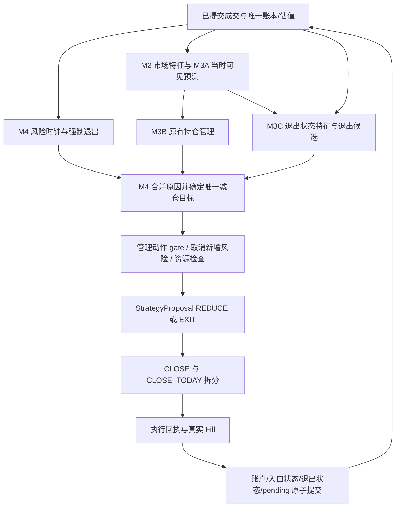

# M3C：退出策略库

文档版本：`devplan-v2.1.7`。节点版本：`M3C-v1.0.0`。日期：2026-09-17。2026-09-17 仲裁 v2-arbitration-legacy-binding-convergence-20260917-r1 的 L1 落文；规范勘误见 §4.1/§8.1/§8.4/§9。同日缺口仲裁 v2-arbitration-prep-gaps-20260917-r1 的 L1 落文：G0-E 全局门禁勘误（§9 全文、§9.1 指针）、§8.1 最终段与 §8.4.1 子条款引用。同日 EP1-DOC 条款补充（v2-ep1-training-path-20260917-r1）：§8.1/§8.4.1 新增固定候选离线路径计量交叉引用，均为目标（contracts 新链），非 contracts-2.1.3 已实现；条款补充不升版本号。依据：用户已批准的[退出策略库规划](../../data/maintenance_artifacts/exit-strategy-plan/plan.md) §1—§7，规划版本 `exit-strategy-plan-v0.1.0`，原文件 SHA-256 为 `cbc4667f5befd60caef2a5e70ced7ae8f55c01cc47717ab86885ee27a9abcb96`。

状态：**已批准规划的正式开发规格，实施及独立硬审核待执行**。跨节点修订见[变更申请-007](变更申请-007.md)，与 001—006 中未被明确替代的裁决共同生效。本次仅新增本文和变更申请-007；文中代码、测试、schema、contract-lock 和运行产物均为后续交付目标，不代表已发布、已验证或获准运行。既有 00—07 的待修订文字以 007 所列精确替换文本解释，不冒称原文件已经改写。

## 1. 目标与不做清单

建立与 M3B 入场注册表并行的退出政策层，登记利润阶梯、固定 ATR 移动保护、波动调整保护、时间衰减、信号失效/反转、整轮盈利回撤、机会成本及分批清退八族。八族是路线范围；PARTIAL_LIQUIDATION 是规模组合器，不是独立预测 Alpha，LEGACY 是对照政策，不算第九个新增家族。每项均有分钟/日线独立身份、精确白名单、适用入场族、观察/执行时钟、状态及资格，分 P0—P4 开发，不一次宣布十六规格可用。

M2 继续生产与账户无关的市场因子，M3A 继续生产市场事件预测；M3B 管理入场、加仓、原 episode 和冻结预算；M3C 根据当时可见市场证据、真实成交与已提交退出状态提出 KEEP/REDUCE/EXIT；M4 负责风险优先、仲裁接线、CLOSE 路由、成交、费用和唯一账本；M5 验证完整的“入场版本 × 退出版本 × 执行规则”。首阶段必需新增 M2 市场因子数为 **0**。

不扩充原 `StrategyFamily` 七族，不改变原十四个入场规格及参数含义，不用退出替代止损。S0/T0、原最大退出时点、账户熔断、0.005 整轮风险、0.02 日损、0.10 账户回撤及冻结压力政策继续有效。新增政策只提前退出、减少手数或收紧保护；不扩大止损、不取消固定目标、不延长持有、不用已兑现利润重新加层，不跨 episode 追损。GRID/MARTINGALE 的冻结区间、目标 M、历史层使用记录和 1/2/4 总 7q 约束保留。

不读数据库、econ、TqSdk、交易账户或跨节点私有缓存；不调用 TargetPosTask 或 broker send/cancel，不修改客户端。不从未成交提案推进真实手数，不把逻辑回放包装为财务 NAV，不从五个分位数猜均值、首达概率或最佳退出。不读取凭据，不修改任何模型配置。`enable_trading=False`、observer=`hold`、真实 send/cancel=0、`broker=NOT_RUN` 保持项目边界。

## 2. 前置依赖与并行方式

依赖 M1 对 ExitSpec/Binding/FeatureSnapshot/State/Proposal、恢复字段、签名、schema 及 required_tests/check_ids 的新冻结；公共契约目标为 `ak_probability_strategy_contract_v2.1.3`，拟发布目录为 `data/research_runs/v2/contracts-2.1.3/`，发布前必须核验既有 `contracts-2.1.2` 实际内容及审核链。旧 lock 不覆盖。M3C 使用所属测试内的 SYNTHETIC fixture 准备，不能修改 M1 共用 fixture。

P0 冻结并经独立审核后，M3C 纯逻辑、M3B legacy 接线、M4 上下文/账本、M5 实验/报告可在各自白名单内并行；完整集成等待实际依赖冻结并通过所需审核。M2/M3A 无新增公式或事件时仍核验新 lock 和受影响来源。P2 部分退出、多层、P3 新信号、P4 continuation 有各自门禁，不能以并行跳过。活跃审核文件集对 owner 同样写冻结；后续工作先 prepare，冲突由 Codex 裁决。

旧运行只在无持仓、无 pending、无未释放预算且原协议对账成立的边界启动新登记 run；已有 episode 用原依赖完成管理。缺峰值/绑定的旧 checkpoint 不得补空升级。004/006 的空仓模型激活不允许顺带更换 lock/registry，本次不操作服务或部署。

## 3. 独占文件清单

以下路径相对项目根目录。M3C 独占新增实现 15 个、测试 12 个；P1 只要求首批 9 个实现和 6 个测试，后续文件按阶段解锁。文件已被其他工作创建时先核对真实基线，不能覆盖并行产物。

| 阶段 | 文件 | 职责 |
| --- | --- | --- |
| P1 | `src/ak_trading/v2/exits/__init__.py` | 子包及节点版本，不重导出其他节点 |
| P1 | `src/ak_trading/v2/exits/registry.py` | 并行 ExitRegistry、精确白名单、组合适用性 |
| P1 | `src/ak_trading/v2/exits/features.py` | EXITSTATE 定义、质量传播、可见前缀计算 |
| P1 | `src/ak_trading/v2/exits/state.py` | 观察/选中/成交纯状态变换及恢复校验 |
| P1 | `src/ak_trading/v2/exits/arbitration.py` | 无资源副作用的目标合并规则；M4 实际选择 |
| P1 | `src/ak_trading/v2/exits/legacy.py` | 原退出行为适配；禁止复制出第二份分歧检查器 |
| P1 | `src/ak_trading/v2/exits/trailing.py` | 固定 ATR 完成 close 移动保护 |
| P1 | `src/ak_trading/v2/exits/time_decay.py` | 交易时钟、无进展全平；P2 两阶段版本 |
| P1 | `src/ak_trading/v2/exits/replay.py` | 仅逻辑回放，financial_result=null |
| P2 | `src/ak_trading/v2/exits/profit_ladder.py` | 整轮 R 阶梯触发 |
| P2 | `src/ak_trading/v2/exits/sizing.py` | 累计原始手数、尾仓与 pending 差额 |
| P2 | `src/ak_trading/v2/exits/volatility_stop.py` | 当前 BASE ATR14 的单向保护 |
| P2 | `src/ak_trading/v2/exits/drawdown.py` | 整轮净清算收益回吐 |
| P3 | `src/ak_trading/v2/exits/signal_reversal.py` | 量价反转及单独登记的证据分支 |
| P4 | `src/ak_trading/v2/exits/opportunity_cost.py` | 消费 M4 continuation 估计，先平后开 |
| P1 | `tests/test_v2_m3c_registry.py` | ID、白名单、绑定与 legacy 等价 |
| P1 | `tests/test_v2_m3c_state.py` | 状态推进、成交去重和恢复 |
| P1 | `tests/test_v2_m3c_features.py` | 精确键/公式/单位/前缀/质量手算 |
| P1 | `tests/test_v2_m3c_trailing.py` | 镜像、arm 锁存、tick 和下一窗口 |
| P1 | `tests/test_v2_m3c_time_decay.py` | 午休、缺行情、日线与期限收紧 |
| P1 | `tests/test_v2_m3c_causality.py` | 未来追加、缺口和逻辑回放 |
| P2 | `tests/test_v2_m3c_ladder.py` | 多阈值、累计进度及目标合并 |
| P2 | `tests/test_v2_m3c_sizing.py` | 尾仓、取消/替换、迟到 Fill、多层 |
| P2 | `tests/test_v2_m3c_volatility_stop.py` | ATR 扩大不放宽、失效不补数 |
| P2 | `tests/test_v2_m3c_drawdown.py` | 部分止盈前后整轮收益守恒 |
| P3 | `tests/test_v2_m3c_signal.py` | 原失效不延迟、新软确认和证据 |
| P4 | `tests/test_v2_m3c_opportunity.py` | 配对收益差、同资本/期限、重新准入 |

跨节点文件由原 owner 修改，M3C 不代改：M1 为 `contracts.py/schemas.py/__init__.py/artifacts.py`，必要时 `policy.py` 及公共 fixture；M3B 为 `strategies/registry.py,state.py` 及经工作单列明的 legacy 家族接线；M4 为 `decision/pipeline.py,replay.py,gates.py,routing.py,risk.py,execution.py,ledger.py,payoffs.py`；M5 为 `validation/experiments.py,metrics.py,reports.py,shadow.py` 和必要 CLI/配置消费者。对应原测试亦归原 owner。具体阶段分配见 §9；出现未列明文件先裁决范围。

## 4. 公共接口契约

### 4.1 类型、身份和生产责任

公共类型由 M1 在 `contracts.py/schemas.py` 唯一定义，M3C/M4 不私造跨节点字典。沿用 frozen dataclass、不可变 Mapping/tuple、字段无隐式默认值、Decimal 字符串及严格解码规则。下表是 P0 必须覆盖并冻结的字段语义；精确公共增量及版本见 007 §3/§5，新增字段不得藏在 ID、reason、model_hashes 或未注册 JSON 内。

| 记录 | 必须冻结的内容 | 生产/提交责任 |
| --- | --- | --- |
| `ExitSpec` | exit_policy_id、family、mode、version、parameter_version、code_sha256、parameters、required_market_keys、required_state_keys、applicable_entry_families、observation_duration_seconds、execution_timing、validation_stage；参数键集恰等于 §5.4 白名单 | M3C 生产注册项，M1 锁 schema |
| `ExitPolicyBinding` | binding_sha256、entry_spec_sha256（恰为 StrategySpec.code_sha256 的完整 64 位小写代码摘要，不是整个 StrategySpec 的序列化 hash）、strategy_id、exit_spec_sha256s、sizing_spec_sha256、priority、legacy_rules_version；OPEN 选中前确定，首次真实 Fill 后启用 | M4 选择并持久化，整个 episode 不换绑定；legacy 绑定唯一生产入口为 M3B select_exit_binding，M4 legacy 辅助入口只作无变换转发 |
| `ExitFeatureSpec` | feature_key、formula_version、unit、window_kind、minimum_source_facts、source_scope、clock_unit、required_source_keys；不是 M2 固定 n-bar FactorSpec | M3C 登记，M1 校验有限键集合 |
| `ExitFeatureSnapshot` | snapshot_id、account_id/contract_id/strategy_id/episode_id/exit_binding_sha256、duration_seconds、observed_at_nano、available_at_nano、逐字段值/质量/源事实 hash、source_state_sha256 | M3C 由显式上下文计算，M4 存审计 |
| `ExitContext` | now_nano、上述完整作用域、已绑定 specs、合法 features/forecasts、entry spec/state/budget、真实 account/position/marks、已提交 episode 成交流水、rules/sessions、退出快照与 previous state、可空 continuation 证据 | M4 构造；无 forecast 仍能走硬风险 |
| `ExitProposal` | proposal_id、原 strategy/episode/contract 归属、exit_binding_sha256、action=KEEP/REDUCE/EXIT、有符号 target_lots、触发 policy/输入 hash、observed_at/earliest_execution、可空有效保护记录、next_state、reasons | M3C 纯候选；KEEP 不产生 OrderIntent |
| `ExitState` | 作用域、first_fill_nano、绑定、整轮已实现毛收益/已付费用累计、价格/净收益峰值及各自源事件/hash、arm 锁存、有效保护价/版本/effective_from、按规则隔离的确认数/最后观察 ID、no_more_add、Qbase、实际累计平仓量、各阶触发/请求/完成量、phase、最后提交事件及前缀 hash | M3C 纯变换；M4 唯一 checkpoint 事实来源 |
| `ExitExecutionLink` | 已核验的 ExitProposal/StrategyProposal/DecisionRecord/OrderIntent 外键、绑定、原 action、原有符号目标、请求手数及执行类型 | M4 在下单意图提交前登记；反馈据此区分 REDUCE/EXIT，不能猜 reason |
| 退出仲裁审计 | 所有候选 ID、全部原因、选中目标、对应决策/原意图/回执/Fill 引用；未选与未成交明确分开 | M4 发布，M5 核对外键及祖先链 |

`ExitRegistry` 是按 `exit_policy_id` 索引 ExitSpec/纯实现的独立映射；`StrategyFamily` 仍为原七族。`exit_registry_sha256` 绑定按 ID 排序的完整 ExitSpec 规范数组；原 `registry_sha256`/`registry_hash_for(specs)` 继续绑定完整 StrategySpec 数组，factor registry 又是另一个轴。binding_sha256 覆盖绑定完整内容且只排除自身 hash；包含实际 entry/exit/规模/优先序/legacy 身份。代码 hash 必须覆盖家族实现及实际共享 registry/features/state/arbitration 依赖。

> 本版本 entry_spec_sha256 恰为 StrategySpec.code_sha256 的完整 64 位小写摘要，不是整个 StrategySpec 的序列化 hash。完整 entry 参数/版本由独立 strategy registry 和资格范围核验；binding 可回查所绑定的退出 spec、规模及优先序，不能单独替代完整 entry registry。相同 binding 不代表参数/registry/模型/资格相同。exit spec 的单项 hash 使用单元素完整 ExitSpec 数组，binding hash 使用 M1 唯一算法；priority 使用实际退出 policy ID 并保留次序。唯一绑定生产入口为 M3B select_exit_binding，M4 legacy 辅助入口只作无变换转发，legacy ExitSpec 唯一由 M3C registry 产生。

### 4.2 纯函数入口及提交纪律

以下为 P0 冻结的接口意图；M1 必须把完整类型声明及签名纳入 public_signatures，消费者一起升级。未在 P0 细化的 P2/P4 动作条件或新增概率接口须先取得 Codex 阶段补充裁决，实施者不得自行补字段。

```python
# exits/registry.py
class ExitPolicy(Protocol):
    @property
    def spec(self) -> ExitSpec: ...
    def evaluate(self, context: ExitContext,
                 previous: ExitState | None) -> ExitProposal: ...

def exit_registry_v1(mode: Literal["MINUTE", "DAILY"]) -> Mapping[str, ExitPolicy]: ...
def evaluate_exit(context: ExitContext,
                  previous: ExitState | None) -> tuple[ExitProposal, ...]: ...

# exits/features.py

def exit_feature_registry_v1(mode: Literal["MINUTE", "DAILY"]) -> tuple[ExitFeatureSpec, ...]: ...
def build_exit_feature_snapshot(context: ExitContext,
                                 previous: ExitState | None) -> ExitFeatureSnapshot: ...

# exits/arbitration.py；返回唯一候选目标，不提交资源

def arbitrate_exit(proposals: tuple[ExitProposal, ...],
                    context: ExitContext) -> ExitProposal: ...

# exits/state.py

def commit_exit_observation(previous: ExitState, proposal: ExitProposal) -> ExitState: ...
def commit_selected_exit(previous: ExitState, proposal: ExitProposal,
                          links: tuple[ExitExecutionLink, ...]) -> ExitState: ...
def apply_exit_execution(previous: ExitState, result: ExecutionResult,
                           link: ExitExecutionLink, account: AccountSnapshot,
                           now_nano: int) -> ExitState: ...
def validate_restored_exit_state(state: ExitState, checkpoint: LedgerCheckpoint) -> None: ...
```

观察提交仅推进已完成观察、确认、当时有效峰值/保护的计算事实；不得创建成交、释放预留或标记某阶完成。选中提交才锁存 no_more_add、原动作/目标及意图承诺；真实新 Fill 才改变现金流累计、已平量/完成进度。首次 Fill 初始化 ExitState，不能从 OPEN 提案或取消的订单起算年龄。未选候选的观察可以留审计，但不得造成资源副作用；所有观察/选择/反馈均与事件游标在同一 M4 事务提交。

P1 仅全平，旧 entry state 的 EXITING 语义保留。P2 的 ExitState.phase 精确为 `MANAGING/REDUCING/LIQUIDATING/CLOSED`：REDUCING 到已选合法目标后回 MANAGING，entry state 保持/回 HOLDING，no_more_add 不撤销；全量退出为 LIQUIDATING，entry state=EXITING，部分成交仍继续清退。CLOSED 要求实际归零、pending 终结及资源释放。硬风险可将 REDUCING 升级 LIQUIDATING，不能被 KEEP 或软信号恢复撤回。

## 5. 八族规则、参数与数量语义

### 5.1 共同输入、符号与约束

下述“启用条件”指对**已经真实成交的持仓**启用退出规则，不产生新的开仓条件。`s∈{-1,+1}` 为 episode 方向；`q_t>0` 为真实剩余手数；`A0` 为 `RoundBudget.initial_atr_points`；`At` 为当前同周期 `BASE:atr14`；`S0/T0` 为冻结止损/目标；`R0=RoundBudget.planned_loss_cny>0`。`Nt` 为含已实现部分、全部已付费用及剩余预计退出成本的整轮净清算收益，精确定义见 §6。

**ATR 口径必须分开。** 按批准规划核定的口径，`FeatureSnapshot.atr_points` 使用 VOL004 规格的 Wilder ATR 点数：分钟各登记频率 n=60，日线 n=20；RoundBudget 冻结此值为 A0。`BASE:atr14` 则是最近 14 个 TR 的算术均值，最少 15 根 bar。本节点的固定移动保护使用 A0，波动调整分支显式使用 At；这是两种尺度，不把两者默认为同一个 ATR，也不因此改变原预算价。

以下参数只是**首轮预登记候选值**，均未通过统计验证。价格/金额/比例以 Decimal 字符串登记；计数/手数为整数且拒绝 bool。MINUTE/DAILY 分别有独立 ID、参数与资格，表中同值不代表共用证据。每轮先研究单一退出规则叠加基线，只有单项有足够证据后才登记小规模组合，避免自动生成全参数笛卡尔积。

所有家族共同遵守：只减既有归属仓位，不反手；最晚退出只能提前；原止损/目标先触发即退出；先保留整轮风险预留，只有确定不再使用且取消得到回执的资源才释放；任何新保护价均不改 `RoundBudget` 原字节。原有硬退出和现有信号失效不等待新增家族确认。

### 5.2 家族、参数及与网格/马丁的关系

| 家族 / ID 前缀 | 启用及触发条件 | 首轮参数/行为 | M4、预算及多层交互 |
| --- | --- | --- | --- |
| **利润阶梯 PROFIT_LADDER** / `exit_profit_ladder` | 可可靠估值、费用可算，`Nt/R0` 依次达到阈值 | `profit_levels_r=["0.5","1.0","1.5"]`，`cumulative_close_fractions=["0.33","0.67","1"]`，`confirmation_bars=1`；原 T0 到达可提前全平 | 阈值依据整轮净收益，不能按某一盈利 lot。首次自愿减仓承诺后停止 ADD；按 §5.3 的累计目标管理，不随每次轮询重复卖出。首版先做单层方向族；网格/马丁待多层专门验收 |
| **固定 ATR 移动保护 TRAILING_STOP** / `exit_trailing_atr` | 入场后存在有效价格峰值，整轮盈利达到启用条件 | `arm_profit_r="0.5"`，`trail_atr_multiple="1"`，`atr_basis="FROZEN_ATR"`，`peak_source="COMPLETED_CLOSE"`；触及有效移动线全平 | 价格峰值仅来自首次 Fill 之后已完成可见 close。单调收紧并受 S0 限制；首版只做完成 bar 触发、下一窗口执行。GRID/MARTINGALE 初始关闭，不改变其“回到 M 整轮退出”对照 |
| **波动调整保护 VOLATILITY_STOP** / `exit_volatility_stop` | 当前同周期 ATR14 有效，已有真实持仓 | `atr_basis="BASE_ATR14"`，`atr_multiple="1"`，`confirmation_bars=1`；当前价减/加 kAt 生成候选保护线，只允许收紧 | ATR 扩大绝不能放宽 S0 或已生效移动线。与固定 ATR 移动保护分开比较；Wilder ATR 若使用必须另参数版本。多层初始只做风险减少，不重新冻结层价/预算 |
| **时间衰减 TIME_DECAY** / `exit_time_decay` | 达到原有效持有期的预登记比例而整轮盈利进展不足 | `soft_time_fractions=["0.50","0.75"]`，`minimum_progress_r=["0.25","0.50"]`，`cumulative_close_fractions=["0.50","1"]`；第一阶段可先验证仅全平版本 | 使用交易时钟；午休不算年龄，行情缺失不暂停时钟。active_exit 收紧可能提前触发软退出，绝不延长。GRID/MARTINGALE 触发后取消后续层，不能“再等一层摊平” |
| **信号失效/反转 SIGNAL_REVERSAL** / `exit_signal_reversal` | 基线保留原 MA/区间/持续概率失效；新增软分支检测当前持仓方向的量价反转 | 研究分支：连续 `confirmation_bars=2` 满足 `s×(C−MA20)<0`，且确认 bar 的 `volume_ratio20≥1.5`；另行比较“无量过滤”版本。概率/分位数分支见 §7.5 | 只影响新增软分支；不能给既有 UNKNOWN、假突破、概率跌破 0.65/0.80 或硬风险增加两根等待。平旧仓不代表自动开反向仓；马丁禁止靠反向新仓掩盖旧轮亏损 |
| **盈利回撤 DRAWDOWN_EXIT** / `exit_episode_drawdown` | 整轮净收益历史峰值已达到启用值，其后回吐超额 | `arm_peak_profit_r="1"`，`max_giveback_r="0.5"`；`(peak(N)−Nt)/R0≥0.5` 全平。账户软回撤属于单独 portfolio overlay，初始关闭 | 保留已实现 P&L，因此部分止盈不假造峰值坍塌。账户 10% 回撤熔断仍由 M4 执行；若未来研究 5% 软减仓，必须由组合级规则统一分配，不能各策略自行解释账户损失 |
| **机会成本 OPPORTUNITY_COST** / `exit_opportunity_cost` | 存在同时间、同资本/期限下可比较的合法替代候选；持有/平仓/替换的状态条件收益证据足够 | `minimum_improvement_r="0"`，`confirmation_bars=2`；净费用已计入、日期块重抽样的替换相对继续持有收益改善下界严格 >0 才 EXIT | 需要新 M4 continuation payoff，不能比较“新开 EV 与旧仓从开仓至今收益”。先退出、成交/取消完成、释放资源，再重新过全部 OPEN 门槛；不保证替代机会仍在。首版禁用于网格/马丁 |
| **分批清退 PARTIAL_LIQUIDATION** / `exit_scale_out` | 接收上面某个明确退出触发及累计减仓比例 | `sizing_mode="CUMULATIVE_ORIGINAL_LOTS"`，`lot_rounding="FLOOR_CLOSE"`，`final_step="ALL_REMAINDER"`；可注册如 50%→100% 的规模政策 | 这是**退出规模/执行组合器**，不是额外预测 Alpha，也不是容量限制下的部分成交。硬 EXIT 可覆盖它立即要求全部清仓，执行不足仍如实 pending；实际成交不能恢复网格/马丁已用层 |

支撑/阻力附近止盈仅作为后续预登记的 PROFIT_LADDER 或 SIGNAL_REVERSAL 的参数化触发：同周期 `prior_high20/prior_low20` 与 `distance_high_atr/distance_low_atr` 已经足够。不另建一个同义家族。结构性“枢轴/成交密集区”需要新的定义及数据时才另立版本，不能把未来确认的局部极值倒填。

P1 时间衰减只登记全平版：`soft_time_fractions=["0.75"]`、`minimum_progress_r=["0.50"]`、`cumulative_close_fractions=["1"]`；P2 表中的两阶段版本使用新参数版本，不能覆盖活跃 episode。利润阈值必须正且严格递增，累计比例必须在 (0,1] 且严格递增、末项为 1；trail/ATR 倍数必须正。软确认只按不同的完整同频率观察计数，重复 bar 不加计数，证据中断重置该软分支；硬退出不受该计数器影响。

### 5.3 保护线、数量与组合的精确规则

**移动保护线。** 采用方向变换 `x_t=s×C_t`、`b0=s×S0`。`h_t=max(x_u)`，u 仅覆盖首次 Fill 之后、当时可见且有效的已完成观察；未有这种观察时不启用移动保护。TRAILING_STOP 的候选线为 `h_t−kA0`；VOLATILITY_STOP 为 `x_t−kAt`。启用后统一取 `b_t=max(b0,b_(t−1),candidate_t)`，实际价 `S_t=s×b_t`。多头上移、空头下移，波动扩大不能反向移动。阈值落 tick 的规则也进入版本：多头保护价向上取 tick、空头向下取 tick；若收紧后已穿当前价，只形成下一合法窗口的退出请求，不伪造当前已成交。

TRAILING_STOP 在 `Nt/R0≥arm_profit_r` 且已有合格价格峰值时启用；DRAWDOWN_EXIT 在 `peak_net_liquidation_r≥arm_peak_profit_r` 后，以 `profit_giveback_r≥max_giveback_r` 全平。以上等号均计触发，时间衰减则必须进展严格小于最低值。

启用状态必须锁存：达到 arm_profit_r 后，即使利润回落到启用阈值以下也不能撤去已经生效的保护线；首次启用和后续更新均进入 ExitState。R0、A0 或所需 At 非正/非有限时，对应派生值为 None 并记录 INVALID，不补 epsilon、不以新 ATR 重置旧风险单位；原硬风险路径继续。

首版 `COMPLETED_CLOSE` 路径在当前完整观察满足 `x_t≤b_t` 时请求 EXIT，最早下一合法窗口执行；从 t 的观察更新出的线不能回测为 t 这根 bar 内已经挂好的保护单。未来若增加盘中保护，必须把 t 已知的线版本及生效时间预先登记，下一执行 bar 只读此前有效线，另做同 bar 路径歧义验收。原 S0/T0 保护撮合仍按原契约工作。

**累计平仓量。** 自愿分批退出前必须解决正在进行的 OPEN/ADD：停止新增层，取消未成交新增风险并等待其终态，纳入期间真实迟到 Fill 后冻结 `Qbase`。这是自愿分批规则的前置条件；硬风险退出不因此停止处理当前可平仓位，迟到新增 Fill 必须继续纳入风险清退。设合法平仓步长为 l、第 j 阶累计比例 fj，则预定累计平仓量 `Dj=floor(Qbase×fj/l)×l`；末阶直接取 `Qbase` 并检查交易所尾仓规则。原系统 min_open_lots 不能冒充最小平仓量。

每次仅补发 `max(0,Dj−实际累计已平量−活跃平仓剩余承诺量)`，不能按当前剩余仓重复计算 50%。零手阶梯保留“未形成可执行量”的原因；若 Qbase=1，默认直到最终全平阶才执行。一次跳过多个阈值取最高已触发的累计目标，只生成一次差额。跨多个规则时取**剩余绝对手数最小的合法目标**，不是把各减仓量相加。同时多个原因全部留证；硬 EXIT 的目标恒为 0。

阶梯的 trigger latch、已请求量及实际已完成量分别保存。只有 Fill 推进已完成量；取消/拒绝/重启不算“已经止盈”。首个新增自愿 REDUCE/EXIT 被选中后，episode 的 `no_more_add=true` 永久保持至清仓；后续反弹也不重新开放层。初期对网格/马丁一律采用此规则，避免减仓—补回循环改变原三层模型。

### 5.4 精确白名单、版本与启用范围

参数字典必须**键集精确相等**，既不漏键也不接受额外键。下表是 §5.2 的可执行登记解释，未列的阈值为该版本规则常量，不得偷偷作为配置注入。价格/金额/比例及列表内对应元素均为十进制字符串；计数为 int 且拒绝 bool。数值有限，零/负值的合法性逐项判定，不用 float 误差放宽边界。

| family | 完整参数键集及首轮值 | 额外校验/版本 |
| --- | --- | --- |
| LEGACY（对照） | `{}` | 原 entry 参数及已有退出检查保持完整，不另设通用参数 |
| PROFIT_LADDER | `profit_levels_r=["0.5","1.0","1.5"], cumulative_close_fractions=["0.33","0.67","1"], confirmation_bars=1` | 两数组等长；R 阈值正且严格递增；累计比例在 (0,1] 严格递增、末项 1 |
| TRAILING_STOP | `arm_profit_r="0.5", trail_atr_multiple="1", atr_basis="FROZEN_ATR", peak_source="COMPLETED_CLOSE"` | arm、倍数均正；两枚举只接受所列值；不暗加 confirmation_bars |
| VOLATILITY_STOP | `atr_basis="BASE_ATR14", atr_multiple="1", confirmation_bars=1` | 倍数正，枚举固定；Wilder 分支另版本 |
| TIME_DECAY / P1 | `soft_time_fractions=["0.75"], minimum_progress_r=["0.50"], cumulative_close_fractions=["1"]` | 全平版本，三数组等长；时间比例在 (0,1] 且严格递增，进展阈值正；elapsed≥时间阈值且 Nt/R0<对应进展阈值才触发 |
| TIME_DECAY / P2 | `soft_time_fractions=["0.50","0.75"], minimum_progress_r=["0.25","0.50"], cumulative_close_fractions=["0.50","1"]` | 独立参数版本；累计比例同阶梯约束，不覆盖持仓内 P1 绑定 |
| SIGNAL_REVERSAL | `confirmation_bars=2` | MA20 与 `volume_ratio20≥1.5` 为该规则版本固定条件；连续两根各自均满足反向价格/MA与量比。无量过滤另参数/代码版本及资格，不增隐含布尔开关 |
| DRAWDOWN_EXIT | `arm_peak_profit_r="1", max_giveback_r="0.5"` | 两值正；账户 5% 软回撤未登记，不在此字典 |
| OPPORTUNITY_COST | `minimum_improvement_r="0", confirmation_bars=2` | 改善阈值允许 0、不允许负；配对差 LCB/R0 严格大于此值；不是开仓胜率阈值 |
| PARTIAL_LIQUIDATION | `sizing_mode="CUMULATIVE_ORIGINAL_LOTS", lot_rounding="FLOOR_CLOSE", final_step="ALL_REMAINDER"` | 三枚举固定；累计比例来自绑定的触发政策，不在规模器重复定义另一套比例 |

基线 ID 为 `exit_legacy_m1_v1/exit_legacy_d1_v1`；八族 ID 分别由 §5.2 前缀加 `_m1_v1/_d1_v1` 得到，`version="1.0.0"`，初始 `parameter_version=<exit_policy_id>+":params-1"`，TIME_DECAY 两阶段为 `:params-2`；其他消融必须新登记参数/代码身份。所有新项初始 `validation_stage="RESEARCH"`。分钟 mode=MINUTE/d60，日线 mode=DAILY/d86400，观察与证据不通用。execution_timing 首版固定 `NEXT_LEGAL_WINDOW`；只有 legacy 的原事前 S0/T0 障碍按原保护撮合协议执行。

P1 仅 legacy、trailing、全平 time-decay 可进入已开发登记集；新增两个家族仅适用于 TREND/BREAKOUT/PULLBACK 单层。legacy 保留各原族行为；WAIT 无真实 episode，不绑定会产生减仓的政策。P2 单层闭环通过后另验 REVERSION/GRID，最后 MARTINGALE；trailing 对 GRID/MARTINGALE 初始关闭，机会成本首版禁用 GRID/MARTINGALE，账户软回撤 overlay 初始关闭。白名单出现一个 ID 不等于该组合已获得统计/影子资格。

## 6. 市场输入与退出状态特征

### 6.1 现有市场因子的复用

M2 已有十项库因子 `MOM001/MOM003/MOM010/REV001/VOL001/VOL004/VOL005/VOI001/VOI007/VOI009`，以及每周期十五项 BASE。BASE 全集为 `close,prior_high20,prior_low20,atr14,er20,vol20,ma20,ma60,ma_spread_atr,zscore20,distance_high_atr,distance_low_atr,volume_ratio20,oi_change5,opening_gap_points`；旧 v1 对照仍只有原十四项。季节性两列及 META 元数据不计入“10+15”。

| 退出需求 | 可直接复用的精确键/来源 | 必需新增内容 |
| --- | --- | --- |
| 固定/波动保护、ATR 距离 | `BASE:close:v2.1.0:d60`、`BASE:atr14:v2.1.0:d60`；日线分别为 d86400 | 入场后峰值、有效保护线等 episode 状态；不新增 ATR 市场因子 |
| 波动确认 | `VOL004:v2.1.0:d60:m1-n60`、`VOL001:v2.1.0:d60:m1-n60`；日线 `...:d86400:d1-n20` | VOL004 是 Wilder ATR/abs(C)，要还原点数须乘 abs(C)；它不能与 BASE 算术 ATR14 混用。替换须另版本 |
| 趋势/反转 | `BASE:ma20:v2.1.0:d60`、`BASE:ma60:v2.1.0:d60`、`BASE:ma_spread_atr:v2.1.0:d60`、`BASE:zscore20:v2.1.0:d60`；`MOM010:v2.1.0:d60:m1-n60`、`REV001:v2.1.0:d60:m1-n60` | 新软规则及其确认状态；概率取 M3A，不伪装成 M2 因子 |
| 量确认反转 | `BASE:volume_ratio20:v2.1.0:d60`、`BASE:oi_change5:v2.1.0:d60`；可另选 `VOI001:v2.1.0:d60:m1-n60`、`VOI007:v2.1.0:d60:m1-n60` | 量比与价格/MA 联合即可。BASE 量比无减 1，VOI001 有减 1 且窗口不同；OI 增减不是净多资金流 |
| 支撑/阻力接近 | `BASE:prior_high20:v2.1.0:d60`、`BASE:prior_low20:v2.1.0:d60`、`BASE:distance_high_atr:v2.1.0:d60`、`BASE:distance_low_atr:v2.1.0:d60` | 现有距离分别按 `(prior_high20−C)/ATR14`、`(C−prior_low20)/ATR14` 使用；可为负，表示越界，不能强截为 0 后掩盖破位。episode 原 FrozenRange 仍独立冻结 |
| 跳空/事件风险 | `BASE:opening_gap_points:v2.1.0:d60`；同样支持 d86400 等登记周期 | 已有 M3A EVENT_SHOCK 规则：绝对开盘差 ≥ 当前同快照 2ATR。退出库消费统一风险标记；不重算、不把盘中价差当会话开盘差 |
| 利润阶梯、回撤、时间、部分平仓 | 真实 PositionLot、Fill、AccountSnapshot、ValuationMark、RoundBudget、SessionWindow | 新状态派生特征，属于 M3C/M4，不属于面向全市场的 M2 Alpha |
| 机会成本 | M3A 当前合法预测 + M4 候选/成本/预算 + 新 continuation payoff | 新条件收益估计及证据；不是新增一个技术指标就能完成 |

BASE 所有键均可精确替换 duration 为 `{60,300,900,1800,3600,86400}` 中的已登记周期；十项库因子分钟后缀对应 `m1/m5/m15/m30/m60-n60`，日线 `d1-n20`，VOI009 独用 `*-instant`。退出首版观察周期仅 d60/d86400，5/15/30/60 分钟只作为合法 as-of 背景。不得将“20 根 5 分钟 bar”当成“20 交易分钟”，不得盘中读取当日最终日线。

### 6.2 状态特征的公共定义

新增独立的 `ExitFeatureSnapshot/ExitFeatureSpec`，使用 `EXITSTATE:` 命名空间；**不向现有 FeatureSnapshot 偷加账户条件行，不输入原 M3A 市场预测训练**。作用域必须显式为 `account_id+contract_id+strategy_id+episode_id+exit_binding_sha256`；账户级量单独绑定 account_id。键里的 d 是退出观察模式，不改变底层持仓或账户的身份。

以下 `:d{d}` 只表示有限登记展开：首版 d 恰为 60 或 86400，运行时不存在带花括号的键。例如 `EXITSTATE:episode_net_liquidation_r:v1.0.0:d60` 与 `EXITSTATE:episode_net_liquidation_r:v1.0.0:d86400` 是两个明确登记项。表内所有 v1.0.0 是**本次登记的新命名空间版本（尚待实现/发布）**，不是当前 M1/M2 已发布版本。

设当前 episode 剩余批次为 j，手数 qj、成交入场价 ej、方向 s；`Pt` 为该合约 CURRENT mark，m 为与该 mark/账本口径一致的已消费有效合约乘数。`RGt` 为该 episode 所有已平批次的累计实际毛损益；`Ft` 为该 episode 全部已支付开/平费用；`Kclose(t)` 为剩余仓按当前今/昨仓划分及冻结成本场景估计的退出费用、滑点和冲击金额。则：

`Ut = Σj [s×qj×(Pt−ej)×m]`。

`Nt = RGt − Ft + Ut − Kclose(t)`。

Nt 是**预计净清算收益**，不是已实现收益。实际 Fill 的成交价已经包含实际滑点，不再从 RGt/Ut 扣一次 `account.slippage_cny`；Kclose 只覆盖尚未成交的未来退出成本。已平批次的现金流必须从可核验 episode 成交流水取得，不能用账户总 realized 分摊猜值。无法完整估值或费用未知时 Nt 为 None，不能用 0 或只知小计触发利润政策。

| 精确键（按上文展开 d） | 公式 / 单位 | 回看、更新及边界 |
| --- | --- | --- |
| `EXITSTATE:unrealized_pnl_cny:v1.0.0:d{d}` | Ut；元 | 当前全部剩余真实批次 + 当前有效 mark；`CURRENT_STATE`，最少 1 个有效估值。仅浮盈，不含旧已平收益 |
| `EXITSTATE:unrealized_pnl_r:v1.0.0:d{d}` | Ut/R0；无量纲 | 同上；R0 永久使用入场前冻结的整轮计划损失，不随减仓/加仓重置 |
| `EXITSTATE:entry_distance_atr:v1.0.0:d{d}` | `s×(Pt−Σqj ej/Σqj)/A0`；ATR 单位 | 当前真实剩余持仓加权成本；可因 FIFO 平仓改变，不能充当不变的整轮峰值 |
| `EXITSTATE:episode_net_liquidation_cny:v1.0.0:d{d}` | Nt；元 | `EPISODE_PREFIX`：首次 Fill 至当前所有已提交 Fill/费用及当前估值，不能只看现存 PositionLot |
| `EXITSTATE:episode_net_liquidation_r:v1.0.0:d{d}` | Nt/R0；无量纲 | 同上；不以浮盈为正代替整轮净收益为正 |
| `EXITSTATE:peak_net_liquidation_r:v1.0.0:d{d}` | `max(0,max_u Nu)/R0`；无量纲 | 首次 Fill 后所有当时可验证的完整 Nt 观察；持久化峰值、对应事件和源 hash。无一个有效观察则 None，不凭空造 0 |
| `EXITSTATE:profit_giveback_r:v1.0.0:d{d}` | `peak_net_liquidation_r−Nt/R0`；无量纲 | 当前净清算值与整轮已提交峰值；部分清仓不丢已实现收益，清仓后留最终记录 |
| `EXITSTATE:peak_favorable_price:v1.0.0:d{d}` | `s×max_u(s×Cu)`；价格点 | 首次 Fill 后已完成且当时可见的 close；多头取最大、空头取最小。不含 Fill 前本根 bar 的未知极值 |
| `EXITSTATE:trailing_atr_distance:v1.0.0:d{d}` | `(max_u(s×Cu)−s×Pt)/A0`；ATR 单位 | 同上 + 当前有效价格；A0 固定，非滚动 ATR。未启用移动保护也可用于研究诊断 |
| `EXITSTATE:effective_stop_distance_atr:v1.0.0:d{d}` | `s×(Pt−S_effective)/A0`；ATR 单位 | 当前有效保护线及其生效事件，`CURRENT_STATE`；≤0 表示已达/越线，不把负值截去 |
| `EXITSTATE:age_trading_minutes:v1.0.0:d60` | 从首次实际 Fill 至 t 与合法 SessionWindow 相交的纳秒长度之和 / 60e9；交易分钟 | `EPISODE_PREFIX + CALENDAR`；可为 Decimal，真实经过的开市时间即使缺行情也继续累计；不是 bar 行数 |
| `EXITSTATE:age_trading_days:v1.0.0:d86400` | 从首次 Fill 所在交易日至 t 已完成的合法交易日步数；整数交易日 | 日历计步，入场日收盘为第 1 个完成步，未完成当天不计；不按自然 86400 秒相除 |
| `EXITSTATE:remaining_steps:v1.0.0:d{d}` | t 至 `min(active_exit,holding_deadline,lifecycle_cutoff)` 的非负合法交易步数 | d60 单位交易分钟；d86400 单位交易日，期限已到为 0；日历不明为 None。只计算时钟，不选择概率最好的期限 |
| `EXITSTATE:elapsed_fraction:v1.0.0:d{d}` | `age/(age+remaining_steps)`；[0,1] | age/remaining 使用同模式时钟；期限已到取 1；两者均 0 且尚无合法持有窗口则 None。离散日线软阈值在首次满足的完成日触发 |
| `EXITSTATE:account_drawdown_ratio:v1.0.0:d{d}` | `(account.peak_equity_cny−account.equity_cny)/account.peak_equity_cny` | `ACCOUNT_PREFIX`；复用账本已有可靠峰值。要求完整可靠当前账户及正峰值；非完整 NAV 返回 None，硬风险锁保留 |
| `EXITSTATE:closed_fraction:v1.0.0:d{d}` | 退出阶段累计真实平仓量 / Qbase | `LIQUIDATION_PREFIX`；只有首次入账的新 Fill 改变分子；pending 量、阶梯触发/完成位图另作为离散状态，不能把挂单算完成 |

这些回看是**事件/episode/账户前缀**，不是 M2 FactorSpec 的固定 n 根市场 bar。新 ExitFeatureSpec 必须显式记录 `window_kind`、最少源事实数、源作用域与计时单位；不得硬填 lookback=14 来满足旧 schema。最小累计状态足以递推，但其 hash 必须绑定历史提交链，原始证据可回查。

状态量按字段传播质量：缺价格不抹掉可由可靠日历计算的年龄；未知日历不伪造期限。价格/利润峰值按所绑定退出模式的合格观察更新，日线软策略不能借分钟极值偷偷变为盘中策略；M4 硬风险时钟仍独立运行。应有观察缺失时保留旧峰值及缺口标记，不宣称已经观察到缺口中的峰值；后来补齐不得回写已提交决策。若未来允许高频峰值驱动日线退出，必须另登记频率与验证版本。

**估值失效。** CURRENT 且时效有效才可更新峰值、利润阈值和机会成本。STALE 保留最后已提交值及真实价龄作审计，不刷新峰值、不延后期限；UNVALUED 为未知，不用入场价/0 初始化。与此同时，M4 原估值失效风险退出继续运行，REDUCE/EXIT 仍受真实费用规则、容量及停板限制。恢复时只加载校验 checkpoint，不消费新 bar、不重新 mark、不重放扣费；恢复后首个相同时点快照应与不停机一致。

### 6.3 机会成本特征：新增经济估计，不是 M2 市场因子

P4 登记 `EXITCTX:continue_value_cny:v1.0.0:d{d}`、`EXITCTX:next_best_value_cny:v1.0.0:d{d}`、`EXITCTX:switch_advantage_lcb_r:v1.0.0:d{d}`。其窗口为**当前状态至共同评价终点 H 的剩余前瞻期限**；估计样本仅来自此前已成熟的训练区 episode/决策状态，不能消费当前未来路径。

固定相同初始账户、当前持仓、可用风险预算/资本和共同 H。动作 a 为继续持有旧政策、现在清仓持现金、现在清仓后依同一预登记选择政策尝试下一候选 j。定义 `Va=E[equity_H(a)−equity_t | 当前合法状态]`，包含实际退出/重入手续费、平今费、滑点、等待、不可成交及资源约束；它们共用同一基准，已付历史成本为共同沉没部分。前两键分别取 Vhold 与预登记可比较候选中的最大 Vj；无候选时 next_best 为 None，不能把未知赋 0。

第三键为 `LCB_5%(Vj−Vhold)/R0`，对**配对的动作收益差**按交易日期块重抽样 1000 次、seed=7 求均值分布 5% 分位；不得用 `LCB(Vj)−LCB(Vhold)` 冒充差值置信下界。候选 j 的选择方法也必须在训练/开发中冻结，并将“取最大”的整个政策纳入 OOS 验证。不同持仓状态、不同期限或不同预算不能直接比较元金额；跨品种初版禁用。所有键同时保存样本数/日期块、condition identity、模型 hash、可见截止及状态，缺支持为 INSUFFICIENT。

这意味着新增 M4 `ContinuationPayoffEstimate`/动作条件样本定义，不能从现有 `MarketForecast.point_quantiles` 的中位数推出期望，也不能从已有首次 OPEN 的 PayoffEstimate 推导该值。第一阶段不实现此家族。

当前 `choose_proposal` 还限制同合约、同期限且已有仓位归属固定，不能从其当前 eligible 集直接取得其他入场族的 next-best。后续需 M4 显式构造“旧仓按可验证假设清算后”的条件候选集，只用于研究估计、绑定假设/hash，不提前改真实账户或释放资源；成交后仍重新准入。无合法共同期限/资本或假设不可验证则该分支 INSUFFICIENT，不用未经准入的高 EV 候选催促换仓。

### 6.4 可选的新 M2 市场组合指标

只有量价反转消融显示需要统一登记的连续分数时，才允许另行登记 **1 项可选指标**：`EXITMKT:signed_volume_pressure:v1.0.0:d{d}:body-vr20`，d 分别展开为 60/300/900/1800/3600/86400；`operator_version="body-vr20-v1.0.0"`、`parameter_version="body-vr20"`、`lookback=21`、单位无量纲。

公式：`[(C_t−O_t)/max(H_t−L_t,tick_t)] × [V_t / mean(V_(t−20),...,V_(t−1))]`。要求当前完整同合约同周期 OHLCV、前 20 根完整量及当时有效正 tick；量均值排除当前。使用合法连续槽，缺槽重新预热；不跨合约、不跨午休拼高周期 bar；量均值为 0、缺 volume 或规则时返回 None 及对应原因，不加 epsilon。Vt=0 且参考均值>0 时可为 0；零振幅用真实 tick 作已登记尺度，不伪造波动。

对持仓方向 s，`s×score<0` 表示反向实体成交量压力；它只是 OHLCV 代理，**不是主动买卖流、订单流或已校准反转概率**。available_at 取全部实际 bar/规则输入的最大可见时点，source/spec/operator/parameter/input hash 遵循 M2/005。源定义为本地新定义，不能伪称十项库因子原件。所有频率单独登记与验证，不修改已有 10+15 的键/公式；该组合与现有量比/价格项高度相关，不算新增独立证据。第一阶段保持未纳入注册表。

### 6.5 特征登记与质量的严格解释

§6.2 共 16 种字段定义，14 种展开 d60/d86400，加两个单模式年龄键，合计 **30 个精确 EXITSTATE 键**；`:d{d}` 不得成为运行键。ExitFeatureSpec.window_kind 只接受 `CURRENT_STATE/EPISODE_PREFIX/EPISODE_PREFIX_CALENDAR/ACCOUNT_PREFIX/LIQUIDATION_PREFIX`；表中的“EPISODE_PREFIX + CALENDAR”编码为 EPISODE_PREFIX_CALENDAR。当前字段至少有一个真实作用域状态和所需有效源事实；价格/收益峰值至少一个首次 Fill 后有效合格观察；年龄至少首次 Fill 与完整覆盖日历；closed_fraction 至少有已冻结 Qbase，零个平仓 Fill 时可精确为 0。完整性要求不能被 minimum_source_facts 的数量满足替代。

每个值单独使用 M1 DataQuality：READY 表示所需事实完整有效；WARMUP 表示尚无合格峰值观察或尚未冻结 Qbase；MISSING 表示价格/费用/规则/日历必需事实缺失；INVALID 表示非正风险尺度、非法数值/身份/时序；STALE 只保留可审计旧值及真实源时点；DEGRADED 表示存在已声明的历史观察缺口。对应源集合的最大 available_at 不得晚于本次决策。无法合法计算的值为 None，reasons 非空；完整性/时效不足的利润、保护或机会成本分支不能按 READY 使用。字段级质量不压成“一个缺价导致所有年龄失效”。

ValuationMark 的 CURRENT/STALE/UNVALUED 是估值源状态，不能直接冒充特征状态。CURRENT 且时效有效才允许更新收益峰值；无合格净收益观察时 peak 仍 None，有观察但全为负时 `max(0,max_u Nu)` 可为 0。缺口保留旧峰值及缺口事实，不回填已提交决策；有 gap 的数值不能被描述为已观测全路径峰值。清仓后只保留最终审计，entry_distance 等要求正余仓的在线比率不以零除生成数值。EXITCTX 的 INSUFFICIENT 是经济支持状态，不能填到 M1 QualityStatus 枚举中。

## 7. M4 集成、恢复与原保护边界

### 7.1 M4 事件顺序与 CLOSE 路由



1. **硬风险通道先运行**：账户 killed、日损/回撤熔断、生命周期与持有期限、原冻结止损/目标、估值失效、既有 EXITING 均保持原语义。没有 forecast、M2 新特征失败、退出库资格过期时，这条通道仍可处理最后已验证持仓。
2. **已有仓优先于新增风险**：保留 M3B 已有结构/持续失效退出；评估匹配该 episode 的 M3C 规则。任何 EXIT 优先于 REDUCE；REDUCE 按 §5.3 仲裁；KEEP 不能撤销已有退出义务。软策略异常保留具体原因并降级至原保护管理，不能静默关闭风险时钟。
3. **以目标仓位转换订单**：将仲裁结果映射为原归属的 StrategyProposal，`target_lots=s×q_remaining`，EXIT 为 0。继续使用 `evaluate_gate → enforce_account_risk → choose_proposal → commit_selected_proposal → sync_reservations` 的既有纪律；管理 gate 核验归属、时点、严格降风险、不能反手，新退出组合另核验绑定/触发身份。不要把 OPEN 的正 EV、最低置信度或全套 Alpha 可用性搬成强制退出前提。
4. **今仓/昨仓按真实 lots 划分**：本次正式冻结 `intents_for_proposal` 先 CLOSE 昨仓，再 CLOSE_TODAY 今仓；费用按当时有效规则、实际 opened_trading_day/FIFO 批次计算。日期跨越后旧 CLOSE_TODAY 必须通过原终态回执流程重新拆分，不能直接改原 OrderIntent.offset。内部 offset 名为 `CLOSE_TODAY`，未来外部执行适配仍由既有执行边界负责。
5. **挂单冲突先处理**：新增分批退出与已有 pending 平仓共享剩余量。需要升级为全平时，取消/替换的承诺量与新增量必须守恒，不能产生两组可合计超平的订单。硬退出持续处理可平数量；迟到 OPEN/ADD Fill 归原 episode，随后补足退出义务，不能伪造 flat。
6. **M4 才能判断成交**：费用未知、停板、零容量、缺可成交行情均保留 BLOCKED/EXIT_PENDING 和真实 remaining_lots。平仓不依赖新开资格，但不等于忽略执行合法性。利润阶梯只提出目标；不自行调用 TargetPosTask、broker send/cancel 或修改客户端。

**保护性撮合必须显式分流。** 批准规划指出原接线按 reason 中 STOP/TARGET 设置 purpose，原保护撮合读取冻结预算价；新增退出必须明确消除此误路由风险。第一阶段新移动/时间/盈利规则按“完成观察触发 → 下一合法窗口普通平仓”执行，并保持可追踪的退出原因；不能让字符串碰巧包含 STOP/TARGET 就误走旧障碍撮合。具体用途映射按 007：`ExitExecutionLink.execution_kind=NEXT_WINDOW_CLOSE` 时 `OrderIntent.purpose="REDUCE"`，表示普通降仓执行用途，是否全平由原 action/target 决定；原事前 S0/T0 才为 `LEGACY_PROTECTIVE` 配 STOP/TARGET，原期限/生命周期保留 TIME_EXIT/ROLL_EXIT。后续若做动态盘中保护，M1/M4 必须新增版本化保护触发记录（价格、来源、effective_from、episode/binding），执行时核验其事前存在性；不以覆盖 RoundBudget 解决接口不足。

**主动分批必须修订状态机。** 批准规划指出原反馈路径会将任意平仓后的余仓置为 `StrategyState.phase="EXITING"`，risk timer 继续全平；主动分批必须按下述新动作语义接线。P2 按本文及 007 的 M1/M3B/M4 接口裁决区分“尚在执行某档 REDUCE”与“整轮清退已锁存”：ExitState 使用 `MANAGING/REDUCING/LIQUIDATING/CLOSED`。合法自愿 REDUCE 达到目标后，原 entry state 保持/回到 HOLDING，ExitState 回到 MANAGING 且 no_more_add 保持；全量 EXIT 则原 state=EXITING、ExitState=LIQUIDATING，不能因部分成交恢复持有。receipt 处理必须取得已核验的原动作/目标/绑定，不能从 Fill.offset 或 reason 猜测意图。

`sync_reservations/enforce_account_risk` 同步消费 no_more_add 及已确认取消结果：HOLDING 但已停止补层的余仓不能按“历史层数未满”重新预留可用 ADD，也不能在取消终态前提前释放。已用层、R0、冻结预算和风险锁不重置；具体可释放预留由 M4 根据真实余仓/未决承诺计算。达到硬条件时 REDUCING 立即升级 LIQUIDATING，此升级不可因软信号恢复而撤销。这是 P2 的必要接口工作，P1 的全平版本不依赖该新分批语义。

### 7.2 checkpoint、资格与版本

现有 `LedgerCheckpoint.registry_sha256` / `registry_hash_for(specs)` 的明确含义是完整 **StrategySpec 数组**，006 已禁止与 factor registry 混用。保留这个含义，新增 `exit_registry_sha256`，并在新 checkpoint 内显式保存 `exit_bindings` 与 `exit_states`。组合的 `binding_sha256` 同时进入新资格、收益样本、决策、回放 manifest 和 M5 分组。不能把 exit registry hash 偷塞入固定的 `model_hashes` 键集或改变旧 registry hash 的算法而不升契约。

M1 必须新发 contract/checkpoint/相关记录 schema，更新签名、解码白名单、字段完整性、所有权、required_tests 及新 lock。具体目标版本由 007 §3 分配；目标版本不代表已发布；未改结构的市场因子/标签/几何 schema 不全库替换版本字符串。M3A 市场标签不变时无需为“退出库”重新定义标签，但受新 lock/来源影响的依赖仍要按正式方案重验。

`StrategyQualification` 增加明确的退出/组合身份，资格范围至少包含 entry strategy/version/params/code、exit policy/version/spec hash、binding hash、product、mode、horizon、macro_mode、成本场景和实际模型依赖。RunPolicy 的 FIXED 选择也必须唯一绑定组合；现有只有 `fixed_strategy_id` 的形式不能在多个退出版本间随机选一个。旧组合 PASS 不能替代新组合 PASS。

恢复必须延续 003：原意图不可改，`pending_remaining_lots` 保持有符号真实剩余量；新 Fill 才推进已成交层/退出进度，同 ID 不同内容整事件拒绝。账户、marks、processed_fill_hashes、原 M3B state、ExitState、pending、容量/预留及事件游标在**同一事务**提交；断写前后按最后已提交 checkpoint 恢复，不从尾行补造完成状态。阶段确认、峰值更新与订单选择的提交边界也要明确，未选退出不得释放资金或标为已平。

旧 checkpoint 没有峰值/绑定时不能补空字段就升级。新契约从符合原协议的无持仓、无 pending、无未释放预算边界开始新的已登记运行；旧 episode 用旧依赖完成管理。004/006 的模型激活不允许顺带改变 lock/registry，退出库升级不能伪装成一次模型热切换。原运行服务及客户端部署由后续独立工作单处理。

### 7.3 既有 stop/take-profit 参数的地位

首版保留它们作为 entry 策略冻结 RoundBudget 的几何输入和 legacy 对照，不让新退出库替换原最大损失边界。方向族原 1ATR/2ATR、区间族原 stop/M、成本及压力预算共同约束退出政策。利润阶梯的最后一个阶段即使未达到，原 T0 到达也必须全平；新增 stop 只能在原风险包络内收紧；时间衰减只能提前。

04 §1 明确“不实现移动止损”，M3B-H04 明确“不移止损”。因此不能把新增 trailing 宣称为已经包含在原 M3B 任务内。本节点及 007 正式裁决边界为：**原 entry 预算 stop 永不移动；另一个已登记退出版本允许单调收紧的有效保护线**，并为新版本增加独立 H 条款。旧十四规格及旧审查证据不追溯修改。

### 7.4 新恢复字段与退出绑定的落盘边界

LedgerCheckpoint 在原全部字段之外，增加 `exit_registry_sha256:str`、`exit_bindings:tuple[ExitPolicyBinding,...]`、`exit_states:tuple[ExitState,...]`、`exit_execution_links:tuple[ExitExecutionLink,...]`。它们全部严格必填、参与 checkpoint_hash；最后一项提供原动作/目标与原 intent 的不可变连接，解决 P2 不能从 Fill.offset 猜动作的问题。空集合仅在真实无对应事实时合法；持仓、待成交 OPEN 和尚未完成的退出必须有完整绑定/引用。已终结实体从已提交祖先链验证，不靠 reason 文本复原。

恢复核验原 StrategySpec registry、独立 exit registry、binding 内容、实际已消费 rules/model/qualification 和全部源实体。峰值值/时点/hash、保护线/arm、软确认/观察去重、Qbase/no_more_add、阶梯请求/成交及 pending 必须同事务恢复；不消费新 bar、不重新 mark、不重复收费。旧 schema 不自动接受这些字段，新 schema 不接受缺字段、未知字段或伪造空状态。004/006 固定的 model_hashes 键集不扩作 exit registry 容器。

Qualification 增加 exit_registry_sha256、exit_binding_sha256、exit_spec_sha256s；RunPolicy 增加 fixed_exit_binding_sha256，FIXED 时与 fixed_strategy_id 一起唯一选中组合，其他模式为 None；策略上下文和收益估计显式绑定对应退出组合。M5 资格必须重建，旧十四规格的旧 PASS 不追溯改写或移植。

### 7.5 退出是否另设 0.70/0.85

**不设所有退出必须达到的 0.70/0.85 门槛。** 它们是新增风险所需的持续事件概率；用来拦截止损会使低置信度时无法退出。原滞回退出阈值 0.65/0.80 保持，马丁 0.10 止损触达上限仍是开/加仓必要条件，不变成“低于 0.10 才允许平仓”。

- 硬退出、时间到期、确定的价格阈值、原结构失效不需要一个“退出成功概率”；继续受可见性、归属、订单与成交约束。
- 新 SIGNAL_REVERSAL 若使用**规则性量价反转**，阈值只是策略参数，通过 M5 经济与因果验证，不冒称校准概率。
- 若研究 `P(PERSIST:反向趋势)` 或其他概率事件，应有独立 `exit_signal_policy_id`、事件定义、期限、geometry（适用时）、样本/日期块及校准证据。可以预登记研究阈值，不能默认继承开仓 0.70/0.85 的资格；样本不足该软分支不可启用，原风险退出保留。
- M3A 分位数可用于“剩余收益偏弱”的候选规则，但不是剩余持仓净 EV。多头用相应点数分位，空头收益分位须按 `Qα(−X)=−Q(1−α)(X)` 变换，不能把 Q05 直接乘 −1 仍称 Q05。五个分位数不能唯一确定均值、动态止损首达概率或最佳退出时点。
- 持仓中使用新的剩余预测时，按事前时钟规则从分钟 `[60,30,15,5,1]`、日线 `[20,5,1]` 选可容纳期限，核验完整锚/冻结 range/发布时间/证据，不缩放原预测、不延长原 active_exit，也不选择概率最好看的期限。

## 8. M5 回测、收益观察与验收影响

### 8.1 PayoffObservation 按退出组合重建

现有 PayoffObservation 已按整轮真实策略路径定义，并非与退出无关的方向样本。改变退出会改变收益、成本、峰值保证金、尾损和样本成熟，所以即使入场信号相同也要重新回放并拟合 M4 payoff。

004 §6 已把首版收益匹配固定为完整 **16 项 condition_key 精确相等**，取消旧 05 中“较粗波动桶回退”的未定义分支。当前键没有退出身份。新版本按 007 明确的 schema 加入 `exit_binding_sha256` 与适用的 `exit_state_condition`；旧 16 项记录保持旧解释，禁止把不同 exit policy 的样本放入同一个旧桶。

exit_state_condition 必须区分影响未来动作的经济状态；完整 ExitState hash 仅作来源核验，不作为每次唯一的统计桶。首次单层 OPEN 使用裸 OPEN_INITIAL；ADD 使用 ADD_PRE_V1，续持使用 CONTINUING_V1，后两者的第 18 项均为“版本前缀|严格投影 S 的规范 JSON 文本”，表示及来源规则见 §8.4.1。这是一族连续数值精确匹配的状态条件，不做区间分桶、插值或近邻回退。精确匹配导致稀疏或没有合格样本时如实报告 INSUFFICIENT，不删字段、不借旧策略/其他退出样本、不伪造样本。以后合并数值范围必须预登记新版本、冻结区间并独立验证，不能复用 V1 名称。OPEN/ADD 的任一正概率 path 类缺支持仍为 INSUFFICIENT；P4 采用独立的配对条件支持，不借用四类 OPEN 概率支持替代。（20260917-r1 仲裁方向 + v2-arbitration-prep-gaps-20260917-r1 RULING L1-G-5 最终段，整段替换。）

（固定候选离线路径计量的 P1 支持域与采样规则交叉引用，2026-09-17 EP1-DOC 落文；依据 v2-ep1-training-path-20260917-r1 RULING 1.2/3.1。本段为目标（contracts 新链），非 contracts-2.1.3 已实现，未经 M1 冻结发布不得宣称已实现）训练收益的首轮计量路径仅支持 TREND/BREAKOUT/PULLBACK 的单层首次 OPEN、裸 `OPEN_INITIAL`；事前采样规则固定为 `PayoffTrainingPlan.selection_rule="FIRST_FEASIBLE_P1_OPEN_PER_WINDOW"`：按 `(decision_nano, contract_id, proposal_id)` 稳定顺序取选择窗内第一个满足 P1 支持域及全部必要输入/资源条件的原生 OPEN，固定每窗最多一轮，选定后无论亏损、未成交、缺后续行情、未成熟或不闭合都不得挑下一条替代。分域检查键固定为 `IDENTITY_TIME, DATA_CLOCK, REGIME_MACRO, FORECAST_CONFIDENCE, TRIGGER_DOMAIN, COST_BUDGET, ACCOUNT_CAPACITY`，覆盖普通 gate 中全部非 payoff 证据要求和账户风险要求。计量/门禁区分、独立来源链、唯一数据流与 producer 双签名的规范落点为 [05-M4-联合决策与账本](05-M4-联合决策与账本.md) §5.1“固定候选离线路径计量段”。计量不等于 gate 批准：新计量协议本身没有“学习所得 EV 准入”的声明，该声明仍只由完整普通 gate 作出；ADD、多层、CONTINUING_V1、P4 hold/cash/switch 不因本路径解锁。

M3A 的 `ATR_1` 四类路径标签仍只负责对完整策略收益分区。提前止盈不改变原 PathLabel 的锚、窗口或类别；持仓已经退出也仍需等待原标签成熟。新的移动止损/阶梯路径不等同于 UP_FIRST/DOWN_FIRST，也不允许择 ATR_0.5/2 来提高表面胜率。

一个成熟经济 episode 仍是“首次真实 OPEN → 仓量归零、pending 终结、资源释放”；所有分批平仓腿只算同一轮。`net_pnl_cny` 用该轮全部实际开平 Fill、费用和完整账本结果；未触发且完整成熟的路径可为 0，缺价、缺规则、未成熟或期末仍挂 EXIT 不得补 0。`available_at` 至少覆盖原标签成熟、最终退出成交/回执和所需规则的最晚可见时间。未平轮的实际已实现和可靠盯市收益在期末账户另列，不充抵成熟轮数。

机会成本退出必须解决**训练自引用**：用于决定某个历史时点是否换仓的 continuation 模型，只能来自更早内层前缀的已成熟数据；不能先拟合整段 payoff 再用它决定同段的退出。后续实现应使用嵌套时间外拟合/冻结滞后模型，并保留每次依赖身份。第一阶段延期该家族正是为避免在基础退出层尚未稳定时引入这条依赖。

批准规划记录了 `validation/experiments.py` 引用 `observation_from_replay`、而当时读取的 `decision/payoffs.py` 无定义的依赖缺口。P0 由 M4/M5 按实施时真实源码核验并提交接通证据；本文不把历史观察冒称当前故障已重现，也不以接口存在推定完整训练链已通过。

### 8.2 实验设计与统计边界

1. **两层对照**：先固定同一入场候选流、起始账户/手数、成本、S0/T0、预算与模型，只变 exit binding，度量退出的增量影响；再完整重放各自在同一 run 内的连续账户，让更早释放资金、停止 ADD、冷却和后续机会变化真实体现。第二层不能借用基线的未来账户路径；不同折独立账户不得拼 NAV。
2. **预登记组合**：至少对照 legacy、单一 trailing、单一 time-decay；第二批再增加 ladder/drawdown/volatility 及少量组合。所有尝试含失败/零交易均登记；分组加入 entry×exit/binding，保留 product/contract/mode/horizon/session/regime/macro/cost 等原维度。N=0 不删组。
3. **分区不因早退放松**：原样本影响为 `[start,max(label_end,holding_end,available_at)]`；分区设计还按预登记最长持有/结算风险保守预留。不能观察某退出更早后缩短其 purge/embargo，原分钟至少 60 交易分钟、日线至少 20 交易日及更长影响区间约束继续有效。行情缺失、锁板导致退出延迟须延长实际影响并如实排除。
4. **一折一 run 与同 run 连续账本分开**：后续 004 §5 已替代 06 §5.3 的默认跨折续账安排，首版每折/每政策/每成本场景是独立 run、独立账户；同 run 内跨日/恢复保留权益、峰值、风险锁、episode、预算、退出绑定与状态。跨折仅分别/汇总统计，不拼连续组合 NAV。真实影子模型激活只能按 004 的显式新段及空仓、无 pending、无未释放预算条件执行；连续动态账户仍是单独验收项，不能宣称当前已自然满足。退出契约/registry 变化另走 §7.2，不伪装成模型激活。
5. **门槛不降低**：普通经济证据至少 100 个成熟独立 episode / 30 日期块，马丁 200 / 60；持续概率证据原普通 200/30、马丁 500/60 另行满足。仍要求正保守净 EV、CVaR95 不超整轮预算、压力损失不超冻结权益 2% 且无压力保证金缺口。分批腿不增加样本数；多退出版本共用行情不增加独立日期块。
6. **最终留出不重置**：退出库换版本不释放已消费区间。已见区间仅 DEVELOPMENT_REANALYSIS；新统计资格仍需合法未见最终留出/前瞻证据。原最终 60 个可成熟决策交易日、成熟尾段及真实 20 日影子 cohort 要求不因早退缩短；日线 20 日预测尚未成熟也仍需等待。

### 8.3 新压力路径及必报指标

保留现有固定六个成本/风险场景 `BASE/FEE_X2/SLIPPAGE_X2/MARGIN_X1_5/GAP/NO_STOP`，在其中增加退出路径断言。新路径名作为诊断/测试案例，不偷加 RunPolicy 枚举。已有 `simulate_stress_paths` 主要按冻结止损及全部计划层生成 STOP/GAP/NO_STOP，不知道动态保护线或分批状态；必须补充带真实 ExitState 的路径回放，不能仅调用原函数就声明退出库压力覆盖。原冻结最坏层组合和风险上限继续报告，不用“通常会提前退出”缩小它们。

| 路径/故障 | 必须验证的结果 |
| --- | --- |
| 单边继续趋势与锯齿反复 | 同时报告过早退出损失、回吐减少、重新进入后的费用；不能只选最适合 trailing 的走势 |
| ATR 突增/突降 | 动态线单向收紧；当前 bar 新 ATR/峰值不能反用于该 bar 内成交；ATR=0/缺失不用 epsilon |
| 开盘穿越固定/动态止损 | 按后续真实可成交价及费用结算，可能超计划损失；不保证止损线成交 |
| 同 bar 达多个阶梯/目标/止损 | 有事前订单才按执行边界处理；无可靠细路径时保守/歧义留证，不能选择盈利顺序；累计减仓不超实际库存 |
| 连续停板、零容量、无规则、断流 | EXIT_PENDING 保留真实剩余仓；TIMER/生命周期退出继续，不以未更新市场预测为由漏掉义务 |
| 分批平仓跨交易日 | 正确拆 CLOSE/CLOSE_TODAY，旧挂单终结后重新拆分；每腿收费，费用×2/滑点×2揭示换手侵蚀 |
| 马丁第二层部分成交后触发退出 | 取消后续 ADD；迟到成交仍属旧 episode；已用层不减少、不补第四层；整轮 Nt 与账户守恒 |
| 保护线收紧/阶梯触发/部分成交附近断写 | 每个提交边界恢复与不停机一致；原 Fill、费用、容量、峰值及完成标记不重复推进 |
| 两合约只有一个缺价、首次 UNVALUED | 缺价合约不借另一合约 mark；未知小计不作完整 NAV/利润峰值；退出可阻塞但不能假 flat |
| 新机会变失效或平仓未成交 | 不能先释放旧资源开替代仓；旧仓平完后的新候选重新过全部准入；机会消失可以最终持现金 |

除原净收益、EV、CVaR、回撤、压力损失、峰值保证金、库存及参与率外，新增：退出原因分布、每轮持有交易步数、退出请求至完成延迟、EXIT_PENDING 持续时间/残仓、每轮平仓腿数与换手/费用、峰值利润回吐、实际 MFE/MAE、净利润保留率、被取消的 ADD 数和预算释放时点。MFE/MAE/错失收益只能在评分端按完整路径计算；在线 trailing 仅使用当时已知前缀，二者不得混淆。未闭合、零峰值或分母不足的比例指标为 None，不能为展示补零。
### 8.4 条件键与必需经济组

新 `condition_key` 为旧 16 项后顺序追加 `exit_binding_sha256,exit_state_condition` 的 **18 项规范 JSON 数组**，所有项 exact-key 匹配；旧 16 项只供旧模型解析，不能给新模型回退。P1 的新退出研究只接受 `exit_state_condition="OPEN_INITIAL"` 的单层首次 OPEN 样本；原有 legacy 多层对照必须按原独立版本报告。P2 ADD 条件版本为 `ADD_PRE_V1`、P4 续持条件版本为 `CONTINUING_V1`（20260917-r1 仲裁 RULING 2.1/2.2 定稿，规则全文见下方“固定 V1 状态表示与身份校验”）；新协议的 PayoffObservation/PathPayoffModel 只消费 OPEN_INITIAL 或 ADD_PRE_V1，CONTINUING_V1 由独立 continuation 类型消费，不能因共享编码器而交叉接纳经济目标。完整 ExitState hash 仅作源核验，不直接作每行唯一的统计桶。

经济组键固定在原 06 §6.1 数组末尾追加 exit_binding_sha256，即 `["STRATEGY",split_id,run_policy_sha256,strategy_id,product,contract_id,mode,horizon_unit,horizon_value,macro_mode,cost_scenario,exit_binding_sha256]`。binding 可回查所绑定的退出 spec、规模及优先序，不能单独替代完整 entry registry；完整 entry 参数/版本由独立 strategy registry 和资格范围核验，相同 binding 不代表参数/registry/模型/资格相同。FIXED 资格只来自同一 fixed_strategy_id+fixed_exit_binding_sha256 自身六场景反事实账户。所有失败、未触发和 N=0 组合保留，最坏状态传播继续为 FAIL 优先、其次 INSUFFICIENT，不能挑最佳退出版本代表整个族。

（紧接补入，逐字取自 decision L96）本版本 entry_spec_sha256 恰为 StrategySpec.code_sha256 的完整 64 位小写摘要，不是整个 StrategySpec 的序列化 hash。完整 entry 参数/版本由独立 strategy registry 和资格范围核验；binding 可回查所绑定的退出 spec、规模及优先序，不能单独替代完整 entry registry。相同 binding 不代表参数/registry/模型/资格相同。exit spec 的单项 hash 使用单元素完整 ExitSpec 数组，binding hash 使用 M1 唯一算法；priority 使用实际退出 policy ID 并保留次序。唯一绑定生产入口为 M3B select_exit_binding，M4 legacy 辅助入口只作无变换转发，legacy ExitSpec 唯一由 M3C registry 产生。

### 8.4.1 固定 V1 状态表示与身份校验（20260917-r1 仲裁定稿）

`S` 为严格对象，键恰为下表所列；除 action_terms 的两种固定形状外，不允许自由附加键。训练、回放、估计和来源验证使用同一纯编码逻辑。所有实例数字来自同一合法历史前缀，不读取未来成交或事后最高价。

| S 的键 | 类型及唯一取值/来源 |
| --- | --- |
| `phase` | 字符串，V1 恰为 `MANAGING`，取已提交 ExitState |
| `qbase` | P4 为正整数；ADD 为 null；不是 maximum_lots 或当前层手数 |
| `no_more_add` / `closed_lots` | 分别为 false / 整数 0，不能由 phase 推断或重置 |
| `ladder_progress` / `armed` / `protection` | 分别为 `[]` / false / null；源状态只要存在 ladder 记录或任一保护线字段就不在 V1 域内，不把“尚未完成”当“未触发” |
| `remaining_lots` | 该 episode 真实未平 lots 的正整数绝对总量，来自账户仓位，不取历史层量代替 |
| `remaining_today_lots` / `remaining_prior_lots` | 按当时可证 trading_day 拆分的今仓/历史仓非负整数，二者和恰为 remaining_lots；保留平今费用差异 |
| `layer_filled_lots` | 动作前 StrategyState 的完整历史已成交层整数数组；不得按部分清退重置；与原前 16 项及 source 的相应层字段核对 |
| `confirmations` | 按 `(exit_policy_id,rule_id)` 排序的 `[policy_id,rule_id,effective_count]` 数组；保留实际登记的确认项。effective_count 是按既有槽间断规则处理后、尚未消费当前槽谓词的整数计数；同槽不重复采样。P4 switch 的 0/1 不混同；其他政策计数亦不能省略 |
| `exitstate_values` | 本 mode 已登记的全部 15 个 EXITSTATE 特征，按完整 feature_key 排序的 `[feature_key,value]` 数组；保留原 formula_version/duration。包括价格/净值峰值、有效止损距离、年龄、remaining_steps、elapsed_fraction、真实 closed_fraction 和账户回撤等；使用该状态及当时合法观察构造的值，非未来 MFE/MAE |
| `cost_scenario` | 本 run 已登记的六种成本/风险场景之一；不能把相同 rule_id 的不同场景合桶 |
| `action_terms` | 下述 ADD 或 P4 的严格对象，不能将两种形状互换 |

`exitstate_values` 的整数保持 JSON 整数；Decimal 编成有限的十进制字符串，展开指数、仅去无意义的小数尾零、负零规范为 `"0"`，不按 Decimal 当前精度重舍入。按特征声明的数值类型核验，bool 不当整数。V1 要求所需特征为已知、可见、可用的值；ADD 的 closed_fraction 因 qbase 未冻结而为 null 是唯一明确的结构性空值例外，须由真实 qbase=None 证明。缺价格、缺费用、未知日历、无有效峰值观察、STALE/UNVALUED、DEGRADED 峰值不能伪装成该例外或零值，当前条件不成立。

源证据须绑定：完整 previous ExitState 及前缀、当前观察及质量、StrategyState、lots/Fill、pending 原件/剩余承诺、RoundBudget、规则、日历和当前 mark。pending 由 M4 账本取证，不能因为 ExitState 无该字段就宣称无 pending。当前纯观察可推进的峰值与时间特征在取条件时可使用，但不能提前选中退出、锁 no_more_add、增确认计数或写成交。完整源 hash 留在 observation 的来源原件和 source_sha256 中，不能替代上述可复现投影。

ADD 的 `action_terms` 键恰为：

{layer_index: 非负整数, add_lots: 正整数, target_lots: 有符号整数}

三项取本次合法提案和原冻结层计划，目标方向与旧持仓相同，目标绝对量减动作前真实余量恰为 add_lots。仍完整执行原 ADD 的层、预算、概率、止损触达、持有期、资格及账户准入；条件编码不产生任何放行权。

P4 的 `action_terms` 键恰为：

{horizon_unit: 原 Horizon 单位, horizon_value: 正整数,
 horizon_policy_version: "COMMON_H_V1",
 candidate_policy_version: "SAME_CONTRACT_OPEN_GATE_V1",
 liquidation_policy_version: "CURRENT_NET_LIQUIDATION_V1",
 capital_cny: 规范 Decimal 字符串,
 eligible_candidate_bindings: 按 binding_sha256 升序且无重复的非空数组}

上述三个 policy 字符串是本次给后续实现分配的协议名，不是已经存在的 API：

- `COMMON_H_V1`：分钟 `[60,30,15,5,1]`、日线 `[20,5,1]`，按列出的降序逐个检查容器；旧仓可合法容纳该 H，且在该 H 下通过完整准入的候选集合非空时，选中第一个 H，再在这个集合内执行候选选择政策。H 不越过旧 active_exit、budget/lifecycle 的任何合法更早截止。不要求别的较短容器候选也能装入本 H；这些候选不在当前集合。所有容器均不满足则 INSUFFICIENT；不按概率/EV 挑期限。continuation 的 condition_key 第 5/6/14 项按同一 H 填写、校验，真实 remaining_steps 另保留在 S 内，不能用 H 假装余期。
- `SAME_CONTRACT_OPEN_GATE_V1`：仅同账户/合约/资本、同 mode/H、已登记单层 TREND/BREAKOUT/PULLBACK 候选；在假设清算后过完整 OPEN gate 和该 binding 自有资格。选择政策在训练内冻结，按估计候选值取最大，平局按 strategy_id，再按 binding_sha256 字典序确定；整个选择政策作时间外验证。eligible_candidate_bindings 是当时实际合法集合，不得列未准入高 EV 候选或未来才出现的候选。无合法集合不进入本条件。
- `CURRENT_NET_LIQUIDATION_V1`：从当前真实仓位、今/昨拆分、有效规则、CURRENT mark 及冻结费用/滑点场景计算同一清算后资本基准 capital_cny；两条腿共用。每个状态的完整假设输入单独记 assumption_sha256 并核验，不能以一个政策名替代来源；这个实例假设 hash 不作为每行唯一统计桶。候选后来不可成交时如实成为现金结果，不保证换仓成功。

P4 必须使用独立的 `ContinuationObservation/Model/Estimate` 经济类型，记录同一历史状态、同一资本和共同 H 下 hold/switch 的净权益增量；不能向现有单一 `net_pnl_cny/path_outcome` 的 PayoffObservation 塞两腿后宣称其校验自动覆盖。新类型须显式实施：18 项规范性、17/18 项与记录字段相等、版本/动作/域/登记/来源相符，以及 H/候选政策/假设身份一致。配对差按共同交易日期块 bootstrap 1000 次、seed=7、5% 下界；不得相减两腿各自 LCB，也不得拿首次 OPEN EV 或五个预测分位替代 continuation EV。

同一条件精确匹配的例子：只改变源 episode ID、观察的绝对日期及来源 hash，而经济投影和其余 17 项完全相同，不应改变条件值；改变真实余仓、今/昨拆分、余期、价格或净值峰值、有效确认计数、ADD 目标层、H 或合法候选集合，则不得仍匹配原条件。此例是后续规范验收要求，本次未运行探针。

**§8.4.1 子条款（v2-arbitration-prep-gaps-20260917-r1 细化，引用落文）。** 下列子条款按该仲裁细化本节，均为条件协议链（contracts-2.1.4）目标，未经 M1 冻结发布，不得宣称已被 contracts-2.1.3 实现；规范全文以该决定为准：

- C1-G-02：confirmations 的 effective_count 为槽间断处理后的当前谓词前值——先识别本槽之前的应有槽/证据中断并按已登记政策重置，在尚未消费本槽谓词、未增加本槽计数的位置取样；保留 count=0、last_observation_id=None 的合法确认项，排序键恰为 `(exit_policy_id,rule_id)`，不删零项、不为未建立规则合成零项；effective_count 为非 bool 的非负 int，受其 ExitSpec 确认上限约束。
- C1-G-03：COMMON_H_V1 按交易时钟容纳——D 为同一已提交前缀能证明的全部合法截止（至少含 active_exit_nano、budget.latest_exit_nano，存在更早的已生效 pending_exit_nano 时必须纳入）的最小值；对每个 H 先以当时可用日历定合法终点 T_H，再要求 `T_H <= D` 且按同一交易时钟 `remaining_steps(t,D) >= H.value`；两检查同日历/会话/端点语义。有未终态退出或待履行承诺时先因支持域不成立拒绝，不是缩短 H 后继续产条件。
- C1-G-04：CONTINUING_V1 十八项逐项来源表（index 0—17 / 第 1—18 项）；原 regime/barrier/geometry 只作条件身份，不调用旧四类概率混合剩余收益，不要求其冒充共同 H 的 forecast。
- C1-G-05：每 mode 恰 15 个 EXITSTATE 键的静态冻结表与逐键数值类型（D=规范有限 Decimal 字符串，I=非 bool JSON 整数，两列各严格 15 项按键字典序）；P4 action_terms 恰七键，ADD 恰三键。
- C1-G-07：首槽按每 episode、每完整 18 项 condition_key 选择——支持域成立后的首个合法新观察槽固定为该 K 的唯一训练起点，不以后见结果改选后槽；首槽及选择规则进完整来源，block_id 为该取样槽的真实交易日。
- C1-G-08：OPEN_INITIAL 不接受任何后缀（含空后缀、null、空对象、合法 S、多个分隔符），唯一合法字符串恰为 `OPEN_INITIAL`；稳定错误码 `exit_state_condition_unknown_form`；裸 ADD_PRE_V1/CONTINUING_V1 版本串仍按 `exit_state_condition_bare_version_rejected` 拒绝；带状态形式只按第一个 `|` 分割。
- C1-G-09：配对差固定 `d_i = switch_net_delta_cny_i − hold_net_delta_cny_i`；support 恰为 `READY/INSUFFICIENT/INVALID` 三值；按真实交易日整块重抽样恰 1000 次、seed=7、排序取零基 `[49]`，对所抽全部 d_i 求算术均值（不先平均块均值）；1000 次未得 1000 个有效值即 INSUFFICIENT 且 reasons 含 `BOOTSTRAP_PAIRED_SUPPORT_MISSING`；结构缺腿/来源冲突走 INVALID/拒绝。
- C1-G-11：ADD_PRE_V1 逐 index 精确锚——4/5/13、7/11/12 取本次 ADD 的合法新预测与同一冻结证据，8/10 取选择提交前的已提交前状态，6/14 取当前会话/有效规则，0/1/2/3/9/15/16 沿原 episode 身份，17 为 ADD_PRE_V1 加合法前状态 S；整轮经济量不因 ADD 拆为新 episode。
- C1-G-12：ADD 支持域要求可证未进入准备期——起点为首项“为本轮 Qbase 冻结前置而停止新增 OPEN/ADD 风险”提交到 episode 权威事件前缀的事件；证据缺失不产有效条件，可证进入准备期即域外。
- C1-G-13：共用编解码落点为 `ak_trading.v2.decision.payoffs` 的 `encode_exit_state_condition`/`decode_exit_state_condition`（M4 拥有实现，M5 消费同一符号，M1 冻结描述/签名/schema）；完整签名与来源校验入口归 C1-API 再裁，纯文法解码不自行证明真实 pending 为空或 qbase=None。

（固定候选离线路径计量交叉引用，2026-09-17 EP1-DOC 落文；依据 v2-ep1-training-path-20260917-r1 RULING 1.2/2.4。本段为目标（contracts 新链），非 contracts-2.1.3 已实现，未经 M1 冻结发布不得宣称已实现）本节 V1 状态表示不因固定候选离线路径计量改变：该计量路径只消费裸 `OPEN_INITIAL`（单层首次 OPEN），`ADD_PRE_V1`（ADD）、多层、`CONTINUING_V1`（续持）与 P4 continuation 均不因该路径解锁；新的来源类型通过 source 原件区分，不冒充条件协议 C1/P4 已实现。采样规则与七域检查键见 §8.1 固定候选离线路径计量交叉引用段及 05 §5.1 固定候选离线路径计量段。

## 9. 分阶段任务、文件范围与门禁

| 阶段 | 具体交付及启用范围 | 门禁/可并行工作 |
| --- | --- | --- |
| **P0 契约与基线** | 冻结本文及 007 的正式裁决、精确类型/白名单/组合身份/新 checkpoint、旧版本迁移边界；核验当前 lock 指针、实际内容、依赖和审核链；legacy 对照及 payoff 生产链接通计划 | M1 owner 实施契约；M3C/M4/M5 可并行 prepare：条款映射、设计、局部 fixture/测试框架。公共冻结及独立审核之前不擅改跨节点类型 |
| **P1 最小闭环** | legacy + **固定 ATR 移动保护、时间衰减全平版本**；限 TREND/BREAKOUT/PULLBACK 的单层版本，分钟/日线分别验证；新增状态特征、恢复、M4 下一窗口平仓、M5 exit binding/payoff/分组 | M1 新契约通过后，M3C 纯策略与 M4 接口/账本、M5 报告可按各自文件并行；完整集成等待三方产物冻结。不增加 M2 市场因子 |
| **P2 规模与收益管理** | 利润阶梯 + PARTIAL_LIQUIDATION、整轮盈利回撤、波动调整保护；先单层，再按专门工作单接 REVERSION/GRID，最后 MARTINGALE | 多层工作在单层数量/pending/费用/恢复闭环通过后解锁；同预算 1/2/4、等量、不加仓和固定网格继续对照。禁止依赖尚未通过的部分平仓语义并行落地马丁 |
| **P3 证据退出** | 量价 SIGNAL_REVERSAL，必要时才增加可选 M2 组合指标；新增概率分支需要匹配证据 | 可与 P2 的不同文件并行研究/prepare；发布资格须等 M2（如改）、M3A 证据和 M5 实际消融通过 |
| **P4 机会成本** | continuation payoff、同合约共同期限机会集、嵌套时间外拟合、先平后开重审；跨品种及网格/马丁换仓另案 | 等 P1/P2 稳定及状态条件收益链有足够样本后实施；数据不足可完整交付 INSUFFICIENT，不能降门槛演示交易 |

优先次序的理由：P1 主要回答“盈利回吐能否减少、无进展持仓能否更早结束”，只需已有市场数据；P2 才承担部分数量、跨日费率和多层互动复杂度；P4 需要新的经济估计与严格防止训练自引用，范围最大且最易误用现有 EV。

按 AGENTS 的并行纪律，每个 owner 只改自己冻结的文件集；M1 契约、M3C 规则、M4 账本/执行、M5 实验由不同工作单负责。新增家族模块之间可以并行，shared registry/state 由单一 owner 合入。审核中的文件集连 owner 也写冻结；后续阶段先 prepare，不把已解锁开发直接写入正在审核的文件。FAIL 由原 owner 修复，重新冻结 hash 后交新独立审核，旧审计包不覆盖。

> 条件版本定稿不解除阶段顺序或共享文件审核冻结。原“等待 m5-r3-smoke-chunk01—06 全部成功”的 G0 已由紧急仲裁的 G0-E 替代。G0-E 真实通过后，按原 owner 执行 L/E 工作单；新系列须在短链接通、独立审核和新锁完成后启动。旧登记/源码/错误结果按原身份保留，不回写、不续算，不将未启动或取消写成 COMPLETE。条件协议、D3、P4 和活动审核冻结的其他门禁保持。P4 在条件协议、实际训练链、基础统计支持、精确类型/拟合计划和新 M1 契约全部具备后实施；无支持分支不为风险退出设障碍。（G0-E 条款全文落本节；§9.1 只保留指针——v2-arbitration-prep-gaps-20260917-r1 RULING 0。）

### 9.1 阶段出口与各 owner 文件范围

| 阶段 | owner 文件范围（项目根下；测试归同 owner） | 必须完成的出口门禁 |
| --- | --- | --- |
| P0 | M1：`src/ak_trading/v2/{contracts,schemas,__init__,artifacts}.py`，必要的 `policy.py`、M1 契约/产物测试和共用 fixture；M3C/M4/M5 只在所属范围 prepare | 新类型/解码/签名、双 registry/绑定、checkpoint、版本/迁移/required_tests 冻结；核验旧 lock 和 payoff 链；M1 独立 PASS 后发布新 lock；未通过不得实现跨节点替代类型 |
| P1 | M3C：§3 首批 9 实现/6 测试；M3B：`strategies/{registry,state}.py`及必要家族 legacy 接线；M4：`decision/{pipeline,replay,gates,routing,risk,execution,ledger,payoffs}.py`；M5：`validation/{experiments,metrics,reports,shadow}.py`及必要 CLI/schema 消费点 | legacy 动作/Fill/账本/恢复等价；trailing/time 全平、分钟/日线独立、下一窗口执行、恢复/收益生产/完整分组接通；独立审核固定本阶段范围判 PASS/FAIL；统计不足照实阻断运行资格 |
| P2 | M3C 新增 `profit_ladder.py,sizing.py,volatility_stop.py,drawdown.py`，修改所属 `state.py,arbitration.py,registry.py,time_decay.py`及四组测试；M1/M3B/M4 各自修订动作反馈、no_more_add、资源/pending；M5 所属实验/统计/报告 | 单层自愿 REDUCE 不误全平、硬 EXIT 不撤销，Qbase/尾仓/pending/成本/断写守恒；通过后才接 REVERSION/GRID 专项，再接 MARTINGALE，保留不加仓/等量/1-2-4/网格对照；时间两阶段新 params-2 |
| P3 | M3C `signal_reversal.py`、`registry.py`及 signal 测试；仅另行批准指标时 M2 修改 `factor_specs.py/factors.py/baseline.py`；新概率分支由 M3A 所属模块/测试负责；M5 消融 | 原失效退出未加等待；规则/无量过滤增量消融；可选 M2 定义及所有频率/源/PIT 通过；概率分支具有独立事件/校准证据才发布资格 |
| P4 | M3C `opportunity_cost.py`及 opportunity 测试；M4 `decision/{payoffs,pipeline,gates,routing,replay}.py`；M5 `validation/{experiments,metrics,reports,shadow}.py`；需要新公共字段时先 M1 | P1/P2 稳定且状态条件收益链成立；ContinuationPayoffEstimate/候选集/嵌套时间外拟合精确定稿；同合约共同 H/资本、配对 LCB、旧仓平完重审新 OPEN；无支持可工程交付 INSUFFICIENT，不以此声称机会成本统计 PASS |

后续族模块可以在不同文件并行，shared registry/state/arbitration 每轮只由一个 owner 合入。任一涉及公共 schema/动作条件的新发现先交 Codex 裁决；跨节点回归连最小复现交原 owner。审核期间同文件的下一阶段修改排队，或由主会话显式重新切割审核范围与哈希；不得使正在审核的冻结版本漂移。

> L/E 实施门禁见 §9 的 G0-E 条款；P4 仍须 A（v2-arbitration-legacy-binding-convergence-20260917-r1）RULING 2.3 四项门禁及本决定（v2-arbitration-prep-gaps-20260917-r1）的再裁项。

### 9.2 详细任务与离线命令

以下为实施完成后的必跑命令，**本文编制阶段全部 NOT_RUN**。M1 在每个阶段锁定精确 required_tests 和 H/D 清单；P1 不能声称 P2—P4 已验收，完整 M3C 路线须覆盖全部 16 条及适用阶段证据。原各节点完整必需组继续执行，下面的增量组不能替代它们。

| 步骤 | 交付 | 主要验证文件 |
| --- | --- | --- |
| M3C-01 / P0 | 公共契约、严格白名单、hash 轴、迁移与首批 fixture | M1 contracts/artifacts/policy；M3C registry |
| M3C-02 / P1 | 30 个 EXITSTATE 键、净清算/前缀/质量、legacy | M3C features/registry/state |
| M3C-03 / P1 | 固定 ATR trailing、time-decay 全平与因果 | M3C trailing/time_decay/causality |
| M3C-04 / P1 | M4 CLOSE、唯一账本/恢复、M5 新 binding/payoff | M4 全组；M5 experiments/metrics/reports/shadow/CLI |
| M3C-05 / P2 | 阶梯/规模/回吐/波动与多层分门禁 | M3C ladder/sizing/drawdown/volatility_stop；M3B 多层和 M4 执行组 |
| M3C-06 / P3 | 量价反转、消融及可能的新证据 | M3C signal；受影响 M2/M3A/M5 组 |
| M3C-07 / P4 | continuation 及替代机会条件集 | M3C opportunity；M4 payoffs/routing；M5 experiments/splits |
| M3C-08 | 每阶段逐文件冻结、独立反例、修复闭环 | 全部当前阶段清单，最终为全部 12 个 M3C 测试及相关原组 |

```powershell
# P1：首批六组
python scripts/test_offline.py -q tests/test_v2_m3c_registry.py tests/test_v2_m3c_features.py tests/test_v2_m3c_state.py tests/test_v2_m3c_trailing.py tests/test_v2_m3c_time_decay.py tests/test_v2_m3c_causality.py
# P2 / P3 / P4：按门禁分别加入；每次仍重跑受影响的前阶段组
python scripts/test_offline.py -q tests/test_v2_m3c_ladder.py tests/test_v2_m3c_sizing.py tests/test_v2_m3c_volatility_stop.py tests/test_v2_m3c_drawdown.py
python scripts/test_offline.py -q tests/test_v2_m3c_signal.py
python scripts/test_offline.py -q tests/test_v2_m3c_opportunity.py
# 公共恢复与原入场接线
python scripts/test_offline.py -q tests/test_v2_m1_contracts.py tests/test_v2_m1_artifacts.py tests/test_v2_m1_clock.py tests/test_v2_m1_policy.py tests/test_v2_m3b_registry.py tests/test_v2_m3b_state.py tests/test_v2_m3b_causality.py
# M4 / M5 增量集成
python scripts/test_offline.py -q tests/test_v2_m4_payoffs.py tests/test_v2_m4_gates.py tests/test_v2_m4_routing.py tests/test_v2_m4_risk.py tests/test_v2_m4_execution.py tests/test_v2_m4_ledger.py tests/test_v2_m4_replay.py tests/test_v2_m4_causality.py
python scripts/test_offline.py -q tests/test_v2_m5_splits.py tests/test_v2_m5_experiments.py tests/test_v2_m5_metrics.py tests/test_v2_m5_reports.py tests/test_v2_m5_shadow.py tests/test_v2_m5_cli.py
```

M3B 全矩阵/方向/回归网格/马丁、M3A 标签/模型/校准/预测/因果、M2 相关完整组按 07 及 002—006 继续执行。文件缺失、零收集、skip 或未执行不能算通过；SYNTHETIC 只证明工程路径，SCENARIO 压力不冒充历史 PIT。

## 10. 测试与验收标准

1. **白名单与绑定**：精确键、少键/多键、bool 计数、NaN/Infinity、数组不等长、比例不递增、非 1 末阶、模式/入场族错配分别拒绝；同 ID 不同代码/参数不得继承资格。legacy 绑定对同冻结输入逐事件比较动作、真实 Fill、预算、费用和恢复事实，而非只比期末收益；旧事实可比字段保持一致，新退出元数据另核验，不要求不同 schema 的完整 checkpoint 字节相同。
2. **移动保护手算**：S0=98、A0=2、已 arm、多头完整 close 峰值105、k=1，则候选103；后续候选102有效线仍103。空头 S0=102、峰值95，则有效线97，后续不得升回98。tick=0.2、原候选多103.01/空96.99分别向上103.2/向下96.8；本 bar 更新线不能按本 bar 极值成交。首次合格观察前不凭 Fill 前 high/low 激活。
3. **波动反例**：多头原有效线103，当前 C=105、At 从1扩大为4，候选由104变101，已生效104不得降回101或103。A0/At/R0 为0或无效时相关值 None/INVALID，原硬风险仍运行；arm 后盈利回落不能解除保护。
4. **整轮手算**：多头原3手各入场100，乘数10；已平1手在104，当前余2手 mark103，RG=40、全部已付费 F=4、未来退出成本 K=2，则 U=60、N=94；R0=100 时 N/R0=0.94。若历史净峰值120则 giveback=0.26；不从已实现收益再减实际滑点，也不因 FIFO/部分平仓丢掉40元。缺退出费时 N=None，不用60或0替代。
5. **累计量手算**：Qbase=7、l=1，33%/67%/100% 累计目标为2/4/7；已平2、活跃剩余承诺1，第二阶只补1。一次跨到末阶只补最终差额；两个50%规则不顺序变75%。Qbase=1 时前阶0手留原因，末阶全平。增加迟到 OPEN/ADD Fill 后必须等新增风险终态再冻结自愿 Qbase；硬退出即时处理可平数量。
6. **时钟**：首次 Fill 后10分钟开市+90分钟午休+5分钟开市年龄为15交易分钟；缺 bar 不停表。有效总期30分钟时22.5分钟首次满足0.75，进展<0.50R触发；等于0.50R不因“不足”触发。日线入场日收盘年龄1、未完成当天不计，active_exit 收紧后比例只会更快到阈值，绝不延后。
7. **新旧信号**：反向 MA 且量比=1.5 的两根不同完整 bar 可触发新量价分支，重复同 bar 不累加；中断重置。原 UNKNOWN/假突破/0.65或0.80跌破/期限/硬止损首个合法事件就处理，不等新 confirmation=2。0.70/0.85/0.10 只阻新增风险，不阻 EXIT。
8. **主动减仓与硬清退**：REDUCE 达目标但留仓回 HOLDING/MANAGING，no_more_add 永久保持；硬 EXIT 部分成交仍 EXITING/LIQUIDATING。取消、拒单、重启不把请求进度当完成量。GRID/MARTINGALE 专项覆盖第二层部分成交、迟到成交、取消后续层、历史已用层不减、第四层永禁和整轮金额守恒。
9. **恢复**：峰值/保护更新、确认计数、选中、意图发布、首个部分 Fill、终态、checkpoint 发布与 shadow 提交前后分别断写；与不停机同一事件边界逐字节比较。完整 Fill 同 ID 同内容幂等，异内容整事件失败；恢复不重估、不刷新价龄、不补缺事实。两合约只一合约缺价、首次 UNVALUED 分别断言。
10. **撮合/压力**：旧事前 S0/T0 同 bar 双触达保守留证；新完成 close 触发走下一合法窗口普通平仓，不由 reason 含 STOP/TARGET 误路由。跨日先终结旧 CLOSE_TODAY 再拆分；每腿真实计费。停板至少原三交易日、零容量/缺规则/断流均留真实 EXIT_PENDING，期末不强造 flat；§8.3 全部压力路径有独立断言。
11. **机会成本**：只对相同账户/资本/H、同合约的配对差作日期块 bootstrap。`LCB(Vj−Vhold)` 与 `LCB(Vj)−LCB(Vhold)` 的反例必须区分；Vhold 历史成本不重复算，未知 next-best=None。两次改善下界>0才软 EXIT；旧仓未平不能提前释放资金开替代，新候选消失可以持现金；训练内自引用、未来成熟样本、未经准入候选分别拒绝。
12. **收益/统计/因果**：原 ATR_1 标签成熟前，提前退出不生成成熟 payoff；多腿算一轮，未知/未成熟不补0。新 binding 不能命中旧桶/旧 PASS；已消费留出改名仍拒绝。配对固定入场与各 run 完整账户两层对照均有产物；独立折不拼 NAV，N=0不删组，追加未来不改历史退出快照、提案、账本/hash。

## 11. 硬审核检查单与协议

以下 16 条为固定 requirement_id，沿用批准规划的编号与含义。与原 M1/M3B/M4/M5 H 项及 07 D 项联合执行；阶段审核必须在开始前冻结 P0/P1/P2/P3/P4 范围和所需证据，延期家族不能写成通过，也不得事后删除失败条款。完整节点交付要求所有已承诺阶段的证据闭合。

- [ ] **M3C-H01 身份与白名单**：entry/exit/binding、双 registry、lock、payoff、资格、checkpoint 全链精确一致；未知参数、错模式、旧资格和未登记组合拒绝。
- [ ] **M3C-H02 legacy 等价**：同输入/代码版本约束下，legacy 绑定与原退出动作、成交、预算、账本及恢复事实一致；差异必须是已批准的新版本行为。
- [ ] **M3C-H03 硬退出不被阻断**：概率不足、模型过期、退出统计不足、软确认未满、零/负 EV 均不能延后硬退出；无法成交仍真实 pending。
- [ ] **M3C-H04 风险不扩大**：S0/T0/RoundBudget 原字节不变；有效 stop 单向收紧、active_exit 不延后、退出不反手，不以利润缩减原压力约束。
- [ ] **M3C-H05 因果与时钟**：新保护线只对合法未来执行生效；完整可见前缀、正确交易时钟/日线隔离、未知/缺槽/未来追加均有反例。
- [ ] **M3C-H06 状态与口径**：Wilder/算术 ATR 分开，账户/episode 分开，当前浮盈/整轮净清算分开；所有新增键的单位/回看/来源/质量可手算。
- [ ] **M3C-H07 多触发与部分退出**：同 bar 多阶取累计目标，多个规则不重复减仓；整数尾仓、pending 承诺、撤单/替换、迟到 Fill 均守恒。
- [ ] **M3C-H08 多层不重置**：GRID/MARTINGALE 按组合许可启用，退出后 no_more_add 不撤销，减仓/撤单/重启不减少历史已用层，不跨 episode 追损。
- [ ] **M3C-H09 估值与恢复**：CURRENT/STALE/UNVALUED 分别处理，价龄/峰值不伪刷新；完整 Fill hash 与新增 ExitState 原子保存，逐断写点及同 ID 冲突独立验证。
- [ ] **M3C-H10 成本与平仓归属**：今/昨仓 FIFO、有效历史规则、真实剩余量正确；实际滑点不双扣、预计退出成本不漏算；零容量不假成交。
- [ ] **M3C-H11 收益样本**：新 exit binding 的 PayoffObservation 由完整逐步路径重建，保持 ATR_1 原标签；部分平仓仍一轮，未知/未成熟不补零，不借旧退出样本。
- [ ] **M3C-H12 训练与留出**：参数只在训练/开发内层确定，机会成本模型无训练自引用；purge/embargo 与永久留出消费记录不能因早退或改名绕过。
- [ ] **M3C-H13 公平对照与分组**：相同初始机会/预算/成本的配对实验和各 run 内连续账户都存在；独立折不拼 NAV，连续动态账户另验；全部预登记组合/必需组输出，无交易保留 INSUFFICIENT。
- [ ] **M3C-H14 压力覆盖**：六场景、新动态保护/分批路径、至少原三交易日无法止损、断流、跨日及晚到成交覆盖；未知/SCENARIO 不冒充历史 PIT 验证。
- [ ] **M3C-H15 概率/经济资格**：原 0.70/0.85/0.10 与 0.65/0.80 不误用；新概率事件单独校准，完整经济样本数、日期块及风险门槛不降低。
- [ ] **M3C-H16 审计与运行边界**：新增状态/提案/成交外键与祖先链可验证，结果可复现；工程、统计、影子验收分开，实盘 send/cancel 仍为 0，broker=NOT_RUN，独立审核只给 PASS/FAIL。

H11—H16 中的收益、统计、压力和运行证据由 M4/M5 各 owner 交付，作为当前阶段 M3C 集成验收的依赖；M3C 不能越权改写其文件以满足清单。007 另追加 M1-H10、M3B-H10、M4-H11/H12、M5-H11/H12，原条款不删。

与原条款映射：H03/H04/H08 细化 M3B-H04/H05/H06、M4-H06/H10；H09/H10 细化 M4-H05/H07 与 003；H11/H12 细化 M4-H03、M5-H03/H04；H13/H14/H15 细化 M5-H05/H06/H10；H16 继续 M5-H08/H09。007 要求同步更新各 owner 的 required_tests/check_ids，不能以本清单替代旧必需组。

Codex 负责计划/契约裁决和审核简报，不执行硬审核。由未参与被审节点开发的独立 ZCode 子代理只读冻结文件，独立重跑 required_tests，并自行编写反例探针。每条 finding 必须包含文件/符号、H/D ID、最小复现、实际/期望及原始证据。仅 PASS/FAIL，无条件 PASS；FAIL 交原 owner 修复，新 SHA-256 集合交新独立实例复审，保留旧包。审核开始至 verdict 文件集对 owner 亦冻结，verdict 后审计包只读。

审核包含 00—08、001—007、批准规划和相关裁决原文字节 hash，逐文件开发前后 hash、实际 Python 3.12 补丁版本、工作目录/命令/起止时间/返回码/收集与 pass/fail/skip 计数、原始 stdout/stderr/hash、依赖 PASS/hash、新 lock/registry/binding、输入/模型/成本/种子及全部产物。数据分清 SYNTHETIC/HISTORICAL_RECONSTRUCTED/HISTORICAL_PIT/FORWARD_SHADOW；SCENARIO-only 限制明示。工程、统计和影子分别报告；文档静态检查不能替代这些审核。

## 12. CSV/JSON 产物与交付物清单

通用记录信封及规范编码沿 M1：`schema_version,record_type,contract_version,records`，严格字段/类型、UTF-8 无 BOM、键排序、紧凑 JSON、尾 LF；JSON 是无损事实源，CSV 只作投影。所有下列新产物目标版本为 v1.0.0，公共 contract_version 使用 007 的新常量。实际 schema 描述必须先由 M1 冻结。

| 文件 | schema / 内容及 owner |
| --- | --- |
| `exit_specs.json` | `ak_probability_exit_specs_v1.0.0` / ExitSpec，按 exit_policy_id 排序；M3C |
| `exit_feature_specs.json` | `ak_probability_exit_feature_specs_v1.0.0` / ExitFeatureSpec，按精确键排序；M3C |
| `exit_bindings.json` | `ak_probability_exit_bindings_v1.0.0` / ExitPolicyBinding，按 binding_sha256 排序；M4 发布实际选择，M3C 可发布候选并明确候选性质 |
| `exit_features.json` | `ak_probability_exit_features_v1.0.0` / ExitFeatureSnapshot；M4 实际时序记录 |
| `exit_states.json` | `ak_probability_exit_states_v1.0.0` / ExitState，仅已提交快照；M4 |
| `exit_proposals.json` | `ak_probability_exit_proposals_v1.0.0` / ExitProposal，全候选；M4 |
| `exit_execution_links.json` | `ak_probability_exit_execution_links_v1.0.0` / ExitExecutionLink，原动作/目标/执行类型及四类外键；M4 |
| `exit_audit.json` | `ak_probability_exit_audit_v1.0.0`，根为 schema_version/contract_version/records；每项对应一次仲裁，含 episode/绑定、candidate_ids、selected_exit_proposal_id、最终 target_lots、全 reasons、strategy_proposal_id、decision_id、intent_ids；M4 |
| `logical_exit_replay.json` | `ak_probability_exit_logical_replay_v1.0.0`，根为 schema_version/contract_version/binding_sha256/initial_state/snapshots/proposals/final_state/financial_result，financial_result 固定 null；M3C |
| `manifest.json` | `ak_probability_exit_run_v1.0.0`，M1 发布信封，来源绑定 lock、两种 registry、完整 specs/binding、fixture/输入前缀及代码；M3C |

M4 新 checkpoint、payoff 模型/估计、决策及 M5 新 experiment/metrics/qualification 的 schema 按 007 版本表发布，旧文件只读保留。交付包括上述类型/规格/纯逻辑/状态定义、阶段完整实现与测试、M4 退出成交流水和恢复、按绑定重建的收益、两层对照及分折 OOS、各 run 连续账本、另列动态账户状态、六场景/故障恢复、独立审核逐文件 SHA-256 包。P4 continuation 原件另由阶段正式契约登记；未达样本门槛保持 INSUFFICIENT。金融有效性和真实影子所需观察时间不由工程工期代替。
