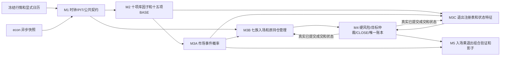

# 变更申请-007：M3C 退出策略库、组合身份与退出恢复契约

文档版本：`devplan-v2.1.7`。日期：2026-09-17。状态：**用户已批准退出库规划；本申请完成正式规格登记，实施、契约发布及独立硬审核待执行**。依据：[已批准规划](../../data/maintenance_artifacts/exit-strategy-plan/plan.md) §1—§7（`exit-strategy-plan-v0.1.0`）及[08-M3C-退出策略库](08-M3C-退出策略库.md)。用户批准及本次正式规格取代源规划“待正式跨节点契约裁决”的筹划状态，不改写源文件或宣称实施通过。

本次写入仅新增 `docs/devplan-v2/08-M3C-退出策略库.md` 与本文件。下列 00/01/04/05/06/07 的精确替换文字是对原文的正式补充裁决，供各文档维护者在后续工作单落实，**本次未修改这些原文件**。本文不发布 contract-lock，不改代码、测试、fixture、运行服务、客户端、凭据或任何模型配置，不代表工程、统计、影子或实盘通过。

001—006 未被本文明确替代的裁决继续生效，特别是 002 的完整几何/迟发证据、003 的逐合约估值及 Fill/pending 原子恢复、004 的 exact-key payoff 与每折独立 run/空仓新段激活、005 的日历及源哈希、006 的因子/策略 registry 分离。不可直接套用旧节点文本中已被这些变更替代的表述。

## 1. 原因、边界与兼容性

| 现有缺口/冲突 | 本次裁决 | 责任节点 |
| --- | --- | --- |
| 原七族已有固定保护、结构/概率/期限退出，缺独立可组合政策 | 新 M3C/ExitRegistry 与 StrategyRegistry 并行；新增八族，不扩充 StrategyFamily、不改变十四个入场 ID/参数 | M1 公共契约；M3C 实现 |
| 04 §1“不实现移动止损”、M3B-H04“不移止损”与新 trailing 冲突 | 原 RoundBudget.stop/target 原字节不动；另登记有效保护线，只能收紧，原目标/期限仍有效 | M3B/M3C/M4 |
| FeatureSnapshot 无账户条件；原 mark 无入场后峰值 | 独立 ExitFeatureSpec/Snapshot，30 个精确 EXITSTATE 键和3种晚期 EXITCTX 特征；不混入原市场训练列 | M1/M3C，continuation 由 M4 |
| 当前任何平仓后余仓可能被置 EXITING | P2 区分自愿 REDUCE 与整轮 EXIT；显式原动作/目标/绑定反馈，no_more_add 锁存 | M1/M3B/M3C/M4 |
| checkpoint、资格、收益样本、FIXED 只识别 entry | 独立 exit registry/binding/state/执行连接，FIXED 唯一绑定 entry+exit，新收益18项精确匹配 | M1/M4/M5 |
| 动态 stop 可能误用旧预算价撮合，多退出可能超平 | P1 完成观察触发、下一窗口普通 CLOSE；显式执行类型，累计目标及 pending 守恒 | M3C/M4 |
| 旧收益/PASS 和跨折 NAV 不证明新退出效果 | 重建 payoff、两层公平对照、六场景加新路径，独立折不拼 NAV，影子/成熟尾段保留 | M4/M5 |

不改变普通/马丁新增风险的 0.70/0.85、马丁止损触达 ≤0.10、原滞回退出 0.65/0.80，不另设所有退出共用的置信门槛。0.005 整轮损失比例、0.02 日损、0.10 账户回撤、冻结压力政策和经济样本/日期块标准不降低。P1 必需新增 M2 市场因子为 0；可选 EXITMKT 或新概率事件须在 P3 前另行冻结，不借本申请自动发布。

这是公共记录/嵌套结构的破坏性扩展。旧产物按原 schema 解释并保留；新消费者拒绝缺退出身份的旧资格/payoff/checkpoint，不补空字段或仅换 hash 升级。原十四入场规格仅在对应实现字节实际变化时重算 code_sha256，不为退出扩展全库改名，也不在代码变化后冒用旧 hash。

## 2. 冻结基线与发布前提

批准规划 SHA-256：`cbc4667f5befd60caef2a5e70ced7ae8f55c01cc47717ab86885ee27a9abcb96`。本次核对文档及非敏感契约元数据，不把规划里的代码观察当作本次重新运行的证据。

旧契约路径为 `data/research_runs/v2/contracts-2.1.2/contract-lock.json`，本次读取实际 SHA-256 为 `72ce4159810a1a8677f12baee2bdc1a335c837a2be216521735bc48bea9df94d`，document_version=devplan-v2.1.5、contract_version=v2.1.2。AGENTS 的旧指针 `ac211ec99f143e699f8cb2e828ada4850f117af39312a66fdd0b5ac8c1e93b66` 对应保留的 `contract-lock.r1-omission.json`；同目录 `contract-lock-correction-r1.json` 记录 required_tests-only 订正及前后来源。P0 必须重核实际字节、订正和审核链，本次读取不构成审核 PASS，也不修订上述文件。

新 lock 拟发布至 `data/research_runs/v2/contracts-2.1.3/contract-lock.json`。M1 独立审核前不预填其 SHA-256、不覆盖旧目录。审核报告绑定 00—08、001—007、批准规划及相关裁决原字节；尚未写回的 00—07 同时绑定本文替换块。新 M1 契约先审核再发布 lock，报告不反向引用尚不存在的新锁，lock.reviewer_report_sha256 引用报告，避免自引用。

## 3. 版本、schema 与哈希轴

下表均为后续实施的**目标值**。完整公共声明、生产者/消费者同步及独立审核后方可发布。结构/枚举未变的 schema 保留原值，不能机械替换全库版本。

| 版本轴/产物 | 当前有效基线 | 本次目标/原因 |
| --- | --- | --- |
| DOCUMENT_VERSION / lock.document_version | `devplan-v2.1.5` | `devplan-v2.1.6`→`devplan-v2.1.7`；修订00/01/04/05/06/07，新增08/007；v2.1.7 为 20260917-r1 仲裁落文增量（legacy 收敛与 P2 ADD/P4 续持条件版本） |
| M3C / 退出规格 / 特征命名空间 | 无 | `M3C-v1.0.0`；ExitSpec/EXITSTATE/EXITCTX的`1.0.0`独立于公共契约版本 |
| CONTRACT_VERSION | `ak_probability_strategy_contract_v2.1.2` | `ak_probability_strategy_contract_v2.1.3` |
| CHECKPOINT_SCHEMA_ID | `ak_probability_checkpoints_v2.1.2` | `ak_probability_checkpoints_v2.1.3` |
| SHADOW_CHECKPOINT_SCHEMA_ID | `ak_probability_shadow_checkpoints_v2.1.2` | `ak_probability_shadow_checkpoints_v2.1.3` |
| run_policy.json | `ak_probability_run_policy_v2.1.0` | `ak_probability_run_policy_v2.1.1`；fixed_exit_binding_sha256 |
| proposals.json / decisions.json | `ak_probability_proposals_v2.1.0` / `ak_probability_decisions_v2.1.0` | `ak_probability_proposals_v2.1.1` / `ak_probability_decisions_v2.1.1`；嵌套新PayoffEstimate |
| payoff_model.json / payoff_estimates.json | `ak_probability_payoff_model_v2.1.0` / `ak_probability_payoff_estimates_v2.1.0` | `ak_probability_payoff_model_v2.1.1` / `ak_probability_payoff_estimates_v2.1.1`；18项条件和退出身份 |
| experiment.json / m5_research.json | `ak_probability_experiment_v2.1.0` / `ak_probability_research_config_v2.1.0` | `ak_probability_experiment_v2.1.1` / `ak_probability_research_config_v2.1.1`；退出登记/组合及新RunPolicy |
| metrics.json | 004的`ak_probability_metrics_v2.1.3` | `ak_probability_metrics_v2.1.4`；保留replay_summaries，新增退出组/指标 |
| qualifications.json | `ak_probability_strategy_qualifications_v2.1.0` | `ak_probability_strategy_qualifications_v2.1.1` |
| qualification_review.json | `ak_probability_qualification_review_v2.1.0` | `ak_probability_qualification_review_v2.1.1` |
| 07协议 / review.json | `hard-review-v2.1.0` / `ak_probability_hard_review_v2.1.0` | `hard-review-v2.1.1` / `ak_probability_hard_review_v2.1.1`；node枚举增M3C |
| 新退出产物 | 无 | 08 §12列明的10个`ak_probability_exit_*_v1.0.0` schema，按所列精确文件名/结构注册 |
| registry_sha256 / registry_hash_for(specs) | 完整StrategySpec数组 | 含义/算法保持；实际字节变则重算，不混入exit/factor registry |
| exit_registry_sha256 / binding_sha256 | 无 | 完整ExitSpec排序数组 / 完整绑定去自身hash的规范SHA-256 |
| lock / shared fixture根schema | `ak_probability_contract_lock_v2.1.0` / `ak_probability_shared_fixture_v2.1.0` | 保持；fixture.contract_version更新，不擅加shared根键 |
| factor registry / seasonality | 006/005的`ak_probability_factor_registry_v2.1.1` / `ak_probability_seasonality_v2.1.1` | P1保持；原10+15市场公式/源定义不改 |
| 标签/几何/时钟/成本/风险/置信政策 | `path-label-v2.1.0`、`geometry-v2.1.1`及既有冻结值 | 保持，无新增退出成功概率总门槛 |
| shadow_events / 激活请求/记录 | 004的v2.1.3 | 保持原字段；退出经checkpoint/实体引用接入，契约升级不是模型激活 |
| Fill/OrderIntent/ExecutionResult/AccountSnapshot/RoundBudget/StrategyState | 原字段/schema | 保持；退出原动作经独立ExitExecutionLink，不藏在offset/reason |
| 其他manifest / commands.json | 原schema | 根字段未变则保持；文件/hash进入files/provenance，已有contract_version取新常量 |

M1将新类型/枚举/schema/public_signatures及ownership/required_tests/required_check_ids纳入原lock根结构。嵌套依赖也须版本化：`ak_probability_logical_replay_v2.1.0`与`ak_probability_macro_comparison_v2.1.0`分别升为同前缀v2.1.1，因为嵌套proposal/payoff或strategy_groups改变；影子proposals/decisions记录信封同样按原实际schema分别升v2.1.1。P0逐项列明真实schema ID/描述/hash后冻结，不能以“只改内层”为由继续使用旧schema。P2—P4出现本次未冻结字段/事件，先补Codex裁决和版本，不挪用旧空字典。

## 4. 00-开发总纲：精确替换文本

### 4.1 页首及§1首段

页首版本首段整体替换为：

> 文档版本：`devplan-v2.1.7`。修订日期：2026-09-16。需求基线为[已确认总规划](../probability-strategy-v2-plan.md)、用户批准的[退出策略库规划](../../data/maintenance_artifacts/exit-strategy-plan/plan.md)及001—007。本目录是实施与独立硬审核规格；M3C新契约/资格须按阶段实施审核，不代表已发布或获准实盘。

§1“在同一次首版交付中”首段整体替换为：

> 对螺纹、铜、黄金、豆粕、铁矿、原油的合格具体合约，形成分钟预测、日线背景、行情判断、M3B七族入场候选、M3C独立退出政策、联合准入、连续账本和无实盘订单的影子记录。品种键为SHFE.RB/SHFE.CU/SHFE.AU/DCE.M/DCE.I/INE.SC，raw_symbol保留原大小写。M3C八族按08的P0—P4门禁交付，不改变十四个入场规格，不把路线中全部退出组合列为已可用；品种目录不等于可交易清单。

### 4.2 §2架构及说明

§2 Mermaid及图后说明整体替换为以下图和段落：



> 账本回流仅含当时已提交的成交、账户、归属、估值和退出状态。M3C输出KEEP/REDUCE/EXIT候选，不执行或记账；成熟标签仅供后续合法训练或事后评分。EXITSTATE/EXITCTX不加入M2市场特征及原M3A训练，分钟循环不等待远端econ。

### 4.3 §3依赖/所有权及§7导航

§3首段替换为：

> M1新契约独立审核PASS并冻结后，M2/M3A/M3B/M3C在独占文件并行。M3C/M4/M5在P0可prepare，P1纯策略、接线、账本和报告并行，完整集成等待实际依赖冻结通过。P2单层数量/pending/费用/恢复闭环通过后才接REVERSION/GRID，最后MARTINGALE；P3可不同文件研究，P4等P1/P2稳定和状态条件收益支持。门禁/白名单见08 §9。审核文件对owner同样冻结，后续工作排队或显式重切范围/hash，不以并行跳过门禁。

§3图在M1→M3B后插入`M1 --> M3C[M3C 退出策略库]`和`M3C --> M4`两边；保留其他边。节点表M3B后插入M3C行，M4依赖单元按下行替换：

| 节点 | 独占代码范围 | 独占测试前缀 | 依赖产物 |
| --- | --- | --- | --- |
| M3C | `src/ak_trading/v2/exits/`，15个实现按阶段解锁，见08 §3 | `tests/test_v2_m3c_`，12个文件见08 §3 | M1退出/恢复契约；M2市场键、M3B原管理和M4真实反馈用于集成 |
| M4 | `src/ak_trading/v2/decision/` | `tests/test_v2_m4_` | M2/M3A/M3B及当前阶段M3C审核有效的冻结产物 |

§7导航表追加：

| 文档 | 后续执行者应获得的决定 |
| --- | --- |
| [08-M3C-退出策略库](08-M3C-退出策略库.md) | 八族白名单/公式、EXITSTATE/EXITCTX、组合/恢复/CLOSE、M5重建、P0—P4及M3C-H01—H16 |

### 4.4 §4版本/lock、§5保护及§6审核

§4第1项整体替换为：

> **版本显式**：命名空间ak_trading.v2；文档devplan-v2.1.7；公共契约目标ak_probability_strategy_contract_v2.1.3；数据包保持ak_probability_input_v2.1.0。M3C节点/退出规格v1.0.0，各因子、标签、几何、模型、入场/退出、成本、时钟及资格独立版本。实际结构变化见007 §3，不全库替换字符串，不授权任何agent模型配置变化。

§4自“M1 硬审核通过时发布”起至“变更必须提交本目录”之前的lock两段替换为：

> 原contracts-2.1.2已存在，其实际字节和测试清单订正链按007 §2核验，不沿用历史“尚未发布”描述。M1对退出契约独立审核通过后在全新data/research_runs/v2/contracts-2.1.3/contract-lock.json发布新锁，旧锁/报告不覆盖。lock根结构沿M1；public_signatures/schemas/ownership/required_tests/required_check_ids加入M3C及受影响消费者，document_version=devplan-v2.1.7。审核报告绑定00—08/001—007/批准规划原字节，再以reviewer_report_sha256进入lock。只有实际结构变化的schema升级。

§5七族介绍后追加：

> 退出库叠加于原保护：S0/T0、最晚退出点、结构/持续失效和账户风险继续有效。独立退出版本只可单向收紧有效保护线，预算stop/target不移动；不得借trailing取消固定目标或无限延长盈利持仓。新增退出不套0.70/0.85共用门槛，原0.65/0.80退出与马丁0.10新增风险条件仍按原事件使用。

§6首段整体替换为：

> Codex编写计划、规格、裁决和审核简报，不执行审核。开发者交冻结文件/hash、测试原文、lock/产物后，由未参与该节点开发的独立ZCode子代理重读规格、独立重跑及自行构造反例，逐H/D留证，仅PASS/FAIL。FAIL交原owner修复，新hash交新独立实例复审，旧审计包只读保留；审核中文件对owner亦冻结，详见07和08 §11。静态文档核对不构成实施PASS。

## 5. 01-M1：公共退出类型、恢复和资格的精确修订

页首文档版本目标为devplan-v2.1.7，节点修订目标为`M1-v2.1.3`。

### 5.1 §4新增类型（在LedgerCheckpoint定义前插入）

下列是新增ExitSpec/特征契约精确声明，import和JsonValue/DataQuality沿原§4。其余退出记录按随后字段表及08 §4在P0展开完整强类型声明，由Codex定稿、M1锁定后才可实施消费者。

```python
type ExitFamily = Literal["LEGACY", "PROFIT_LADDER", "TRAILING_STOP",
                          "VOLATILITY_STOP", "TIME_DECAY", "SIGNAL_REVERSAL",
                          "DRAWDOWN_EXIT", "OPPORTUNITY_COST", "PARTIAL_LIQUIDATION"]
type ExitAction = Literal["KEEP", "REDUCE", "EXIT"]
type ExitPhase = Literal["MANAGING", "REDUCING", "LIQUIDATING", "CLOSED"]

@dataclass(frozen=True)
class ExitSpec:
    exit_policy_id: str
    family: ExitFamily
    mode: Literal["MINUTE", "DAILY"]
    version: str
    parameter_version: str
    code_sha256: str
    parameters: Mapping[str, JsonValue]
    required_market_keys: tuple[str, ...]
    required_state_keys: tuple[str, ...]
    applicable_entry_families: tuple[StrategyFamily, ...]
    observation_duration_seconds: int
    execution_timing: Literal["NEXT_LEGAL_WINDOW", "LEGACY_PROTECTIVE"]
    validation_stage: Literal["RESEARCH", "VALIDATED", "SHADOW"]

@dataclass(frozen=True)
class ExitFeatureSpec:
    feature_key: str
    formula_version: str
    unit: str
    window_kind: Literal["CURRENT_STATE", "EPISODE_PREFIX",
                         "EPISODE_PREFIX_CALENDAR", "ACCOUNT_PREFIX", "LIQUIDATION_PREFIX"]
    minimum_source_facts: int
    source_scope: Literal["EPISODE", "ACCOUNT"]
    clock_unit: Literal["NONE", "TRADING_MINUTE", "TRADING_DAY"]
    required_source_keys: tuple[str, ...]

@dataclass(frozen=True)
class ExitFeatureValue:
    feature_key: str
    value: Decimal | int | None
    observed_at_nano: int | None
    available_at_nano: int | None
    quality: DataQuality
    source_hashes: Mapping[str, str]

@dataclass(frozen=True)
class ExitFeatureSnapshot:
    snapshot_id: str
    account_id: str
    contract_id: str
    strategy_id: str
    episode_id: str
    exit_binding_sha256: str
    duration_seconds: int
    observed_at_nano: int
    available_at_nano: int
    values: tuple[ExitFeatureValue, ...]
    source_state_sha256: str
```

紧随类型插入以下约束：

> StrategyFamily保持原七族；ExitFamily独立，LEGACY只作基线。ExitSpec.parameters恰等于08 §5.4完整白名单，未知键/错模式/未许可入场族拒绝。MINUTE=d60、DAILY=d86400，数量拒绝bool，Decimal有限。新增软规则首版只能NEXT_LEGAL_WINDOW；LEGACY_PROTECTIVE仅复用原事前保护，不成为新trailing同bar成交豁免。
>
> ExitFeatureSnapshot不改变FeatureSnapshot/FactorSpec和原M3A输入。08 §6.2的16种定义展开为30个EXITSTATE键，values按精确键排序无重复；缺值显式None+原因，不存在含花括号的运行键。金额/比例/整数、单位、前缀/最少事实和质量按08 §6.2/§6.5校验。ACCOUNT源只绑定当前account_id，快照其余身份记录消费episode，不把账户亏损分摊猜成episode损益。所有实际源available_at≤决策，不补epsilon或伪造固定lookback。
>
> CURRENT且时效有效才更新相关峰值/机会成本；STALE保留旧值/真实价龄而不刷新，UNVALUED保持未知。缺价格不抹掉可靠日历年龄，未知日历不伪造期限；无首个合格观察的峰值为None。缺口和源前缀留证，补齐不回写已提交决策。EXITCTX的经济INSUFFICIENT不写入M1 QualityStatus。

P0同步冻结的记录字段语义表，插入在上述约束之后：

| 公共记录 | 强制内容/约束 |
| --- | --- |
| ExitPolicyBinding | `binding_sha256:str,strategy_id:str,entry_spec_sha256:str,exit_spec_sha256s:tuple[str,...],sizing_spec_sha256:str\|None,priority:tuple[str,...],legacy_rules_version:str`；entry_spec_sha256 恰为 StrategySpec.code_sha256 的完整 64 位小写摘要（见下方 20260917-r1 仲裁补入段），不是完整 StrategySpec 序列化 hash；原保护总存在，hash排除自身，OPEN选择前固定、首次Fill激活 |
| ExitContext | 当前时钟/完整作用域/绑定/specs、可空合法市场快照及预测、原entry state/budget、真实账户/批次/marks、已提交episode成交流水、规则/日历、退出特征/previous state；P4显式continuation证据，不隐读外部状态 |
| ExitProposal | 原strategy/episode/contract归属、绑定、KEEP/REDUCE/EXIT、有符号目标、触发policy/input hash、观察/最早执行时点、保护版本/effective_from、候选下一状态/reasons；不是成交 |
| ExitState | 作用域/首次Fill/绑定、整轮RG/F累计；价格/净收益峰值及各自事件/时点/源hash；arm、有效保护线/版本/生效时点；各规则确认/最后观察ID；no_more_add/Qbase/实际已平量/各阶触发请求完成量/ExitPhase/最后事件及前缀hash；P0逐字段展开并校验nullable组合 |
| ExitExecutionLink | `link_id:str,exit_proposal_id:str\|None,strategy_proposal_id:str,decision_id:str,intent_id:str,exit_binding_sha256:str,action:ExitAction,target_lots:int,requested_lots:int,execution_kind:Literal["NEXT_WINDOW_CLOSE","LEGACY_PROTECTIVE"]`；硬风险无M3C候选可为None，原决策/意图仍可核验；请求量正、目标严格降风险不反手 |

这些语义不允许下游用dict私传。P0完整字段/函数/nullable/schema摘要由M1提交Codex定稿并经独立审核写入lock，是后续实现门禁，不代表本次已生成公共实现。P4 ContinuationPayoffEstimate及动作条件样本也须在P4开工前完成强类型/模型依赖字段裁决；经济定义已由08 §6.3冻结。

> （20260917-r1 仲裁落文）本版本 entry_spec_sha256 恰为 StrategySpec.code_sha256 的完整 64 位小写摘要，不是整个 StrategySpec 的序列化 hash。完整 entry 参数/版本由独立 strategy registry 和资格范围核验；binding 可回查所绑定的退出 spec、规模及优先序，不能单独替代完整 entry registry。相同 binding 不代表参数/registry/模型/资格相同。exit spec 的单项 hash 使用单元素完整 ExitSpec 数组，binding hash 使用 M1 唯一算法；priority 使用实际退出 policy ID 并保留次序。唯一绑定生产入口为 M3B select_exit_binding，M4 legacy 辅助入口只作无变换转发，legacy ExitSpec 唯一由 M3C registry 产生。

### 5.2 §4 LedgerCheckpoint整个类替换

```python
@dataclass(frozen=True)
class LedgerCheckpoint:
    sequence: int
    contract_lock_sha256: str
    registry_sha256: str
    exit_registry_sha256: str
    run_policy: RunPolicy
    rule_hashes: Mapping[str, str]
    model_hashes: Mapping[str, str]
    qualification_hashes: Mapping[str, str]
    account: AccountSnapshot
    valuation_marks: tuple[ValuationMark, ...]
    states: tuple[StrategyState, ...]
    exit_bindings: tuple[ExitPolicyBinding, ...]
    exit_states: tuple[ExitState, ...]
    exit_execution_links: tuple[ExitExecutionLink, ...]
    pending_intents: tuple[OrderIntent, ...]
    pending_remaining_lots: Mapping[str, int]
    processed_event_ids: tuple[str, ...]
    processed_fill_hashes: Mapping[str, str]
    capacity_used: Mapping[str, int]
    previous_hash: str
    checkpoint_hash: str
```

§4.1原“恢复必须显式携带以上三个新增字段”整条替换为：

> 保留003全部恢复事实，新增exit_registry_sha256/exit_bindings/exit_states/exit_execution_links严格必填并参与checkpoint_hash（只排除自身，保留previous_hash）。registry_sha256仍为完整StrategySpec数组，新退出registry独立，model_hashes保持004/006固定键集。未选候选不占资源，已选未成交OPEN保存绑定，首次Fill后才有有效ExitState/年龄。状态/绑定/执行连接按唯一ID和作用域排序校验，重复/缺失/错归属拒绝。
>
> 账户、marks、Fill全文hash、M3B state、退出状态/绑定/执行连接、原意图/有符号剩余量、容量/预留和事件游标同事务提交。恢复仅加载已提交checkpoint并核验祖先实体，不消费bar、不mark、不加sequence、不重复收费或推进阶梯；首次同账户时点快照与不停机一致。同Fill ID同内容幂等、异内容整事件拒绝。旧checkpoint无峰值/绑定不能补空升级；旧episode用旧依赖完成，新run在原协议空仓/无pending/无未释放资源边界建立。

§4.1 pending条最后“StrategyState字段与apply_execution签名保持原样……”句替换为：

> StrategyState字段保持；M3B.apply_execution新增必填关键字exit_execution:ExitExecutionLink|None，OPEN/ADD显式None，REDUCE/EXIT必须传已核验原动作/目标/绑定/意图连接。M4只反馈本事件新Fill，原state/ExitState/pending/账本原子保存，不从Fill.offset或reason推断动作。

### 5.3 §4 RunPolicy/资格/上下文/收益估计的定点字段增量

原其他字段和顺序保留，均无默认值：

```python
# RunPolicy：紧接fixed_strategy_id
    fixed_exit_binding_sha256: str | None
# StrategyQualification：紧接code_sha256
    exit_registry_sha256: str
    exit_binding_sha256: str
    exit_spec_sha256s: tuple[str, ...]
# StrategyContext：紧接spec
    exit_binding: ExitPolicyBinding
# PayoffEstimate：紧接opportunity_set_id
    exit_binding_sha256: str
    exit_state_condition: str
```

§4.1原RunPolicy/StrategyQualification两条替换为以下两段；原模型/合约/六场景/30日证据其他条款保留：

> RunPolicy是整条账户路径的冻结选择政策。FIXED须同时给fixed_strategy_id和fixed_exit_binding_sha256并匹配唯一预登记组合；其他routing_mode两字段均None。BEST_EV/抽样也只能选登记且资格匹配的组合，已有episode绑定不变。RESEARCH_EVALUATION仅豁免运行统计资格，不豁免数据/经济/风险；SHADOW_OPERATIONAL新增风险必须有完整匹配且有效的资格。
>
> StrategyQualification同时绑定entry strategy/version/params/code、exit_registry_sha256、完整exit_spec_sha256s/exit_binding_sha256，再匹配product/contract/mode/horizon/macro/cost和实际模型依赖。换退出绑定/代码/参数即新组合，不继承旧PASS。资格只支持无实盘影子新增风险；REDUCE/EXIT不依赖新开资格，资格过期、退出统计不足或负EV不能阻断硬风险。

### 5.4 §4.2签名、§7 schema/lock与H项

§4.2末尾插入：

> 新退出纯函数签名采用08 §4.2，M4/M5入口必填关键字增量见007 §7/§8；原位置参数顺序不改，不用可选默认值兼容未知绑定。verify_qualification_evidence原位置参数保留，新增必填关键字exit_registry_sha256:str、exit_binding:ExitPolicyBinding，以新metrics/experiment/review的完整范围和实际字节核验，不联网/隐读路径。P2反馈参数同007 §5.2。

§7从“变更申请-003新增公共字段，因此”起的版本段及其后006修订段替换为：

> CONTRACT_VERSION=ak_probability_strategy_contract_v2.1.3，DOCUMENT_VERSION=devplan-v2.1.7；目标schema见007 §3。checkpoints/shadow_checkpoints为v2.1.3，退出记录各自v1.0.0。未改结构的Factor/Feature/Forecast/PathLabel、成交/意图/账户/预算/StrategyState、输入及shared fixture/lock根schema保持。已有contract_version字段的新产物使用新常量，原无该字段者不擅加。严格拒绝额外/遗漏/重复JSON键、bool数量、非法null及身份/hash错配。
>
> lock.document_version=devplan-v2.1.7；public_signatures包含完整退出类型、08纯函数及所有增量关键字；schemas为真实描述hash；ownership/required_tests/required_check_ids加入M3C和原owner受影响组。旧contracts-2.1.2及其订正链只读，contracts-2.1.3独立审核后发布，不沿用“首个真实lock尚未发布”的历史状态。

原“首个真实lock尚未发布，目标目录按变更申请-003……”整段由上述末段替代；contract-lock字段示例只将document_version改为devplan-v2.1.7，不增根字段。资格验证说明追加：

> 必需经济组含exit_binding_sha256；review绑定exit_registry_sha256及完整bindings。逐字段核验资格、当前上下文、checkpoint与原报告/experiment范围，保持原模型hash/六场景/有效期/所需组全集检查。旧资格只能按旧契约解析，不供新组合准入。

M1 §10原H09后追加，不删旧ID：

- [ ] **M1-H10** 新退出类型/30个状态键/白名单、双registry/绑定/执行连接、schema/签名/解码一致；旧产物不补空升级、恢复不偷换依赖，新lock经独立审核后发布。

## 6. 04-M3B：组合边界和状态接线的精确替换文本

页首文档版本目标devplan-v2.1.7，节点修订目标`M3B-v2.1.1`；原十四StrategySpec.version=2.1.0、ID和参数保持，实际代码变化必须重算code_sha256/registry并重审。

§1第二段（“不改旧”开头）整体替换为：

> 不改旧futures/strategies.py或probability/episodes.py，不把carry算进七族，不调用数据库/econ/TqSdk/账户，不根据未成交意图更新仓位，不看测试未来路径EV选策略，不实现无限网格/翻倍、跨episode追损或实盘启用。M3B不实现独立移动止损政策，原entry冻结RoundBudget.stop/target永不移动；[M3C退出库](08-M3C-退出策略库.md)可用独立版本另维护只能收紧的有效保护线，保留原目标/期限及硬风险。退出库补充原保护，不替代止损，不改变原六个交易族加WAIT的入场/加仓条件。

§4.1公共参数段后插入：

> stop_loss_multiple="1"、take_profit_multiple="2"继续作为方向族冻结预算几何输入和legacy对照；区间族仍为冻结stop和中心M，不解释成统一任意2ATR。StrategySpec.parameters保持原common+family精确键集，不加入exit_policy_id/trailing_atr/ladder。独立ExitPolicyBinding在OPEN选择前固定、首次Fill激活、整个episode不变，不同退出重新验证经济资格。exit_confirmation_bars=1保留原语义，新家族confirmation_bars只属于其ExitSpec，不能延迟既有UNKNOWN/假突破/概率失效/硬风险退出。

§4.2原滞回段末尾从“软退出仅1次……”开始的两句替换为：

> 原软退出1次合格观察确认，止损/停盘风险/计划平仓不等待。原持续退出普通<0.65、马丁<0.80保持；新增风险0.70/0.85及马丁stop_touch≤0.10不成为平仓门槛。M3C量价分支两次确认只约束该新增软规则，不延迟原退出，不借HOLD续期。

§4 apply_execution声明替换为：

```python
def apply_execution(previous: StrategyState, result: ExecutionResult,
                     account: AccountSnapshot, now_nano: int, *,
                     exit_execution: ExitExecutionLink | None) -> StrategyState: ...
```

§7“WAIT_TRIGGER中可有待成交意图”段前插入：

> P1新增退出只全平，沿原EXITING清退。P2据已核验ExitExecutionLink区分主动REDUCE/整轮EXIT：REDUCE未达目标时ExitState.REDUCING，达目标仍有仓后entry保持/回HOLDING、exit回MANAGING；第一次新增自愿REDUCE/EXIT被选中后no_more_add永久为true。全量EXIT为entry.EXITING/exit.LIQUIDATING，部分成交仍清退；硬条件升级LIQUIDATING不可撤回。实际归零、pending终结及资源释放后才CLOSED。取消/拒单/重启不算已平，减仓不减少历史layer_filled_lots/filled_layers，不重置R0/S0/T0/冷却/风险锁。
>
> M4只传本事件新Fill及真实remaining/status；OPEN/ADD显式exit_execution=None，退出传已核验原动作/目标/绑定/意图。未知/冲突连接整事件拒绝，不从Fill.offset/reason猜动作。原state与ExitState、资金/pending由M4原子保存，M3B不建旁路账本。legacy由原owner提取/适配，只保留一份权威检查器，绑定legacy证明逐事件等价。

M3B-H04整行作以下解释性替换，不换其原要求含义；原H09后另追加H10：

- [ ] **M3B-H04** 预算、层价、原预算止损/目标和最晚期限入场前冻结，每层再准入，不以浮亏加仓，RoundBudget.stop/target原字节不移动。独立M3C版本只可在原风险包络内单向收紧有效保护，不取消原目标或延长期限；旧十四规格证据不追溯修改。
- [ ] **M3B-H10** legacy等价与退出绑定接线通过，P2显式区分REDUCE/EXIT，no_more_add及历史层/预算跨取消、部分成交、重启不回退，未许可族不启用新组合。

## 7. 05-M4：CLOSE、信号消费、收益和恢复的精确替换文本

页首文档版本目标devplan-v2.1.7，节点修订目标`M4-v2.1.3`。§2依赖条件追加M3C当前阶段冻结/审核产物，完整接线验收不得提前至公共契约和退出语义冻结前。

### 7.1 §4公共入口和收益字段

PayoffObservation紧接condition_key插入：

```python
    exit_binding_sha256: str
    exit_state_condition: str
```

原位置参数顺序保持，以下入口增加**无默认值的必填关键字**，已有星号时追加在该关键字段内：

| 入口 | 新增关键字 | 约束 |
| --- | --- | --- |
| ContinuousLedger.__init__ / restore | `exit_registry_sha256:str` | restore与checkpoint精确一致，保留原strategy registry核验 |
| ContinuousLedger.checkpoint | `exit_registry_sha256:str,exit_bindings:tuple[ExitPolicyBinding,...],exit_states:tuple[ExitState,...],exit_execution_links:tuple[ExitExecutionLink,...]` | 与pending_remaining_lots共同严格必填，同事务 |
| build_strategy_context | `exit_binding:ExitPolicyBinding` | 与对应entry精确匹配，供收益/资格核验 |
| run_decision_replay | `exit_specs:tuple[ExitSpec,...],exit_bindings:tuple[ExitPolicyBinding,...]` | 显式依赖，不隐读全局缓存，不以默认legacy代替缺值 |
| enforce_account_risk / sync_reservations | `exit_states:tuple[ExitState,...]` | 保留004既有valuations等增量，消费no_more_add和真实pending/终态 |

§4原registry_sha256解释句后插入：

> exit_registry_sha256独立哈希完整ExitSpec排序数组，不填入model_hashes。StrategyContext.exit_binding与PayoffEstimate的退出绑定/条件逐次匹配，只有本组合自己的收益/资格可支持OPEN/ADD。M4构造ExitContext、调用08纯退出函数，留全候选及输入hash，按原归属接唯一目标；每个退出OrderIntent经ExitExecutionLink连接ExitProposal（原硬风险可None）、StrategyProposal、DecisionRecord和原目标。link在执行前提交，终态实体沿已提交祖先链可核验。

> （v2-arbitration-prep-gaps-20260917-r1 RULING L1-G-1 落文指令）legacy 绑定接线唯一正文已按“新增”落入 05 §4：锚点为以“RunPolicy是mode/seed/fixed ID/宏观分支/成本场景的唯一来源”起首、以“纯重启禁止偷换依赖。”结束的整段之后、“StrategyContext.model_hashes由pipeline……”段之前；正文为该决定 G-1 SPEC DELTAS 文字（`strategies.registry.select_exit_binding(spec, profile="legacy")` 唯一生产入口、M4 两 helper 仅转发、legacy_rules_version 唯一生产值 `legacy-rules-v2.1.0`、G0-E 前置）。后续 007 回填 05 时识别该唯一段落，已经存在则核对/更新，不重复插入，也不伪称替换了原有 legacy 段。
>
> （RULING L1-G-3 回填位置标注）model_hashes 纪律段已按“新增”落入 05 §4：锚点为以“返回防御性不可变映射，键恰为 forecast/payoff/regime_reference”起首的整段之后、“ReplayResult和模型句柄只由本节点编码”段之前；后续整体写回时核对该段，不重复插入，不改变 004/006 的原投影或键集。

### 7.2 §5.1 condition_key和收益重建

原condition_key段及“条件支持不足时只允许……较粗波动桶回退”整段，分别替换为以下两段：

> 新condition_key为18项固定顺序规范JSON数组：`[product,strategy_id,parameter_version,mode,horizon_unit,horizon_value,session_kind,base_regime,phase,side,layer_filled_lots,barrier_key,geometry_key,remaining_horizon,cost_rule_id,budget_cny,exit_binding_sha256,exit_state_condition]`。前16项沿004；新增hash精确匹配，exit_state_condition为训练前登记的退出状态条件版本/表示，完整ExitState hash只作来源，不能用每行唯一hash当统计桶。P1新增单层退出只登记OPEN_INITIAL；P2 ADD为`ADD_PRE_V1`、P4续持为`CONTINUING_V1`（20260917-r1仲裁定稿），第18项为“版本前缀|S的规范JSON文本”的字符串——S为严格状态投影对象，表示及来源规则按08 §8.4.1“固定V1状态表示与身份校验”执行（全文唯一落点，v2-arbitration-prep-gaps-20260917-r1 RULING L1-G-5 交叉引用）；新协议的PayoffObservation/PathPayoffModel只消费OPEN_INITIAL或ADD_PRE_V1，CONTINUING_V1由独立continuation类型消费，不能因共享编码器而交叉接纳经济目标。
>
> 沿004只允许完整exact-key，旧16项保持旧模型解释，新模型不回退到旧退出/其他状态、成本、预算或品种。无支持、样本/日期块不足、任一正概率path类无样本均INSUFFICIENT，OPEN/ADD权重0，不删类别重归一。REDUCE/EXIT原风险通道不以此为前提。

§5.1末尾追加：

> 改退出必须按entry×exit binding×执行规则重新逐bar回放并拟合payoff，不继承旧收益/PASS。原ATR_1 PathLabel锚/窗口/类别保持，提前平完仍等待标签成熟。经济episode为首次实际OPEN至归零、pending终结/资源释放，分批腿只算一轮；available_at覆盖原标签成熟、最终Fill/回执和规则最晚可见时点。未成熟/缺价/缺规则/期末未平不能补0。P0由M4/M5核验批准规划记录的observation_from_replay生产链缺口，交完整接通证据后才声明可用。

### 7.3 §5.2/§5.3风险优先和退出路由

§5.2首段替换为以下两段，后文API顺序和所有OPEN/ADD门槛保留：

> 先运行独立硬风险时钟：killed、日损/回撤、生命周期/期限、原S0/T0、估值失效和已锁存EXITING；不以本barforecast、M2成功、退出统计或软确认作为前提。再保留M3B结构/持续失效管理，评估episode匹配的M3C候选并合并原因。软分支异常留具体原因、降级原保护，不关闭风险时钟。
>
> EXIT目标恒0优先REDUCE；多个REDUCE取合法剩余绝对手数最小目标，不把比例相加/相乘，KEEP不能撤销清退。映射原strategy_id/episode_id的StrategyProposal，target_lots=s×目标余量，执行evaluate_gate→enforce_account_risk→choose_proposal→commit_selected_proposal→sync_reservations。管理gate核验归属/时点/绑定/触发、严格降风险和不反手，不搬用OPEN正EV/0.70/0.85；缺费用/规则/容量仍BLOCKED/EXIT_PENDING，不假成交。

§5.3 FIXED整条替换为：

> FIXED只考察fixed_strategy_id+fixed_exit_binding_sha256唯一预登记组合，仍过数据/概率/成本/风控门槛，不合格现金。已有episode继续原绑定管理，FIXED/CASH不免除退出，不在多个退出版本中随机补选。

### 7.4 §6和§7成交/恢复插入块

§6末尾插入：

> 首次新增自愿REDUCE/EXIT被选中锁存no_more_add。自愿分批停止OPEN/ADD、等取消终态、纳入期间迟到Fill后冻结Qbase；硬退出继续处理当前可平仓，迟到新增Fill归原episode继续清退。sync_reservations/enforce_account_risk消费退出状态，只有确定不再使用且取消已确认的资源才释放；HOLDING余仓不因层未满重新预留ADD。原R0/S0/T0、全部计划层压力及2%压力上限不以“通常早退”缩小。

§7.1末尾插入以下精确执行裁决：

> 新M3C完成close触发在下一合法窗口普通平仓。ExitExecutionLink.execution_kind=NEXT_WINDOW_CLOSE时，OrderIntent.purpose固定REDUCE（表示普通降仓执行用途，原action/target决定部分或全平）；不得按reason含STOP/TARGET改成保护撮合。LEGACY_PROTECTIVE仅用于原事前S0/T0，相应purpose仍为STOP或TARGET，保留保守OHLC歧义协议。原期限/生命周期退出保留原TIME_EXIT/ROLL_EXIT用途。未来盘中动态保护另冻结价格/来源/版本/effective_from事前记录，仅执行bar之前有效线可读，不覆盖RoundBudget。
>
> 本次正式冻结CLOSE路由顺序：intents_for_proposal按真实lots先CLOSE昨仓、再CLOSE_TODAY今仓，以opened_trading_day/FIFO和当时规则计费。跨日旧CLOSE_TODAY经终态回执后重新拆分，不改原offset。累计补发max(0,Dj−实际已平量−活跃平仓剩余承诺)，升级全平/取消替换守恒，不产生两组超平订单。停板/零容量/缺可成交价或费用保留真实余仓/pending。

§7.4末尾插入：

> 恢复同时核验退出registry/bindings/states/execution_links和003全部事实，峰值/保护/确认/Qbase/no_more_add/进度及已消费依赖必须完整。旧检查点不补空升级，普通重启不换组合；004模型激活不改变lock或任一registry。新契约从合法空仓资源边界新run开始，旧段字节不改。

§7.5原子提交段末尾插入：

> 同一事务包含退出观察/选中/反馈及执行连接，只有Fill推进实际完成量，未选候选不释放预算，取消/拒绝不伪造止盈。P2 REDUCE达目标回HOLDING/MANAGING且永久no_more_add，EXIT部分成交保持EXITING/LIQUIDATING，硬风险升级不可撤回。引用实体fsync→原子checkpoint→最终shadow_events提交的003顺序及各断写点恢复保持。

§8受影响schema行按007 §3替换，追加08 §12中M4退出实体/审计文件。原“除checkpoints.json嵌套结构外，本表其他schema/CSV列不变”整段替换为：

> checkpoint/payoff/proposals/decisions和退出实体按007 §3/08 §12发布新schema，contract_version=v2.1.3、document_version=devplan-v2.1.7。Fill/OrderIntent/ExecutionResult/账户字段保持，原CSV只作投影，不可替代新增身份JSON或用于恢复；完整外键和源JSON随manifest发布。旧产物只读，旧PASS不靠换hash迁移。

M4 §11原H10后追加：

- [ ] **M4-H11** 独立风险时钟、M3B原退出/M3C候选合并、原归属目标及CLOSE/CLOSE_TODAY正确，显式执行类型不回看同bar，硬退出不依赖新开资格。
- [ ] **M4-H12** 主动分批/Qbase/no_more_add、取消替换/迟到Fill守恒，新退出与账本/Fill索引原子恢复，新binding18项payoff重建，机会成本不冒用首次OPEN EV。

## 8. 06-M5：退出组合实验、收益与压力的精确替换文本

页首文档版本目标devplan-v2.1.7，节点修订目标`M5-v2.1.3`。§2增补M3C当前阶段产物、退出绑定及M4新收益/恢复为完整集成依赖，保留prepare、真实统计和影子门禁。

### 8.1 §4/§8实验输入、分组和资格字段

ExperimentSpec紧接contract_lock_sha256、m5_research.json根同名字段处分别新增：

```python
    exit_registry_sha256: str
    exit_bindings: tuple[ExitPolicyBinding, ...]  # JSON为完整对象数组
```

条件协议目标（v2-arbitration-prep-gaps-20260917-r1 RULING L1-G-4，谱系按 C1-G-06；属 contracts-2.1.4 条件链，未经 M1 冻结发布，不得宣称已被 contracts-2.1.3 实现）：ExperimentSpec 与 m5_research.json 根在 exit_bindings 后、source_sha256 前再增加无默认值的 `exit_state_condition_versions: tuple[str, ...]`（JSON 为字符串数组），目标 schema 分别为 `ak_probability_experiment_v2.1.2`（19 字段）与 `ak_probability_research_config_v2.1.2`（25 根键）；三版本谱系（v2.1.0 基线 16/22 → v2.1.1 退出集成 18/24 → v2.1.2 条件协议 19/25）与严格键集按 C1-G-06 逐字段比对，版本数组严格必填、非空、无重复、字典序，白名单恰为 `ADD_PRE_V1`/`CONTINUING_V1`/`OPEN_INITIAL`，全部登记唯一顺序为 `["ADD_PRE_V1","CONTINUING_V1","OPEN_INITIAL"]`。

run_shadow保留004全部位置参数和activation_request必填关键字，新增必填关键字`exit_specs:tuple[ExitSpec,...],exit_bindings:tuple[ExitPolicyBinding,...]`。build_strategy_qualifications保留原位置参数并新增同样两个关键字，按entry+binding逐范围发行；M1验证器调用显式传exit_registry_sha256/exit_binding。报告/CLI不得默认补legacy掩盖缺字段。

§6.1 required_group_keys中经济键替换为：

> 经济键固定为`["STRATEGY",split_id,run_policy_sha256,strategy_id,product,contract_id,mode,horizon_unit,horizon_value,macro_mode,cost_scenario,exit_binding_sha256]`；预测键不变。binding可回查entry代码摘要（entry_spec_sha256恰为StrategySpec.code_sha256的完整64位小写摘要，非完整StrategySpec序列化hash）及所绑定的退出spec、规模与优先序，不能单独替代完整entry registry，相同binding不代表参数/registry/模型/资格相同；保留全部预登记组合及product/contract/mode/horizon/session/regime/macro/cost切片。N=0为INSUFFICIENT，不因退出失败删组，原最坏状态传播不变。

> 组键保持 12 项；组内登记版本、每个精确条件和无样本版本按 C1-G-10 的 exit_condition_support 报告，不由组总样本数为某条件发资格。（RULING L1-G-4 条件链目标。）

§6.1“资格的经济基础固定为该strategy_id自身FIXED反事实账户”整段替换为：

> 资格来自同strategy_id+exit_binding_sha256自身FIXED反事实账户，两个fixed字段须精确一致；完整六场景满足该范围门槛。绑定exit_registry_sha256、全部exit_spec_sha256s和binding，再绑定原model/product/contract/mode/horizon/macro/cost范围；不继承旧退出PASS，不从BEST_EV/抽样/其他binding账户择优拼资格。其他组合政策独立报告并继续M4准入/风控。

§8完整字段说明按下表定点新增，原字段不删：

| 记录 | 新增字段/替换值 |
| --- | --- |
| metrics.json根 | `exit_registry_sha256:str,exit_bindings:dict[str,object],exit_groups:list[object]`；bindings按hash映射完整ExitPolicyBinding；保留004的replay_summaries |
| strategy_groups每项 | `exit_binding_sha256:str,exit_spec_sha256s:list[str],fixed_exit_binding_sha256:str\|null`；group_key用新经济键 |
| qualification_review.json根 | `exit_registry_sha256:str,exit_binding_sha256s:list[str]`；完整原件由source_hashes绑定 |
| experiment/research_config/run_policy/qualifications/metrics/qualification_review | schema精确目标见007 §3，嵌套新组的macro_comparison也升v2.1.1 |

exit_groups按08 §8.3指标，在P0逐字段锁定类型、单位、分母、nullable和group_key连接；未闭合、费用/估值未知、无正峰值或分母不足的比例为None。该schema细化是发布前门禁，不允许先用未注册dict宣称完整统计。

experiment/research_config 的版本目标分栏说明（RULING L1-G-4 条件链目标）：v2.1.1 为退出集成目标（+exit_registry_sha256/exit_bindings），v2.1.2 为条件协议目标（+exit_state_condition_versions）；新条件报告的 schema 目标按 C1-G-10（`ak_probability_metrics_v2.1.5` 承载 exit_condition_support 版本+条件两层结构、嵌套 strategy_groups 的 `ak_probability_macro_comparison_v2.1.2`）。不能将 v2.1.2 目标误报为 E1/E2 当前产物，也不得宣称已被 contracts-2.1.3 实现。

### 8.2 §5.2/§5.3和payoff重建

§5.2参数预登记段后插入：

> 退出参数/组合/状态条件只在训练/开发内层登记。先固定相同入场候选流、起始账户/手数、S0/T0、预算/模型/成本，只变exit binding作配对；再分别完整重放各政策自己的连续账户，使资金释放、no_more_add、冷却和后续机会真实体现，不借基线未来账户。至少legacy/trailing/time全平对照，随后ladder/drawdown/volatility及小组合；失败/零交易/所有尝试均登记，不自动遍历全参数笛卡尔积。
>
> 按新binding逐步重放PayoffObservation；原ATR_1标签锚/窗口/类别/成熟保持，分批腿一轮，原标签成熟、最终Fill/回执及规则可见全部满足才入样本。期末未平、缺价/费用、未成熟不补0。影响区间仍为[start,max(label_end,holding_end,available_at)]，预登记最长风险影响及分钟至少60交易分钟、日线至少20交易日purge/embargo不因早退缩短，实际锁板/断流延迟需延长影响并排除。

> OPEN_INITIAL 与 ADD_PRE_V1 的整轮经济量、CONTINUING_V1 的剩余权益配对量严格分离；条件值及来源按 08 §8.4.1、本决定 C1-G-02—G-13 核验。P4 完整类型/恢复/嵌套训练仍等待 C3-P4。（RULING L1-G-4 条件链目标，不得宣称已被 contracts-2.1.3 实现。）
>
> P4仅以更早内层前缀已成熟状态样本、嵌套时间外拟合/冻结滞后模型决定当时退出，不能先拟合整段payoff再决定同段动作。Va统一为当前合法账户/资本/共同H的未来权益增量，配对动作差按交易日期块bootstrap1000次seed=7的5%分位/R0严格>0才产生改善候选。无合法next-best为None，不跨品种或用于GRID/MARTINGALE换仓。

§5.3从标题到§5.4前整节替换为以下内容：

> ### 5.3 独立研究折与同run连续账户
>
> 沿004 §5，每折/每政策/每成本场景独立run、独立账户，initial_checkpoint只能同hash续接本折；跨折分别/汇总统计，不拼连续NAV或混模型样本作新资格。同run跨日/恢复保留资金、权益峰值、熔断/日初基数、episode/层/预算/归属、退出绑定/峰值/保护/确认/Qbase/no_more_add、pending/容量和Fill索引，不每天/每笔重置。
>
> 真实影子按004显式新段、空仓/无pending/无未释放预算、完整原件及新资格激活模型；lock/strategy registry/exit registry/绑定政策不得随激活改变。新退出契约在符合旧协议的清洁边界新建登记run；旧仓继续原依赖风险处理，不篡改checkpoint。连续动态账户仍单独验收，独立折/离线回放不自动满足；真实20日cohort与日线成熟保留。

§5.4末尾追加：

> 改退出版本不重置永久留出消费，已见区间重评只为DEVELOPMENT_REANALYSIS，不作为新最终留出/资格。原60个可成熟决策交易日及至少20日成熟尾段不因早退缩短；日线20日未成熟仍等待，预登记最长结算风险、真实未退出和尾段限制如实报告。

### 8.3 §6压力、指标和门槛增补

原指标表/经济门槛后插入：

> 保持BASE/FEE_X2/SLIPPAGE_X2/MARGIN_X1_5/GAP/NO_STOP六场景；新退出路径是诊断/测试案例，不增加RunPolicy枚举。原冻结层simulate_stress_paths不足以证明动态退出覆盖，必须从真实ExitState逐步回放，同时报告原全部计划层压力，不以“通常早退”缩小资源。
>
> 必需路径：单边继续趋势/锯齿，ATR突增/突降，开盘穿越固定/动态stop，同bar多阶梯/目标/止损，至少原三交易日连续停板/零容量/缺规则/断流，跨日CLOSE/CLOSE_TODAY，马丁第二层部分成交后退出/迟到ADD Fill，保护/阶梯/部分成交附近各断写点，两合约仅一缺价/首次UNVALUED，替代机会失效或旧仓未成交。无细路径保守/歧义留证，无成交保留EXIT_PENDING真实余仓。
>
> 新报退出原因分布、交易步数持有期、请求至完成延迟、EXIT_PENDING时长/残仓、每轮平仓腿数/换手/费用、峰值净利润回吐、实际MFE/MAE、净利润保留率、取消ADD数及预算释放时点。MFE/MAE/错失收益只在评分看完整路径，在线峰值只读当时前缀。未闭合/零峰值/分母不足的比例为None，期末已实现和可靠盯市另列，不充抵成熟轮数。
>
> 普通经济≥100成熟独立episode/30日期块、马丁≥200/60；持续概率原普通200/30、马丁500/60另满足。分批腿/多版本共用行情不增独立样本/日期块。保守净EV>0、CVaR95≤整轮预算、压力损失≤冻结权益2%且无保证金缺口；GAP/NO_STOP仍按压力判据，不要求盈利。工程、统计PASS/FAIL/INSUFFICIENT、真实影子状态分别报告。

§11原H10后追加：

- [ ] **M5-H11** 按entry×exit/binding重建18项exact-key收益、完整必需经济组及组合资格；ATR_1成熟、分批一轮、未知不补0、两层公平对照和退出指标完整。
- [ ] **M5-H12** 六场景中的动态保护/分批/跨日/断写/晚到成交覆盖；改退出不绕purge/embargo/永久留出，机会成本无自引用，独立折不拼NAV，真实影子/动态账户不被离线结果替代。

## 9. 07-硬审核协议：M3C和独立性的精确替换文本

### 9.1 页首、§1独立性及§2输入

页首替换为：

> 协议版本hard-review-v2.1.1，文档版本devplan-v2.1.7，覆盖M1/M2/M3A/M3B/M3C/M4/M5后续实施和分阶段验收。文档静态核对不运行实施测试、不出具节点PASS；M3C按08 P0—P4冻结审核范围，延期项不得冒称完成。

§1“全部外部Codex调用……”整段替换为：

> Codex编写计划、规格、裁决和审核简报，不执行硬审核/预审核/复审。审核由未参与被审节点开发的独立ZCode子代理执行，按当前AGENTS及用户授权分配记录真实工具/实例/模型回执，不伪称工具设置能力、不改任何已有agent配置。外部CLI仅经watchdog wrapper、唯一task_id及专用日志，ZCode-native按项目规则处理；开发者口头通过不是证据。

§2第1项替换为：

> 00总纲、被审节点完整文档、01公共契约、07协议、08退出库、001—007适用变更、已批准退出规划及相关Codex裁决，全部固定原字节hash。未写回原节点与007替换块共同作为规格，不由审核者发明或放松标准。

§2第6项后插入：

> M3C另交当前阶段/明确延期阶段、两注册表、完整binding/参数/code、退出特征源前缀、状态/执行外键、收益重建/分组/压力/恢复产物。审核开始后文件对owner同样只读，后续触及同文件必须排队或显式重切范围/hash。M3C-H11—H16的M4/M5证据是集成依赖，不能授权M3C代改其他owner文件。

### 9.2 §3 R1领域和H清单

领域映射整段替换为：

> D01—D11原含义不改。M1=D01,D02,D07；M2=D02；M3A=D01,D02,D03,D04；M3B=D01,D02,D05,D06；M3C=D01,D02,D04,D05,D06,D08,D09,D10；M4=D01,D02,D04,D05,D06,D07,D08,D09；M5=D01—D11。按本节点职责检查本地及依赖，M5核验完整集成。新增M3C-H01—H16见08 §11；M1加H10、M3B加H10、M4加H11/H12、M5加H11/H12，旧ID不删不重排。lock.required_check_ids登记各阶段全部适用H/D及跨节点义务。

紧接插入固定条款索引，完整验收文本仍以08 §11为准，不用摘要删减条件：

| requirement_id | 固定核验范围 |
| --- | --- |
| M3C-H01 | 白名单、双registry/binding/lock/资格/payoff/checkpoint全链身份 |
| M3C-H02 | legacy逐事件动作/Fill/预算/账本/恢复等价 |
| M3C-H03 | 硬退出不被概率/模型/统计/软确认/EV阻断 |
| M3C-H04 | 原预算字节不动、有效stop只收紧、期限不延后/不反手 |
| M3C-H05 | 完成观察/合法未来执行、交易时钟/日线隔离/未来追加 |
| M3C-H06 | ATR/账户/episode/浮盈/净清算口径和精确键手算 |
| M3C-H07 | 累计目标、尾仓/pending/取消替换/迟到Fill守恒 |
| M3C-H08 | 多层许可、no_more_add/历史层不回退、不跨轮追损 |
| M3C-H09 | CURRENT/STALE/UNVALUED、价龄/峰值、原子恢复/Fill冲突 |
| M3C-H10 | 今昨仓/FIFO/费用/余量，滑点不双扣、无容量不假成交 |
| M3C-H11 | 新退出完整payoff重建、ATR_1成熟/分批一轮/未知不补0 |
| M3C-H12 | 训练隔离、continuation无自引用、purge/留出不绕过 |
| M3C-H13 | 两层公平对照、独立折不拼NAV、完整组/N=0、动态账户另验 |
| M3C-H14 | 六场景/动态路径/三日无法止损/断流跨日及证据等级 |
| M3C-H15 | 原阈值不误用、新概率单独校准、经济门槛不降低 |
| M3C-H16 | 审计外键/祖先链/复现、工程统计影子分开、零实盘 |

各阶段开始前冻结适用分支和测试全集，不事后删失败项。P1阶段PASS不意味着P2—P4完成；完整路线验收要求所有承诺阶段闭合，未实施机会成本不能判其PASS。

### 9.3 §3 R3命令、R4反例和R5闭环

R3在M3B后、M4前插入，原所有节点命令保留：

```powershell
# M3C P1
python scripts/test_offline.py -q tests/test_v2_m3c_registry.py tests/test_v2_m3c_features.py tests/test_v2_m3c_state.py tests/test_v2_m3c_trailing.py tests/test_v2_m3c_time_decay.py tests/test_v2_m3c_causality.py
# P2/P3/P4按冻结阶段加入；完整路线审核包含全部十二文件
python scripts/test_offline.py -q tests/test_v2_m3c_ladder.py tests/test_v2_m3c_sizing.py tests/test_v2_m3c_volatility_stop.py tests/test_v2_m3c_drawdown.py
python scripts/test_offline.py -q tests/test_v2_m3c_signal.py
python scripts/test_offline.py -q tests/test_v2_m3c_opportunity.py
```

R4手算段后插入：

> M3C独立复算08 §10净清算、镜像保护/tick、累计量及交易时钟；自行构造同bar未来执行、pending/迟到Fill守恒和恢复断写反例。P2—P4追加多层/配对LCB/训练自引用探针，开发者自测不能代替。每个finding给文件/符号/H-D ID、最小复现、实际/期望、输入及原始命令证据。

R5“FAIL写明……”整段替换为：

> FAIL包含最小复现、文件/符号/字段、H/D、实际/期望与证据hash；原owner修复后冻结新hash，交新独立实例重跑，禁止条件PASS。公共契约问题由Codex裁决、M1实施、消费者升级，不口头豁免。verdict后审计包对owner/reviewer只读，旧修订不覆盖。审核中写入冻结文件使原范围失效，必须重切并重新取证。

### 9.4 §5审核schema

review.json样例schema_version精确替换为`ak_probability_hard_review_v2.1.1`、document_version为`devplan-v2.1.7`，其余根字段保留。node枚举说明替换为：

> node只能M1/M2/M3A/M3B/M3C/M4/M5，checks字段和PASS/FAIL两值不变。M3C阶段由reviewed_revision对应不可变范围、review.md、冻结文件/检查清单明确，不用隐含条件通过。新M1契约首次审核按防自引用规则处理未发布lock，其余节点绑定实际hash。commands.json保持ak_probability_review_commands_v2.1.0及原全部字段。

## 10. 所有权、实施顺序及交付

| owner | 后续文件范围 | 核心交付 |
| --- | --- | --- |
| Codex | 计划/契约裁决/变更/审核简报，本次仅08/007 | 正式规格；P0/P2/P4不足接口定稿，不执行审核 |
| M1 | `src/ak_trading/v2/{contracts,schemas,__init__,artifacts}.py`，必要`policy.py`、原M1测试/公共fixture | 完整类型/签名/schema/解码，新lock与独立审核 |
| M3C | 08 §3的15实现/12测试，分阶段解锁 | 纯规则/状态/逻辑回放，不代改账本 |
| M3B | `strategies/{registry,state}.py`及工作单列明的原家族接线，原矩阵/状态/多层测试 | legacy等价、原动作反馈、no_more_add/层保持 |
| M4 | `decision/{pipeline,replay,gates,routing,risk,execution,ledger,payoffs}.py`及对应原测试 | 上下文/仲裁/CLOSE/原子恢复/新payoff，P4 continuation |
| M5 | `validation/{experiments,metrics,reports,shadow}.py`、`scripts/research_probability_v2.py`及所属配置fixture/测试 | 实验/组/资格/报告/影子；splits受影响工作仍由M5实施 |
| M2/M3A | 原独占清单，P1不增公式/事件 | 新依赖回归，P3另裁决可选指标/证据才改生产 |
| 独立审核者 | 只读冻结输入，全新独立审计目录 | 独立命令/手算/反例、PASS/FAIL，不改实现 |

阶段次序按08 §9：P0契约/legacy/收益依赖 → P1单层trailing/time全平闭环 → P2单层分批后REVERSION/GRID再MARTINGALE → P3证据退出（允许不同文件prepare）→ P4机会成本。持续并行独占工作，shared registry/state单一owner合入；未过门禁只prepare，活跃审核文件不可写。跨节点失败附复现交原owner，不越权修别人的文件。

实施owner先跑08 §9.2增量组，再跑自身00—07和001—006完整required_tests；M1登记新增M1-H10/M3B-H10/M4-H11—H12/M5-H11—H12/M3C-H01—H16及适用D。独立审核重新运行，缺文件/零用例/skip/NOT_RUN不计PASS。本次文档没有执行项目测试。

提交物含逐文件基线/冻结SHA-256、真实命令/退出码/用例数、签名/schema差异、旧lock订正链/新lock及依赖审核、registry/spec/binding原件、状态/CLOSE/Fill/恢复外键、重建payoff、配对及各run连续账户、完整分组/六场景/新压力、永久留出及真实影子成熟证据。工程/统计/运行分列实况，INSUFFICIENT/NOT_RUN/PARTIAL_UNVERIFIED/SCENARIO-only不改名为PASS；服务/部署/实盘另循既有授权和后续工作单。

## 11. 本次文档基线与交付边界

下表记录既有文档原字节，本次未写入。后续若并行变化，owner须重新核对替换锚点，不能只按行号覆盖。本申请和08自身最终hash由外部提交/审核包记录，不写入循环依赖内容。

| 原文档 | 本次读取SHA-256 |
| --- | --- |
| `00-开发总纲.md` | `df055883ebc2b10e3df7f283a8fe036649c348b229709fd0482fd40a260d74b7` |
| `01-M1-共用基础与时钟契约.md` | `b736cc9bf433b910bfb3972b0d4d6f5c7b921a14d62037461d1c0ecd35ef584a` |
| `04-M3B-策略库.md` | `16a464d1d0a523ce6e941277e07ec1f6e8659433d76d8d06793cd1190a95749f` |
| `05-M4-联合决策与账本.md` | `7016b272bf3eea6b5da38a0954cdae6eb4f9f169802d88175231547629f6764e` |
| `06-M5-验证与影子运行.md` | `41634c3b896e066161fb9aefc252586b24361049b571921b0af06622c81a1b0d` |
| `07-硬审核协议.md` | `5fd9748fe5662ac617a184002bb583d953af0cfd34ab66e3e697e152e24fa7ab` |
| `变更申请-001.md` | `f819a3cd804e5a0345df4e8142afc4f1990697961467d3d1600dcac1352c6b99` |
| `变更申请-002.md` | `e38cffcd318ba4a67a37c5bf57ebf0183e771ee9087c74298f9ede39b84a0199` |
| `变更申请-003.md` | `d85d614fb01e48f35638267697a59875e11709d7fbad73c45260391ed49bad98` |
| `变更申请-004.md` | `c625d311da816354d43191ea8e207d14fee7bb550d381b1fd9cea617d1cfb83e` |
| `变更申请-005.md` | `0dfcd3660e6f340505ec5002ac5d2fa912f2d29487932ffe320309c0cfdd1e1f` |
| `变更申请-006.md` | `f061671f582644bbe58dd2c0a5430375fcf47171abf27d81d95b2cf4e54b7be4` |

本次仅新增08和007，所有替换块尚未写回原文档。规划批准支持规格正式化，不等于实现、lock发布、统计资格、真实影子或首笔实盘授权；未运行实施测试或出具审核结论。
