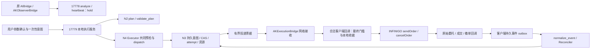

# NE1：无限易客户端 native 执行适配器

文档版本：`infiny-native-execution-plan-v1.0`。编制日期：2026-09-14。规划者：Codex。节点标识：`NE1`；硬验收 ID 为 `NE1-H01`—`NE1-H40`。

本文是下一节点的开发规格，不是已经实现、通过独立审核、部署或获准实盘的声明。本次唯一写入 `docs/infiny-native-execution-plan.md`；下文的生产文件、测试、配置、迁移及验收产物均属于后续实施。本文不改变实际交易开关，不授予真实报单或撤单权限。后续执行仍遵守根目录 `AGENTS.md`：Codex 制定计划和裁决，原节点所有者开发，未参与开发的独立子代理硬审核；Codex 不执行硬审核。

## 1. 目标与不做清单

### 1.1 交付目标

建立“本地执行服务规划与持久锁存 → 客户端合法回调调用框架 → 原始回报持久传回 → N3 对账”的执行通道。复用 N1b 的身份与数值契约、N2 的纯规划、N3 的 SQLite 账本和回报状态机、N4 的执行编排及 FakeNative；客户端只承担框架绑定、最后安全检查、一次调用和回报采集。

真实 `send_order/cancel_order` 必须同时满足：执行域依赖及本节点独立硬审核 PASS；对应部署版本的 S3 验收通过且真实 send/cancel 均为 0；用户明确授权该账户、实例、会话、合约、动作、数量、价格范围和有效期；用户在执行实例 UI 显式确认参数并设置 `enable_trading=true`；当前平台证据、风险、持久化及线程门槛通过。上述条件是 AND 关系，开发许可、服务在线、参数文件、`mode=native` 或本地 OrderID 都不能替代其中任何一项。

首版客户端 native 运行范围为一个明确选择的账户、一个执行实例、一个已授权具体期货合约、账户最多一个在途执行腿。离线契约覆盖六类动作和拆单；S4 只放行一条明确指定的限价订单及其另行明确允许的自有撤单。首次实单不会启动连续自动交易、自动追单或自动反手。扩大账户、合约、次数或动作范围须发布新的授权和验收范围。

### 1.2 保持的边界

- `AIBridge`、`AKObserverBridge` 永远是 observer；强制关闭交易、`last_signal=hold`、订单入口阻断及期权观察语义保持不变，不通过继承后覆写 `_force_observer_mode` 来取得下单能力。
- 各默认值均为 `enable_trading=False`、`mode=disabled`、`authorization=None`、`can_submit=False`、`can_cancel_owned=False`。旧参数恢复、重启、重连及新交易日不能自动重新武装。
- 不从旧 evaluator 的 `candidate_signal=buy/sell` 自动生成真实订单；不开发预测模型或修改 M1—M5 的策略资格、模型配置、统计门槛及 `src/ak_trading/v2/`。
- 不实现全账户自动对账、全账户撤单、外部订单接管、跨会话盲撤、无证据清账、自动重发、市价/FOK/期权/组合/主连交易。GUI 无 tick 自动刷新仍是 `UNSUPPORTED`。
- 不用 TqSdk、柜台直连库或服务端 native 调用代替无限易客户端框架。运行时 Investor 由客户端已登录框架提供；agent 不读取 `.env`、账户密码、令牌或数据库凭据。

## 2. 真实起点、依赖与必须先解决的契约缺口

### 2.1 已核对的来源

依据包括 [执行域规格](infiny-execution-development.md)、[N3 精确接口](infiny-execution-ledger-interface.md)、[N1b 共用契约](infiny-execution-contracts.md)、[v2 总纲](devplan-v2/00-开发总纲.md)，以及本节所列源码。节点结构参考 [M4 文档](devplan-v2/05-M4-联合决策与账本.md)；独立性、冻结哈希和反例要求承接 [硬审核协议](devplan-v2/07-硬审核协议.md)，本节点使用自己的 NE1 报告，不能冒填该协议只允许 M1—M5 的 node 字段。

知识图谱查询未覆盖 infiny 新模块，随后直接读取实际文件。以下是本次静态阅读基线，不是运行验收记录：

| 来源 / 公共入口 | 核对事实及对本节点的约束 |
| --- | --- |
| `integrations/infiny/AIBridge.py` | 版本 `observer-20260914-reconnect-v5`；每合约有界网络 lane、generation 绑定、统一 stop 期限；native 查询、订阅、日志、GUI 仅在回调线程；观察缓存最多 512 条，传输最近 20 条，不能作执行账本 |
| `AIBridge.Params/set_params/_restore_connection` | 保留 `exchange/instrument_id/additional_symbols/api_url/batch_size/account_tag/enable_trading/order_volume`；`volume` 是兼容别名；空白连接参数恢复为已确认值；运行中拒绝改订阅身份；observer 的 true 会被强制恢复 false |
| `AIBridge.validate_loopback_url/_endpoint/update_status_bar` | `api_url` 是完整 analyze URL，默认 `http://127.0.0.1:17778/analyze`；heartbeat 替换 URL path，不能字符串拼接；拒绝远端、凭据、query/fragment；`_native.updateState(self.strategy_id, state_dict)` 必须是两个位置参数 |
| `infiny_bridge/protocol.py` | v1/v2 是观察请求版本；`hold_response` 只返回 `signal/reason`；`normalize_payload` 过滤执行所需归属字段，观察时效 30 秒不能用于执行 |
| `infiny_bridge/service.py` | `/analyze`、`/heartbeat` 是仅有的 POST 路由；evaluator 默认 8 槽并有超时，超时不等于底层任务结束；买卖候选仍转成 hold；batch 重放缓存仅适合观察，不提供订单幂等 |
| `executor.py` | `Executor(ledger, *, port, mode, binding, investor_handle, clock)`；`prepare/refresh/readiness/submit_once/request_cancel/refresh_pending_open/disable`；构造线程是 owner；当前 `_gate` 只允许精确类型 `FakeNative`，native 被主动禁止 |
| `native.py` | `build_native_request(leg, binding, investor_handle, *, order_type, price_tick, verified_hedge_flags)` 为纯映射；`NativeAdapter` 永久禁用；`NativePort` 仅定义 `send_order(request)/cancel_order(order_id)`，不是已可用真实端口 |
| `planning.py` | `plan(intent, snapshot, reservation_view, policy, now)` 和 `validate_plan(plan, latest_context, now)`；包含时效、今昨仓、现金/总仓/在途量及收据认领；`_proof_scope` 仍只允许 simulation 完整证明 |
| `simulation.py` | `FakeClock`、`FakeNative`、`simulation_context`、`Simulation`、`run_demo`；FakeNative 有 `sent_requests/cancelled_ids/on_send/on_cancel`；`Simulation` 使用 absent-only 初始化，`barrier` 是明确模拟屏障 |
| `ledger.py/reconcile.py` | `initialize_context`、完整 context CAS、一次 attempt、取消锁存、`normalize_event(raw, CallbackContext)`、`Reconciler.ingest`；真实回报目前不能取得模拟归属证据，原生 proof 也不能释放资源 |
| `integrations/infiny/AKExecutionBridge.py` | 当前是独立 disabled 装配入口，依赖仓库包，不是已部署的 PythonGO 执行策略；本节点把此文件演进为独立客户端入口 |

原生 SDK 仅静态核对 `.../pyStrategy/pythongo/infini.py` 和 `base.py`：`infini.send_order` 映射到 `INFINIGO.sendOrder`，`infini.cancel_order` 映射到 `INFINIGO.cancelOrder(OrderID=...)`；`BaseStrategy.send_order` 固定 OPEN，不适合承载所有 CLOSE 语义。没有 import/执行这些 SDK 文件，也未查询账户。

关键基线 SHA-256：

| 文件 | SHA-256 |
| --- | --- |
| `docs/infiny-execution-development.md` | `08fa6c85435dab5834e051b98af0e323b6bb4b724383832a3ab9ab96c53353a9` |
| `docs/infiny-execution-ledger-interface.md` | `b3c9d062e1fbb88e956cbf2c2ba739cf2854eba7b4b209d4a1ada8c537c597d5` |
| `docs/infiny-execution-contracts.md` | `c5815fe8fa9d455f7e0dcd90cfab9f36e74548b231ace35d2ae30545da7049e3` |
| `integrations/infiny/AIBridge.py` | `2ae4981ef49f99cc12fc39f92aff4d5655f7d9d46191acbd8c54e5ae8b221fb1` |
| `src/ak_trading/infiny_execution/contracts.py` | `9d07964819383ffbba5943d23596a8243da134a25b4f526f1f220857e53f3dd4` |
| `src/ak_trading/infiny_execution/executor.py` | `92a9bbad9b9f529c45d2adfbb1766b411cfe471156ad1aea2bbada2b343bdc54` |
| `src/ak_trading/infiny_execution/ledger.py` | `30cc80b8f350c5eeba6452914c2d9ff73dcd8d73b71dcd71d35435cd42c56427` |

v2 研究 lock 为 `data/research_runs/v2/contracts-2.1.2/contract-lock.json`，实际哈希 `ac211ec99f143e699f8cb2e828ada4850f117af39312a66fdd0b5ac8c1e93b66`。它不授予 native 能力，本节点不改它。执行域 r3 PASS、N1a v5 PASS、模拟验收 r1 等状态来自 `AGENTS.md` 指针，本次未重跑；开工和审核必须取得对应报告及精确依赖哈希。

### 2.2 原生准入的裁决与实施前置

当前 v1 在 `Authorization/Readiness/ExecutionContext` 构造期拒绝 native，`CashBoundSource`、N2 proof、N3 归属/吸收及 N4 端口也限制 simulation。因此“只新增客户端 send_order 包装”不能完成本节点。禁止通过 monkeypatch 常量、构造器旁路、把原生快照标成 simulation、伪造 owner_thread_id 或删掉 FakeNative 校验来接线。

本计划选择两条明确区分的证明能力：保留既有 simulation 完整屏障；新增严格限额的 `NativePilotPermit`，仅用于经过单独批准的独占账户人工接管试运行。后者不把 `coverage` 升为 `FULL_ACCOUNT`，不声称 SDK 已有自动全账户对账。采用该试运行属于旧执行域 §2/§8 禁用范围的显式变更：必须由 N1b/N3/N4 所有者按本计划完成新契约、独立硬审核，且用户在 S4 **另外批准有限范围人工接管和该笔实单**。本次编写计划没有给出这两项运行授权。

`NativePilotPermit` 的证据最少包括：账户稳定标识与客户端选择一致；已验证的账户/策略回调路由；有来源和明确截至时点的委托、成交、双向今昨持仓及冻结基线；基线范围完整性说明；自基线起的外部写入隔离；框架/SDK 版本、会话与交易日；可靠费用及保证金现金上界；一条订单的次数、数量、价格、失效时间和撤单范围。人工只负责批准证据包和操作隔离，不能用“无挂单”勾选代替清单/完成依据。基线可以来自另行核实的终端或柜台导出；本文不假定现有平台已能生成合格导出。

基线无法证明完整、回报账户范围无法核实、费用来源无法核实，任一项都使 S4 保持 `NOT_RUN`。实现者须交付明确 blocker，不能退回 own_journal 放行。首次尝试后消耗许可；未取得覆盖成交和持仓变化的新接管证据前，不释放预留、不发第二单、不自动换价/反手。这样可以交付可测试的真实调用边界，同时如实保留平台缺口。

### 2.3 契约升级包

下表是后续必须落实的变更范围，不能作为当前 v1 已支持的接口来调用。此文冻结设计方向；实现细节出现冲突仍回 Codex 裁决，不由消费者自行加字段。

| 变更 ID / 所有者 | 必须交付的变化 |
| --- | --- |
| NE-CR01 / N1b | 新核心契约 `infiny_execution_v2`；native 证据、授权、transport DTO 与控制序号；v1 保持仅离线可读，不把旧 simulation 授权迁成 native；关闭默认值及全部来源隔离保留 |
| NE-CR02 / N3 | 同库持久 dispatch/outbox、原子 attempt 与投递票据、native 归属证明验证、限额许可消耗、控制 CAS 和恢复迁移；不增加第二套订单状态机 |
| NE-CR03 / N2、N4 各自文件 | N2 接收已验证的有限 scope 准入而不放松价格/预算；N4 抽出同一套预检供 simulation 直接端口和 native 两阶段 dispatch 使用；真实端口仅在客户端 |
| NE-CR04 / 客户端、服务所有者 | 独立 execution 协议与策略文件、参数确认和本地 dispatch 收据日志；不修改 observer 路由/类/参数行为 |

升级须冻结新路径 `data/maintenance_artifacts/infiny-native-execution/<revision>/contract-lock.json`，绑定本文、新 schema、公共签名、文件所有权、全部 H 条款和 required_tests；目录不得覆盖。N1b 同步更新原契约文档，N3 同步精确接口文档，原执行域文档通过追加变更记录明确范围；这些都是后续对应所有者任务，本轮不写。

v2 的具体兼容边界：允许构造 native 类型以表达被阻断状态，但构造成功不授予执行权；`Readiness` 新增 `execution_scope=none|simulation_full_account|native_pilot`，native 的 can_submit 只能由登记的有效试运行许可派生。原 `ReconciliationProof(source=pythongo)` 仍保持 `verified=false/complete_through=None`，FULL_ACCOUNT 仍不从原生普通查询产生；新增 scope 证据单独验证，不改写旧证明。`CashBoundSource` 的 native verified 只能引用服务已验证的原生费用证据；v1 解码不能带入此能力。旧 `NativeAdapter` 和旧默认禁用常量继续拒绝执行，新增 dispatch 路径持有明确能力引用，不用全局开关解锁所有对象。

## 3. 架构与协议选择

### 3.1 选择新端点和独立本地执行服务

采用新服务 `127.0.0.1:17779`，路由前缀 `/execution/v1/`；端口是计划默认值，部署前检查占用，禁止结束占用进程或悄悄换端口。原 `api_url=http://127.0.0.1:17778/analyze` 的含义和 observer 服务均不变。客户端执行实例新增 `execution_api_url=http://127.0.0.1:17779/execution/v1/poll`，其余路径用 URL parser 替换 path。

| 方案 | 与实际代码的关系 | 裁决 |
| --- | --- | --- |
| 给 `/analyze` 增加 `orders` 或让 `signal=buy/sell` 可执行 | observer `_send_job/_handle_response` 严格校验两个响应字段；服务始终 hold；当前重放缓存、20 条回报窗口、evaluator 超时均无执行承诺 | 不采用；会破坏协议并把诊断候选误作交易指令 |
| 在原服务同进程增加执行路由 | 可以版本化，但共享 evaluator、工作池、停机和错误路径，会扩大 17778 已部署基础设施的影响范围 | 本节点不采用 |
| 独立服务与版本化执行端点 | 独立请求限额、账户串行调度、持久回报、授权和停机；旧服务零协议变化 | 采用；增加一个本地进程，由主会话维护和记录 |



本地执行服务持有 N3 唯一业务账本。客户端 outbox 只保存投递/调用收据及未确认事件，不自行计算持仓、释放预算或裁决订单终态。服务端不得 import INFINIGO、持有真实 Investor 或直接调用柜台；客户端不得复制 N2/N3 的规划和订单账本。

### 3.2 指令来源与 evaluator 隔离

首次实单来源固定为服务中显式登记的 `OrderIntent`，来自与用户授权对应的单次操作单。`source_key` 绑定该操作单，不能用 poll 序号、当前 tick 或每次 UUID 重新生成。HTTP `poll` 只领取既有意图，不创建交易决定。未来策略若接入，需提供已审核的资格与稳定决策键，本节点不接线。

observer evaluator 的 `execution_authorized` 等字段仍只是诊断文本；无论它返回买卖、晚返回还是重复返回，都不能进入执行队列。执行服务不等待 observer evaluator。需要纯计算的服务任务采用固定工作槽；timeout 后槽位直到实际任务退出才释放，不无限启动替代线程。分析失败不阻塞原始回报落盘与已获授权的自有撤单判定。

### 3.3 执行 HTTP 契约

以下 DTO 属于新 `native_contracts.py`，不是任意 dict 扩展。核心对象用 N1b `encode/decode/canonical_hash`；传输信封独立为 `infiny_client_execution_transport_v1`，不能与核心 `infiny_execution_v2` 或 observer 的数字版本混用。

| 路由 | 输入 / 输出及副作用 |
| --- | --- |
| `POST /execution/v1/poll` | 上传不可变快照引用/新增快照、客户端状态与回执水位；返回 `idle/blocked/offer`、关联 ID、readiness；offer 尚未取得调用权 |
| `POST /execution/v1/ready` | 客户端合法回调复验 offer 后回传 readiness challenge；服务重新校验控制、风险和证据，原子锁存 attempt 后返回唯一 `dispatch` 或 blocked；同请求幂等 |
| `POST /execution/v1/results` | 上传本地调用前/后收据、返回值类别或安全错误码；只有 N3 落盘才确认；不能以 HTTP 200 推断柜台接受 |
| `POST /execution/v1/events` | 原始白名单回报批次及稳定 event_id；持久隔离/归属/去重后返回连续已落盘 ACK 水位；允许补发相同批次，不重放 native 动作 |
| `POST /execution/v1/control` | 仅配对客户端可报告参数确认、关闸、停止和 generation；不能提交自报 verified 的授权/证明；服务信任域另有显式授权登记接口 |
| `GET /execution/v1/status` | 已认证只读状态、阻断码、两端实际调用计数与待对账数；不暴露凭据、Investor 或原始错误文本 |

信封必填：`schema_version,type,request_id,instance_id,session_epoch,generation,service_epoch,sequence,sent_at,params_sha256,body`。首次握手的 `service_epoch=null` 仅可取得 disabled 状态，不能领取票据。响应原样绑定 request_id、双方 epoch、generation 和 scope；还带 `received_at,ledger_revision,control_revision`。核心 `Binding` 包含账户、策略、native strategy_id、实例、交易日、交易所、合约及 hedge，均须精确匹配。重放同 ID 不同 body hash 返回冲突，不能接受后一次覆盖。

新 DTO 必需字段：

| 类型 | 字段及语义 |
| --- | --- |
| `ParameterConfirmation` | `confirmation_id,binding,params_sha256,adapter_sha256,confirmed_at,expires_at,explicit_ui_action`；恢复参数不签发确认 |
| `NativePilotPermit` | `permit_id,authorization_id,binding,control_revision,baseline_evidence_id,route_evidence_id,cash_bound_evidence_id,source_key,actions,max_send_attempts,max_cancel_attempts,max_volume,price_bounds,expires_at,params_sha256`；production 来源只能由证据验证器登记 |
| `ExecutionOffer` | `offer_id,intent_id,leg_id,plan_id,intent_hash,leg_hash,binding,snapshot_id,policy_id,params_sha256,control_revision,expires_at`；无 native 调用权 |
| `ReadyChallenge` | offer 身份、当前 capture ID、合法回调线程证据引用、最新参数 hash/开关、客户端未确认事件水位、generation；服务不能仅凭该声明认定权限 |
| `DispatchCommand` | `command_id,kind=SUBMIT或CANCEL,attempt_id,offer_id,intent_id,leg_id,plan_id,binding,leg,order_type,price_tick,contract_limits,control_revision,permit_id,params_sha256,issued_at,expires_at`；CANCEL 另带 journal 认证的 `order_id/route_evidence_id/cancel_id`，不接受裸 OrderID 指令 |
| `DispatchReceipt` | `receipt_id,command_id,attempt_id,binding,generation,stage=CONSUMED或RETURNED或NO_CALL,local_sequence,recorded_at,result_kind,result_value,error_code,request_sha256,previous_receipt_sha256`；NO_CALL 不伪装 native 返回 -1 |
| `RawCallbackEnvelope` | `event_id,kind,captured_at,callback_generation,callback_session_epoch,route_evidence_id,raw_fields`；只复制 reconcile 白名单，未确认序号从持久 outbox 恢复 |

scope 证据也必须是版本化不可变记录：`NativeBaselineEvidence` 包含 `evidence_id,source_kind,artifact_sha256,account_key,trading_day,session_epoch,as_of,order_inventory,trade_inventory,positions,coverage_description,completion_basis,isolation_evidence_id,approved_scope_id,expires_at`；source_kind 只允许已核实的 TERMINAL_EXPORT/BROKER_EXPORT，不将人工声明标成SDK水位。`NativeRouteEvidence` 包含 `evidence_id,framework_sha256,sdk_sha256,binding,callback_kinds,account_scope_basis,strategy_scope_basis,local_alias_scope,front_id,session_id,memo_limit,memo_roundtrip_verified,validated_at,expires_at`，原生缺字段可null，但缺少足以证明归属/路由的组合即不通过。`ClientThreadEvidence` 包含 `evidence_id,instance_id,session_epoch,generation,process_instance_id,callback_thread_id,callback_kind,observed_at`，线程整数不跨进程比较。

`NativeSettlementEvidence` 包含 `evidence_id,baseline_evidence_id,binding,as_of,artifact_sha256,covered_leg_ids,covered_event_ids,order_inventory,trade_inventory,position_snapshot_id,completion_basis,isolation_evidence_id`。证据来源、原件hash和范围由服务可信验证器核实，不能凭HTTP传来的verified布尔或把received sequence改名complete_through。`completion_basis` 必须引用具体来源的完整性证据；未知文字说明只可作为诊断，不签发许可或释放资源。

价格/资金/TTL 都是规范 Decimal 字符串；bool 不冒充数量；拒绝重复键、NaN/Inf、未知字段、错误类型、无时区时间、超深及超长消息。请求上限 256 KiB、响应 64 KiB、深度 32、每批最多 128 条事件、每次最多一个 dispatch；超限拒绝，不能截断业务对象。连接总期限不超过 3 秒，无代理、无重定向、不跟随服务返回 URL。未知版本/路由/动作明确拒绝且调用数为 0。

loopback 不是交易授权。新服务需每实例配对认证：由运行程序生成临时随机能力令牌，通过仅当前 Windows 用户可读的配对文件交给客户端运行时，禁止放 URL、日志或参数模板。配对只证明通信实例；授权、证据、次数仍分别验证。拒绝浏览器跨源请求，不开放 CORS；不存在匿名可创建意图、签发许可或登记控制的 HTTP 入口。agent 不读取配对令牌。客户端固定配置的 origin 与服务身份，重启重新配对并关闭交易。

## 4. 文件所有权、并行任务与集成顺序

下表全部是后续实施文件；“改”不表示本次改动。一个文件只有一个所有者，NE1 集成者不得代改 N1b/N2/N3 文件。基线、提交和审核包均逐文件 SHA-256；大量未跟踪文件下不能只用 git diff 证明范围。

| 所有者 / 阶段 | 独占生产与文档文件 | 交付 |
| --- | --- | --- |
| N1b / C1 | 改 `src/ak_trading/infiny_execution/contracts.py`、`docs/infiny-execution-contracts.md`；新 `src/ak_trading/infiny_execution/native_contracts.py`、`src/ak_trading/infiny_execution/native_evidence.py` | v2 类型、来源验证、参数/授权/控制契约与 native lock |
| N2 / C2 | 改 `src/ak_trading/infiny_execution/planning.py` | native 有限 scope 准入；经济与手数算法复用，旧模拟用例继续有效 |
| N3 / C2 | 改 `src/ak_trading/infiny_execution/ledger.py`、`src/ak_trading/infiny_execution/reconcile.py`、`docs/infiny-execution-ledger-interface.md`；新 `src/ak_trading/infiny_execution/dispatch_journal.py` | 同 SQLite 的 dispatch/outbox、控制序号、迁移和 native 回报归属；无端口 |
| N4 / C2—C3 | 改 `src/ak_trading/infiny_execution/executor.py`、`src/ak_trading/infiny_execution/native.py`；必要的兼容改动限 `src/ak_trading/infiny_execution/simulation.py`；新 `src/ak_trading/infiny_execution/client_dispatch.py` | 共享预检、两阶段 native 编排；旧 `NativeAdapter` 仍为禁用对象，新增能力走独立受控路径 |
| NE1 服务 / C3 | 新 `src/ak_trading/infiny_execution/client_service.py`、`scripts/run_infiny_execution.py` | 17779 服务、认证、限流、账户串行调度；不接触 native |
| NE1 客户端 / C2—C3 | 改 `integrations/infiny/AKExecutionBridge.py` | 独立自包含 PythonGO 策略、合法回调 pump、最后门槛、持久收据和事件 outbox；装配能力所有权由原 N4 明确移交 |
| NE1 交付 / C3 | 新 `scripts/install_infiny_execution.py`、`config/infiny_native_execution.example.json`、`docs/infiny-native-execution-runbook.md`；后续由规格所有者追加 `docs/infiny-execution-development.md` 变更记录 | 安装/回滚、用户参数模板、操作单和状态边界 |

测试独占文件见 §10；原 N1b/N2/N3/N4 各自维护原 `test_infiny_execution_{contracts,planning,ledger,e2e}.py`，只更新明确版本/能力变更断言，不能删除安全反例。observer 源码、协议、服务、原 observer 测试、v2 目录、通用 conftest 和模型配置均为本节点只读依赖。

C1 先冻结 DTO、能力来源、CAS、dispatch 的事务边界和本文验收映射；C1 通过后，N2、N3、N4 与客户端可用冻结 fixture 并行开发。C3 整体集成等待这些依赖的新哈希通过独立审核。跨节点失败回到原所有者修复；最终 NE1 整体审核不得用子节点报告代替集成重跑。

## 5. 线程、lane、stop 屏障与两阶段调用

### 5.1 客户端线程模型

`AKExecutionBridge` 独立实现 PythonGO 的生命周期和字段协议，不继承 observer 的执行入口，不导入 `pythongo.base/ui`、numpy、ctypes、PyQt，也不要求嵌入解释器能 import 仓库包。允许标准库与框架提供的 INFINIGO。模块导入/构造不会启动线程、查询账户或解析 send/cancel 属性。

合法回调线程在框架生命周期中绑定，之后所有 native 查询、订阅、报单、撤单、`writeLog/updateParam/updateState` 检查真实 `threading.get_ident()`。构造线程与启动回调线程不同且无法确认框架约定时阻断，不能直接把收到的远端 thread_id 写成当前线程。服务端 ExecutionContext 的 owner/current_thread_id 只证明服务账户 actor 的本地线程；新增独立 `ClientThreadEvidence` 记录客户端回调线程与 generation，两者不能冒充同一个线程域。

| 执行位置 | 上限与职责 | 禁止行为 |
| --- | --- | --- |
| 框架回调 | `on_init/on_start/on_tick/on_contract_status/on_order/on_order_trade/on_order_cancel/on_cancel/on_trade/on_error/on_stop/set_params`；每次最多消费一个 native command，单个原生调用不可并行 | HTTP 等待、重入发送、等待 evaluator、无限 drain |
| control lane | 每执行实例 1 条线程，最多 1 个在途 HTTP 和 1 个待处理控制任务；armed poll 最快每 250 ms，disabled 每 5 秒；无任务不空转 | native、GUI、推断持仓、改写采样时间 |
| event/result lane | 每实例 1 条线程，批量发送持久 outbox；结果和原始回报优先，重试仅针对传输幂等 ID | 丢最旧事件继续交易、因超时建立额外线程 |
| scheduler | 每实例最多 1 条线程，只做期限、唤醒、只读快照调度；上述 worker 合计最多 3 条 | native 定时器、无 tick 强制刷新 GUI |
| 服务端 | HTTP worker 最多 8；每账户一个固定串行 actor，已登记 actor 最多 8，满额拒绝；首版 native 只武装一个账户 | 每订单新线程、账本事务跨 IPC/native 等待、任意 payload 创建 actor |

订阅白名单最多 16 个，与 observer 配置格式一致；native pilot 只选其中一个期货。额外观察合约的慢速分析不会占 execution control/event lane。行情快照可合并为每合约最新一份；execution offer 槽位 1，满则明确 backpressure，不能覆盖已接收 command。

客户端待上传事件在独立 SQLite outbox 中持久化，`synchronous=FULL`，内存通知队列最多 1024 项；outbox 未确认数据上限为 10000 条或 16 MiB，任一先到即关闸并报告 `EVENT_GAP`，不能为了腾空间删除未 ACK 的事件。磁盘/锁失败即时关闭调用入口，保留可保存的故障证据；无内存“成功”兜底。查询/写盘有界等待，建议 busy_timeout 200 ms；native 本身可能阻塞，不承诺能强行中断。

### 5.2 完整调用时序

1. 合法回调复制原始 tick、合约、资金、持仓冻结及框架身份，生成不可变 snapshot；校验账户在采样前后未变。快照由网络 lane 上送；服务收到时填写可信 `received_at`，不接受客户端自填接收时间续期。
2. 服务核对控制/证据和 N3 context，调用 N4 `prepare` 的共同逻辑完成 register、N2 plan、原子 reserve；生成无调用权的 offer。未尝试 offer 到期可走 `release_unattempted`，重复 poll 不创建新 source_key。
3. 客户端在下一合法回调验证 offer 的绑定、参数、授权范围和最新数据，记录 readiness challenge；网络 worker 发送 `/ready`。这个阶段调用数仍为 0。
4. 服务再次读取持久控制，按 CAS 和最新资源重验；N3 在**同一个 BEGIN IMMEDIATE** 内锁存 `SUBMITTING/attempt_no=1`、许可次数占用和唯一 dispatch 记录。事务提交后才返回 dispatch；不把 SQLite 锁带到网络等待中。
5. 网络 worker 仅将 dispatch 放入有界接收槽。下一合法回调持有本实例 admission 锁，复核实际 `enable_trading`、当前 generation/会话、参数 hash、期限、行情/合约及已确认用户许可；成功后将 `CONSUMED` 本地收据 fsync，再解析真实 send/cancel 属性并调用一次。同 command_id/attempt_id 的重复响应只能补传收据，不能再调用。
6. 原生返回/异常后持久化 RETURNED 收据并异步上传；N3 通过 `record_submit_result` 或 `record_cancel_result` 投影。native 同步触发的回调先落本地 outbox，可先于返回收据到服务，N3 持久隔离后再关联。
7. N3 根据原始订单/成交事件更新数量、终态和 reconcile；仅符合 §7.5 的证明才吸收/释放资源。HTTP 接收、local OrderID、客户端消费 ACK 都不是成交。

拟新增的精确编排接口在 C1 冻结：

```python
# N4；公共结果类型由 native_contracts 提供。下列是拟开发接口。
Executor.prepare_native_offer(intent, context, *, resources=()) -> ExecutionOffer
Executor.commit_native_offer(offer_id, challenge, context) -> DispatchCommand
Executor.prepare_native_cancel(cancel_id, intent_id, leg_id, context) -> ExecutionOffer
Executor.complete_native_dispatch(receipt) -> SubmitResult

# N3；事务与投影仍归 N3，不由 HTTP handler 直接写内部表。
DispatchJournal.begin_dispatch(offer, context, *, expected_control_revision) -> DispatchCommand
DispatchJournal.record_receipt(receipt) -> SubmitResult
DispatchJournal.pending_commands(binding) -> tuple[DispatchCommand, ...]
```

`begin_dispatch` 必须复用 `begin_attempt/request_cancel` 的同一内部事务校验逻辑，不能先在一笔事务 begin_attempt，再在另一笔事务假称原子写出 outbox。对外现有 simulation `submit_once/request_cancel` 保留签名，使用相同预检和状态转移。transport stage 是 N3 events/dispatch 的附属记录，不新增绕开 `OrderState/CancelState` 的业务终态。

客户端的公共 `send_order/cancel_order/make_order_req/auto_close_position` 不得形成旁路。即使UI已启用，直接传裸请求或OrderID也必须拒绝；实际 ClientNativePort 调用必须在已验证dispatch的同一次回调 admission 范围内，绑定一次性CONSUMED收据并消费内部调用权。不能把服务发来的布尔字段当成此内部能力。

### 5.3 延迟、撤权与可证明的停止语义

dispatch 有效期取授权、意图、规则、数据及签发时刻后 **500 ms** 的最早值；旧票据不得刷新 TTL。没有合法回调或数据已旧时宁可漏发。worker 不能为赶期限下单；已锁存但未调用的动作保守进入待对账，不以新 ID 补发。

分布式系统不能承诺服务端撤权瞬间收回已交付的票据。线性化点明确如下：服务端 commit 之前撤权必定使 CAS 失败；commit 之后可能已有一个尚未消费的短期票据，服务立即停止签发并进入 `REVOKE_PENDING`，直到客户端关闸 ACK/票据失效和收据核对完成，才报告 `DISABLED_CONFIRMED`。不能提前显示“已彻底停止”。客户端 UI 关闭开关与 native 调用入口使用同一 admission 锁；关闸屏障完成后不得进入新的 native 调用，已进入的调用记为在途并等待结果。

`on_stop` 顺序：关本地 admission → 使 generation/会话失效并退休 lane 对象 → 同时唤醒全部 lane → 尽力上传关闸/收据 → 共享一个不超过 `min(3.5, http_timeout+0.5)` 秒的 join 期限 → 仅退订本实例的订阅。不能对每个线程分别等待 3.5 秒。旧 worker 终身绑定旧 lane 对象，不能按合约名重新取新 registry 而覆盖新 generation。

超时旧 worker、未确认关闭或未决 dispatch 尚在时，拒绝重新武装；保留 lane/未决身份以供诊断。不得 kill 卡住的 native 线程后启动第二个 sender。stop 不清 N3 账本或本地 outbox，也不自动撤单。停止后若仍有订单回调，继续保存原始证据；无法证明原归属时隔离，不能贴新 epoch 认领。重启先上传/核对未 ACK 事件，`recover` 绝不发送或撤销。

## 6. 订单映射、今昨仓与价格手数

### 6.1 精确框架边界

N4 的 `build_native_request` 是映射基准。客户端独立文件不导入仓库包，允许内置经审核的**薄映射镜像**：仅执行相同字段、枚举、Decimal 和类型检查；通过独立黄金向量和与基准函数的差分测试保证一致，不复制规划/预算/账本。映射变化必须同时更新两端冻结哈希。

最终一次调用为 `INFINIGO.sendOrder(**request)`，对应 SDK `infini.send_order` 的同一底层客户端 API；撤单为 `INFINIGO.cancelOrder(OrderID=...)`。客户端实现 `ClientNativePort.send_order(request)` / `cancel_order(order_id)` 封装此边界。禁止调用 `BaseStrategy.send_order` 来平仓，因为该入口固定 OPEN；不调用会自行拆分/选择仓位的 `auto_close_position`。

| 逻辑方向 / 开平 | 原生 Direction | 原生 Offset | 合法资源桶及限制 |
| --- | --- | --- | --- |
| BUY × OPEN | `'0'` | `'0'` | 开多；Leg.position_bucket=None，资源键 ALL |
| SELL × OPEN | `'1'` | `'0'` | 开空；同上 |
| BUY × CLOSE | `'0'` | `'1'` | 平空；非 SHFE/INE，ALL |
| SELL × CLOSE | `'1'` | `'1'` | 平多；非 SHFE/INE，ALL |
| BUY × CLOSE_TODAY | `'0'` | `'3'` | 平空今仓；SHFE/INE，TD |
| SELL × CLOSE_TODAY | `'1'` | `'3'` | 平多今仓；SHFE/INE，TD |
| BUY × CLOSE_YESTERDAY | `'0'` | `'1'` | 平空昨仓；SHFE/INE，YD |
| SELL × CLOSE_YESTERDAY | `'1'` | `'1'` | 平多昨仓；SHFE/INE，YD |

`GFD → OrderType='0'`，`FAK → '1'`；`Market=False`。FOK、裸未知数字、market=True 均 unsupported；不能借 SDK 其他枚举猜测支持。FAK 未成交余量是否撤销要看最终回报，不能在函数返回时自行补 CANCELLED。

输出键精确为 `StrategyID,Exchange,InstrumentID,Volume,Price,Direction,OrderType,Investor,HedgeFlag,Offset,Market,Memo`。StrategyID 来自当前框架实例；Investor 只在客户端由用户选定的实际 InvestorID 解析为内存句柄，决不跨 HTTP/日志发送。HedgeFlag 必须有已核实白名单，不默认取 `'1'`；回报字段 `Hedgeflag` 大小写不同。Memo 只用稳定 leg_id；平台支持长度和回传行为须验证，不支持时阻断，不截断后把它当唯一归属证据。

### 6.2 今昨仓与拆单

逐账户、交易所、合约、hedge、long/short 保存 `Position,PositionClose,FrozenClosing,YdPositionClose,YdFrozenClosing`；缺字段或缺方向桶保持 unknown。计算：

```text
td_close     = PositionClose - YdPositionClose
td_frozen    = FrozenClosing - YdFrozenClosing
td_available = td_close - td_frozen
yd_available = YdPositionClose - YdFrozenClosing
local_available = max(0, sdk_available - local_not_proven_reflected)
```

原始非负/层级/冻结约束必须先通过，不能对坏源数据 clamp。SHFE/INE 的 AUTO_YD_FIRST 先昨后今，拆成不同 Leg/native 单；禁止通用 CLOSE。TD_ONLY/YD_ONLY 不够即整计划失败。非 SHFE/INE 仅通用 CLOSE/ALL，不承诺强制今昨；TODAY_ONLY/YESTERDAY_ONLY 均 unsupported。

手算基准：long `Position=10,PositionClose=10,YdPositionClose=6,FrozenClosing=3,YdFrozenClosing=2`，可用昨 4、今 3；平多 6 得 SELL/CLOSE_YESTERDAY 4，再 SELL/CLOSE_TODAY 2。平空镜像 BUY；请求平今 4、平昨 5、总平 8 均拒绝，不能转为开仓补量。

每腿数量为正整数且不是 bool。有效最小值取交易所及已验证附加规则的最大下限；最大值取交易所、附加规则和 `RiskPolicy.max_leg_qty` 的最小上限；步长取规则步长 LCM。保持总量确定性拆分：min=3/max=5/总量11 → 5+3+3；min=4/max=5/总量6 无合法拆分，整份拒绝。不得提高数量凑尾单或只发送可拆部分。S4 只允许天然满足一腿边界的一单，不自动拆成多次真实调用。

### 6.3 价格与动作

价格用 Decimal，有限、正数、`price % price_tick == 0`，位于有效上下限内；转换 float 后必须 `Decimal(str(float_price)) == original_price` 且仍对齐 tick，不静默四舍五入。客户端最终复验和服务端 N2 都执行。tick=0.2 时 3500.2 合法、3500.1 拒绝。

连续交易、有效盘口及当前合约状态是提交前提；竞价、闭市、未知、涨跌停锁定、倒挂、必要对手档无价/无量、价差超过 10 tick 均阻断。合约必须是明确具体 FUTURE，未到期；交易日与日历日分别校验。示例 rb2610 只是 2026-09-14 离线 fixture，不能直接作为后续实单参数。

六动作沿用 N2：OPEN_LONG/OPEN_SHORT 分别 BUY/SELL OPEN，CLOSE_LONG/CLOSE_SHORT 分别 SELL/BUY CLOSE*。反手先平全部原方向，再开 intent.volume；后腿须全部前腿 FILLED、settled、trade_gap=0，无未决撤单/提交，且新覆盖证据证明原方向零仓。调用 `refresh_pending_open` 只刷新未尝试腿及资源，不能更改已尝试腿或借 refresh 重新定价。S4 不授权反手后腿。

## 7. 安全门槛、参数确认与 N3 纪律

### 7.1 参数和授权是不同的证据

执行实例保留 observer 连接参数的名称和解析方式；新增账户选择、execution URL、授权引用和确认字段，详见 §12。`account_tag` 永远只用于备注，不能变成账号；不得自动选择投资者列表第一项。账户唯一也仍需用户选择确认。与 observer 相同的订阅集合、实际平台合约返回值、服务 allowlist、授权 symbols 四者精确相交；执行端要求完整 `Exchange.InstrumentID`，不继承旧服务允许裸 instrument 匹配的宽松分支。

`set_params` 先验证整份候选，失败零参数变更。空连接字段可恢复已确认的连接值；授权、开关、确认 nonce 不能用此机制恢复。参数 hash 覆盖账户绑定引用、策略/合约/hedge、URL、数量、类型、限价范围、预算政策和版本。运行中变化先关闸；换账户/合约/URL 必须 stop/reload，原参数确认立即失效。

hash 还绑定 execution_mode、authorization_id 引用及send/cancel次数上限；不含确认challenge本身或瞬时enable_trading值，避免自引用及“确认后设置true又使确认失效”。enable_trading由独立实际UI状态门槛检查，关闭立即生效；重新打开仍需新challenge。用于选择账户的真实InvestorID只留客户端，hash使用已绑定的不透明account_key，不在服务或报告里泄露原值。

显式确认流程：用户看到完整参数摘要及一次性确认 challenge → 在执行实例 UI 提交相同 challenge → 客户端在合法参数回调记录确认 → 服务把它与用户的具体操作授权关联。challenge、`authorization_id` 都不是自行签发交易许可的开关。只输入 true、设置 `self.trading=True`、恢复保存的 true、复制别的实例确认、过期/旧会话授权均拒绝。

新核心 context 增加持久 `control_revision` 和 `native_permit_id`（native 必填有效引用；simulation 可空），由 N1b 冻结类型。用户关闭开关即时关闭本地 admission；启用必须重新经过整个确认流程。授权对 CANCEL_OWNED 独立列动作和次数；撤单也是实际交易操作，不能以风险处置名义默认获得权限。

### 7.2 提交门槛执行顺序

1. 确认本节点 release/contract lock 和 S3 证据版本匹配，通信配对有效；native 能力证明由可信装配器持有，HTTP body 自报 verified 一律无效。
2. 确认实际 UI enable_trading、运行状态、当前参数确认和用户授权均有效；完整 Binding、线程、epoch、generation、服务身份逐项一致。
3. 验证最新组件数据和来源：quote 3 秒、account/position 5 秒、contract 3600 秒、packet 10 秒、link 15 秒、future_skew 2 秒；`age > ttl` 失效。心跳只更新传输时间，不能更新 source_at/sampled_at。
4. 验证 native pilot 基线、独占写入隔离、回报路由和现金上界证据；全账户自动能力仍 unsupported。没有证据即 blocked，不把读到空 list 或回调静默当零仓/无挂单。
5. N2 风控与 N3 全账户本地资源视图通过：有效 min/max、费用/保证金上界、可用资金、总多头+空头、全部本地 OPEN 承诺、在途腿上限和同桶剩余量。
6. 持久最新控制 CAS 和同事务 attempt 成功；核对 receipt、plan、intent 和 payload hash；最后由客户端再验本地 gates 后调用一次。

即使只有平仓，也须有平仓费用上界和可平量；不要求开仓保证金率。开仓现金上界必须覆盖保证金、手续费及缓冲，不能把账户 Fee/Margin 金额当费率。原生费率的 verified 来源也需要 NE-CR01/02 改造，不能只解除 proof 限制而忽略当前 `CashBoundSource`/N3 的 simulation 检查。

### 7.3 initialize_context、CAS 与控制更新

首次初始化只调用 `Ledger.initialize_context`：scope 不存在才创建。先 context() 读到 None 再 register_context 是禁止的 TOCTOU。启动时发现已有 context：同完整控制可采用旧值作只读恢复；绑定、政策、授权或会话不一致即冲突，构造器不能覆写。

普通行情刷新、prepare、submit、cancel 一律 `compare_and_register_context(new, expected)`；expected 必须是本操作读取的完整持久值。CAS 核对完整 canonical hash，并保持 mode/binding/policy/authorization/route 不变；另一个连接禁用、撤权、降预算、换 epoch 后，旧调用失败且零写。native 控制变更只能经单一 control actor、单调 control_revision 和明确授权记录进入 `register_context`；该入口不暴露给普通 poll/events，也不能用客户端时间排序代替 revision。

N3 资源 revision 与 control_revision 分开：Plan.ledger_revision 是 reserve 前版本，Receipt.revision 是成功后版本，最新 context/snapshot/view 版本必须一致。不能要求 Plan revision 等于最新 context，也不能凭旧收据跳过资源核算。收据必须在 N3 真实存在，reservation_ids 与所有 legs 同序精确匹配；自己的预留认领一次，其他策略/合约本地预留仍合并检查。

### 7.4 cancel-before-replace

撤单仅针对 journal 已验证自有、尚有余量、当前会话路由唯一的订单，通过 `Executor.request_cancel` 对应共同逻辑及 N3 cancel attempt。先锁存 REQUESTED，再一次调用。未知/foreign/裸 OrderID、旧会话无法核实路由、local ID 冲突、无授权或已全部成交均拒绝。行情陈旧和 `can_submit=False` 不自动阻断自有撤单；开关、撤单授权、线程、路由、持久能力仍不可缺。

改价是“取消旧腿 → 完整核对终态和成交 → 新快照/资源/授权 → 新意图”的流程，不是修改原腿。cancel 返回任意数字、无数量的 on_cancel、部分成交或超时均不能开启 replacement。旧单确认取消后，残量按去重实际成交和原请求总量核算；新 source_key 明确绑定 replacement_of 和替换序号，同时核对旧腿已终结，不能用新 UUID 绕过旧未知结果。

自动追单本节点 unsupported；上段规定的是以后显式替换请求的必要门槛及离线反例。S4 第一次真实尝试消耗唯一 send 次数，若需改价，须结束本轮并重新审批，不自动发第二单。stop/disable 不隐式撤单。

### 7.5 对账归属与资源释放

直接采集 `on_order/on_order_trade/on_order_cancel/on_cancel/on_trade/on_error` 的白名单原字段，传到 `normalize_event(raw, CallbackContext)` 再进入 `Reconciler.ingest`；不经过 observer `_remember`、20 条窗口或 `protocol._clean_events`。保留 Memo、FrontID、SessionID、OrderSysID、TradeID、TradingDay、方向、开平、hedge 和数量；未知字段不补造。

native 回调归属新增验证器必须核对平台版本/账户/策略路由证据、持久尝试、全部业务身份、唯一 local/exchange alias。接收实例、Memo、裸 OrderID 或 payload OWNED 不能单独证明自有。TradeData 没有 FrontID/SessionID，通过已认证 order alias 关联；缺证据事件保留 UNKNOWN、持久隔离。

沿用本地键 `(account_key,session_epoch,order_id)` 和柜台键 `(account_key,trading_day,exchange,order_sys_id)`；成交去重键 `(account_key,trading_day,exchange,instrument_id,trade_id)`。同键同内容幂等，同键改价量/身份锁存冲突；前导零和大小写保留。柜台 `'1'` 在 SHFE/INE 回报归一为 CLOSE_YESTERDAY，其余为 CLOSE。

数量始终 `reported_filled=max(有效累计)`，`trade_filled=sum(唯一成交)`，风险取二者 max，不能相加；`trade_gap=max(reported-trade,0)`。FILLED/其他终态不被迟到 pending 复活；终态后合法成交仍可补齐，矛盾即待对账。数量守恒、无缺口/归属冲突和快照吸收证据齐全才 settled。

simulation 的 `recover(proof, events)` 行为保持；native 需要新类型 `NativeSettlementEvidence`，由 native_evidence 验证器与 N3 联合检查覆盖的 leg/event、最终委托/成交清单、原始基线、实际持仓变化及冻结解除。它只证明被列明 scope，不把 own_journal 升为 FULL_ACCOUNT；普通定时取持仓不产生完成水位。没有合格新证据，HELD 保留、settled=false、禁止后续开仓/替换。原生完整对账无法实现时应明确停在此处，不能调用 `Simulation.barrier()` 顶替。

## 8. 故障映射、恢复与迁移

### 8.1 故障必须进入已有 N3 语义

transport 的 offer/delivery/ACK 是附属审计状态，不能代替 N3 的订单、撤单、资源和 reconcile 状态。

| 故障 / 触发点 | N3 状态与资源 | 下一步及禁止行为 |
| --- | --- | --- |
| 服务断开，尚未 begin_attempt | 未尝试腿保持 RESERVED；整计划未尝试且过期可 EXPIRED/release_unattempted | 关闭调用；重连先核控制和计划；不能把离线缓存 offer 当订单 |
| 已 commit，dispatch 响应丢失/到达时已过期 | SUBMITTING 超时或恢复转 SUBMIT_UNKNOWN，锁存 SUBMIT_UNKNOWN/RESTART_UNRESOLVED，预留不释放 | 可查询/补传原收据，不能重新执行该 command 或换 intent 重发 |
| 本地 CONSUMED 已 fsync，调用前断电 | 是否调用不明，SUBMIT_UNKNOWN | 接受漏发；不以没有 OrderID 推断未发 |
| 原生非负 int（排除 bool） | SUBMITTED_LOCAL，本地 OrderID；不构成柜台接受 | 10 秒内无可归属委托确认进入待对账；不自动重试 |
| 原生返回 -1 | 无矛盾回报时 LOCAL_REJECTED；可按 N3 规则释放该腿 | 用户需要新请求和新授权；不是自动重发理由 |
| None/bool/其他负数/异常/超时；调用后落盘失败 | SUBMIT_UNKNOWN，或 LEDGER_FAILURE 锁存；资源保留 | 不解析错误文本猜结果；不创建第二发送线程 |
| native 返回前同步委托/成交回调 | 先持久隔离；唯一别名和提交结果补齐后关联 | 晚到 local 返回不能覆盖已确认的 PARTIAL/FILLED；若 -1 与真实成交矛盾须隔离而非释放 |
| 先成交后委托、缺 TradeID/TradingDay/归属字段 | UNKNOWN/QUARANTINED；必要时 TRADE_GAP/OWNERSHIP_CONFLICT | 不用接收日期补交易日；不靠 Memo 强行认领 |
| 部分成交、迟到或重复回报 | PARTIAL 或原终态；累计取 max、TradeID 去重；缺明细 TRADE_GAP | 保留未吸收资源；不补量、不自动反手 |
| cancel 超时/异常/未确认终态 | cancel_state=UNKNOWN 或 REQUESTED，CANCEL_UNKNOWN 锁存 | 不自动重撤，不能换 cancel_id 绕过；不启动 replacement |
| 撤单期间又成交；on_cancel 无完整数量 | 更新成交，原 cancel_state 未必 CONFIRMED；最终可 PARTIAL_CANCELLED/FILLED | 最终数量、明细及快照核齐才 settled/释放 |
| 未知状态文本、数量超委托或身份变化 | 未知保留；矛盾 QUANTITY_CONFLICT/OWNERSHIP_CONFLICT | 不能猜 rejected/cancelled 或按最后一个回调覆盖 |
| 账户/策略/会话/交易日/服务 epoch 改变 | 原 journal/attempt/预留保留；RECONCILE_REQUIRED，通常 RESTART_UNRESOLVED/BASELINE_GAP | 旧许可、票据和回调上下文不能挪到新 binding；同 local ID 不能跨 epoch 合并 |
| callback 队列溢出、客户端 outbox 不可写、服务事件丢失 | EVENT_GAP 或 LEDGER_FAILURE/LEDGER_CORRUPT 锁存 | native 新调用关闭；heartbeat/新 tick 不清锁；不得丢旧事件后继续 |
| 最新快照/政策/授权不匹配，尚未 commit | 阻断或 CAS CONTEXT_CONFLICT，零 attempt | 不回写旧控制，不变更冻结腿以求通过 |
| commit 后用户关闸或控制变化 | 已提交票据保留潜在一次调用范围；未调用的 NO_CALL 收据仍按未知尝试保守处理 | REVOKE_PENDING 至关闸屏障/收据核齐；不伪装 native -1 释放 |
| 终态已见，但冻结/持仓吸收证据不足 | 订单可显示终态，settled=false、HELD | 本地活动单为零不等于可重新使用账户资源 |

### 8.2 恢复规则

启动服务先检查 journal 完整性及未决 attempt，启动客户端先检查本地 outbox/收据。保持原 event_id、command_id、attempt_id、source_key 和业务 hash；仅传输可以幂等重试。已经 commit 的 dispatch 重放只能用于核对，在客户端新进程/generation 下不可重新消费。恢复只上传原证据、重建投影和报告缺口，不调 sender/canceller。

断开期间仍能收到的合法回报优先落本地 outbox；上传 ACK 必须表示服务 N3 已经持久接收，隔离事件也算已保存但不算成功入账。只删除连续 ACK 之前的本地事件；乱序 ACK、伪水位、序号缺口不能触发删除。磁盘不足时关闸，未保存部分显式计为 EVENT_GAP。

撤销/关闸与回报接收分离。服务不可用时本节点不离线撤单：无法完成 N3 的持久撤单尝试和现时路由核对。用户可在客户端手动处理风险，但该人工订单/撤单不由本适配器代行；恢复后记录外部介入并使独占试运行许可失效。

### 8.3 v1 → v2 迁移与回滚

N3 新增 `scripts/migrate_infiny_execution.py`，独占于 N3。只在停写后对指定账本使用 SQLite backup API 生成一致性副本，校验 integrity、表计数、canonical hash 和未决集合；输入只读、输出路径必须不存在。保留原 v1 编码/事件作为溯源，在新库显式转换 schema 并重建投影，不能就地改写已审核包，也不能忽略 WAL 后直接复制一个 .sqlite 文件假称完整备份。

所有 intent/source 唯一键、attempt_no、订单别名、成交去重键、cancel_state、预留数量、冻结证据和锁存原因迁移后必须守恒。v1 simulation 记录仍是 simulation；旧授权不得变成 native，旧 context 不自动升为 executable。迁移中断输出不发布；旧库仍可只读核对。新 schema 未识别即拒绝打开为执行模式。

有真实尝试后回滚代码不回滚事实。旧客户端可恢复 observer-only/disabled，但不得让旧账本替代包含新订单的 v2 journal；保留新库、outbox、未决证据，待核对完成再决定下一次授权。任何不兼容都保持停用，不能删库重建“空仓”。

## 9. 节点 H 条款：逐项离线硬验收

每项 ID 永久稳定，不删号、不用新条件替换旧号。以下全部可以在离线临时 SQLite、FakeClock、FakeNative 和 fake framework 上独立验证，不以实盘完成作为工程 H 项前提。每项至少一个 reviewer 自编反例，报告实际值、期望值、最小复现和证据路径；仅运行开发者测试不足以 PASS。

基准 fixture 从 `simulation_context` 派生：SIM_ACCOUNT_A、SIM_STRATEGY_S、SHFE.rb2610、2026-09-14、tick=1、连续交易、bid/ask=3500/3501、各10手、资金100000、现金上界1000/手、平仓费用10/手、min=1/max=5。涉及另一交易所、身份、今昨仓、限额或时间的用例必须显式替换相关字段，不沿用不一致合约。所有 fixture 标记 `SYNTHETIC`。

S2 使用生产客户端/协议/N2/N3/N4 逻辑，import 前注入 fake INFINIGO，精确参数委托给现有 FakeNative；模拟框架可同步回调、阻塞返回、乱序回报、故意拒绝错误线程及错误 updateState 参数。需要走 native gate 的测试通过进程内依赖注入的测试证据验证器签发**测试许可**，在 fixture manifest 显示 SYNTHETIC；生产 CLI/HTTP 没有启用该签发器的开关，测试许可不能通过生产验证器。

测试简称对应 §10 的完整文件，不能因使用简称漏报某个测试文件。

| ID | 离线实验 / 独立反例 | 必须断言 | 测试 |
| --- | --- | --- | --- |
| NE1-H01 | disabled、仅 mode=native、仅 UI true、仅授权分别加载；方法属性哨兵；已武装时直接调裸请求入口 | 默认拒绝且发送/撤单方法解析、调用均0；完整已验证组合且已消费dispatch才可调用，公共入口不能旁路 | TC、TG |
| NE1-H02 | 原双 observer 类收到 buy/sell、orders 扩展、enable=true；执行实例同时存在 | observer 始终 hold/禁用；原 `/analyze`、`/heartbeat` 严格两个字段；observer 不消费 execution 指令 | TI |
| NE1-H03 | 新协议重复键、未知字段/版本、NaN、bool 数量、无时区、超长/超深/129事件 | 严格拒绝、零 attempt、无截断成功；合法边界 roundtrip/hash 稳定 | TC、TP |
| NE1-H04 | 错配配对身份、浏览器 Origin、非 loopback、重定向、错误路径、伪 service_epoch | 无 offer/dispatch；超时有限；同 request_id 改 body 冲突；日志无令牌 | TP |
| NE1-H05 | 同名裸合约/跨交易所/非白名单；另一账户、策略、instance、hedge 或 native ID | 完整 Binding 和四方 whitelist 相交；foreign scope 零调用、零资源污染 | TG |
| NE1-H06 | 空参数恢复、半个合约身份、非法字段、保存的 true、过期/别实例 challenge | 连接可正确恢复，授权不恢复；无半更新；改参关闸并使旧参数 hash 失效 | TG |
| NE1-H07 | quote3/3.001、账户持仓5/5.001、contract3600/3600.001、packet10/10.001、link15/15.001、future2/2.001 | 边界一致；过界拒绝；新 heartbeat 不能续旧行情；夜盘不拼伪时间 | TG |
| NE1-H08 | 期权/组合/主连/到期合约、市场未知/竞价/闭市、停板/倒挂/空档/价差>10tick | 逐项 blocker；send=0；observer 期权观察仍可工作 | TM、TI |
| NE1-H09 | BUY/SELL × 四 offset，SHFE/INE 与 DCE，GFD/FAK；错误枚举/FOK/market | 精确原生键值及 Market=False；SHFE 通用 CLOSE、DCE 严格今昨拒绝；薄映射与基准一致 | TM |
| NE1-H10 | tick0.2 的3500.2/3500.1、float回读损失、NaN；min3/max5/11及min4/max5/6、附加step | 只合法价格/拆单通过；总量11为5+3+3；非法尾单整份拒绝，bool不得成为手数 | TM |
| NE1-H11 | 两连接同桶可用3各预留2；跨合约现金不足/总仓超限/缺费用或上界来源 | 最多一个同桶预留成功，现金账户共享、总仓按long+short；不以净仓或Fee/Margin代替预算 | TG、TD |
| NE1-H12 | initialize_context 读空后插入竞争 context；已有新epoch/降预算状态重新构造 | 只一个初始化成功；另一方 CONTEXT_CONFLICT、零写，不覆盖控制 | TD |
| NE1-H13 | prepare/ready/cancel 普通刷新暂停，另一连接禁用/撤权/改policy/epoch | 完整 CAS 和 control_revision 拦截；旧调用零 attempt、零回写 | TD |
| NE1-H14 | Plan pre-rev、Receipt post-rev、最新view推进及自有预留认领；伪receipt/重复reservation | 不误用 revision 等式；自有资源扣一次，伪造收据和外部超占拒绝 | TD |
| NE1-H15 | 同 intent/source_key 重复100次、换UUID复用source、同键改价量、重复poll | 单意图、稳定腿、每腿最多一个 attempt；冲突不覆盖，poll不生成新交易 | TD |
| NE1-H16 | reserve后、attempt+dispatch事务中、提交后响应前、客户端回执前崩溃 | 事务原子；已尝试不重发；SUBMIT_UNKNOWN/预留保留；无部分发布票据 | TD |
| NE1-H17 | CONSUMED前后崩溃、重复dispatch、新进程收到旧票据、重复results | 至多一次端口调用；原ID可补传，不再次消费；账本和本地收据对齐 | TD |
| NE1-H18 | native返回7/-1/None/bool/其他负数、异常、10秒无回报；-1与同步成交冲突 | 7仅SUBMITTED_LOCAL；-1无矛盾才LOCAL_REJECTED；其他未知；冲突不释放；调用数不增 | TD、TR |
| NE1-H19 | 假Memo/裸OrderID、自报OWNED/verified、账户回调范围不明、Trade无前端session字段 | 仅可信路由+匹配journal+唯一alias入账；未知隔离，不污染别账户、不触发撤单 | TR |
| NE1-H20 | 量4：partial1、filled4、迟到pending；T1=1/T2=3重复及同键改价量 | risk_filled=4不是8，终态不回退；trade_gap阻断；冲突持久、重放一致 | TR |
| NE1-H21 | send返回前同步全成、trade先到order后到、原生返回晚于回报 | 先隔离后唯一关联；不死锁；已FILLED不被local返回覆盖；每Trade计一次 | TR、TI |
| NE1-H22 | 不同账户/epoch/day/合约复用local ID，旧generation回报晚于重启 | 不跨scope合并；旧事件保存但不改新scope；无法确认路由不得撤单 | TR |
| NE1-H23 | 内存1025通知/outbox阈值、丢事件、写失败/锁超时/损坏、伪ACK水位 | 即时关闸、EVENT_GAP/LEDGER故障锁存；未确认事件不删除；heartbeat不清锁 | TR、TL |
| NE1-H24 | 自有剩余单在quote过期/can_submit=false下撤单；foreign/满成/旧路由/无授权 | 仅有效自有路由一次cancel；与quote及新增风险权限独立；enable=false仍不撤 | TG、TD |
| NE1-H25 | cancel期间部分成交、无完整数量on_cancel、最终部分撤销及迟到成交 | 无提前CONFIRMED/释放；终态数量+明细+吸收证据齐备后才settled | TR |
| NE1-H26 | 改价请求早于撤单确认、cancel未知、更换cancel_id/source UUID；合法取消后新请求 | 旧单未知时新send=0；不自动重撤/替换；完整证据与新授权后才可计划残量 | TD |
| NE1-H27 | long3反手short2：只平1/余单拒撤；全平但缺明细/持仓；最后齐备 | 不合格时OPEN=0；齐备后refresh未尝试OPEN，价量/leg_id按冻结规则；pilot单次不放后腿 | TI |
| NE1-H28 | worker直接查询/发送/撤单/更新GUI；构造与回调线程错配；updateState关键字调用 | 全部非法线程拒绝；合法调用只使用updateState(strategy_id,dict)两个位置参数 | TL |
| NE1-H29 | 一个网络lane长期阻塞、持续候选、回报突发、evaluator超时未退出 | worker数量/队列有界，事件lane可推进；不创建替代sender；observer健康lane不被执行拖死 | TL、TI |
| NE1-H30 | stop在stamp/ready/consume前后屏障暂停；旧lane晚返回；重复start/stop | 关闸后无新native入口；统一总join期限；旧generation不清/改新lane，订阅不重复 | TL |
| NE1-H31 | commit前撤权、commit后撤权但票据未过期、客户端本地关闸 | 前者零调用；后者最多已有一票潜在调用并显示REVOKE_PENDING；屏障完成后才关闭确认 | TD、TL |
| NE1-H32 | 服务断开或service_epoch变化，客户端已消费或有未上传结果；重连恢复 | 只补传不重发；新epoch禁用；资源不释放；未知结果必须RECONCILE_REQUIRED | TD |
| NE1-H33 | 无tick5/10秒仍有网络活动，下一合法回调在票据/quote期限后到 | GUI不被worker更新；数据年龄不续期；过期票据零调用，ui_idle_refresh=UNSUPPORTED | TL |
| NE1-H34 | production入口接收SIMULATION快照/授权/现金证明/测试许可、伪source_header | native始终拒绝；测试factory不能通过CLI/HTTP开启；SYNTHETIC不可变成broker证据 | TC、TG |
| NE1-H35 | own_journal为空但基线缺外部单；人工仅勾选无挂单；伪/过期接管许可；完整测试许可消耗后再请求 | 缺证据零调用、FULL_ACCOUNT不升级；测试许可仅一次；第二单/释放需新的有效证据与授权 | TG |
| NE1-H36 | v1含未决submit/cancel/重复trade迁移；中断迁移/错误schema/回滚旧代码 | 原库不变、去重键/次数/数量/锁存守恒；native不自动启用；不能用旧库抹掉新事实 | TD、TE |
| NE1-H37 | 临时目录只放客户端文件和fake INFINIGO，依次load/params/start/tick/order/trade/cancel/stop | 无仓库PYTHONPATH、GUI/数值依赖；完整往返与N3一致；真实native库从未加载 | TI |
| NE1-H38 | 临时self_strategy已有observer双文件和execution文件，安装中途失败/二次安装/回滚 | 先备份旧字节，校验路径/sha256；observer双文件保持原样且相同；失败恢复、无自动UI操作 | TE |
| NE1-H39 | 验收报告缺计数器、observer恒零冒充真实计数、进程中断、fake计数冒充real | 拒绝验收；只有两端可对账计数且无缺口才可给S3/S4限定结果，未知不能写0 | TA |
| NE1-H40 | 审核包缺H项/测试、依赖hash变化、结果或部署hash不匹配、伪broker完成 | 阶段晋级失败；PASS/FAIL无条件通过；S3不推出broker PASS，旧审核不能授予新版本能力 | TA |

## 10. 必需测试文件、命令与离线工具

### 10.1 新增文件清单

| 简称 / 完整路径 | 独占所有者与覆盖 |
| --- | --- |
| TC `tests/test_infiny_native_contracts.py` | N1b；v2/transport schema、来源隔离、许可与控制对象 |
| TP `tests/test_infiny_native_protocol.py` | 服务；路由/认证/绑定/重放/大小上限 |
| TG `tests/test_infiny_native_gates.py` | 客户端集成；参数确认、时效、授权、scope和风险入口 |
| TM `tests/test_infiny_native_mapping.py` | N4；精确框架映射、手算今昨仓、tick和数量向量 |
| TD `tests/test_infiny_native_dispatch.py` | N3/N4 协同但唯一写入者为 N4；CAS、锁存、投递、崩溃、替换和迁移消费 |
| TR `tests/test_infiny_native_reconcile.py` | N3；原始回报、归属、去重、终态、取消与资源吸收 |
| TL `tests/test_infiny_native_lifecycle.py` | 客户端；线程、lane、stop、generation与idle |
| TI `tests/test_infiny_native_integration.py` | NE1 集成；fake framework全链路、observer回归隔离、六动作 |
| TE `tests/test_infiny_native_deployment.py` | 交付；安装/备份/迁移/回滚与自包含加载 |
| TA `tests/test_infiny_native_acceptance.py` | 交付；阶段闸门、证据计数、hash和限制声明 |

局部 fake framework/clock 辅助归新 `tests/infiny_native_fakes.py`（NE1 集成唯一所有者），fixture数据归新 `tests/fixtures/infiny_native_execution/synthetic_cases.json`（N1b）。禁止修改共用 `tests/conftest.py`。网络测试只连接测试自己创建的 loopback 临时端口，不能连接运行中的17778/17779；临时文件只写离线启动器批准的新测试目录。

### 10.2 必须独立重跑的命令

工作目录固定 `D:/Projects/AK-trading`，Python 3.12，记录精确补丁版本。以下为**后续实现/审核命令，本次文档任务不执行**。使用现有离线启动器，不读凭据、不加载真实SDK、不查询数据库。

```powershell
python --version
python -B scripts/test_offline.py -q tests/test_infiny_execution_contracts.py tests/test_infiny_execution_planning.py tests/test_infiny_execution_ledger.py tests/test_infiny_execution_e2e.py
python -B scripts/test_offline.py -q tests/test_infiny_native_contracts.py tests/test_infiny_native_protocol.py tests/test_infiny_native_gates.py tests/test_infiny_native_mapping.py tests/test_infiny_native_dispatch.py tests/test_infiny_native_reconcile.py
python -B scripts/test_offline.py -q tests/test_infiny_native_lifecycle.py tests/test_infiny_native_integration.py
python -B scripts/test_offline.py -q tests/test_infiny_native_deployment.py tests/test_infiny_native_acceptance.py
$infinyObserverTests = @(rg --files tests -g 'test_infiny_*.py' -g '!test_infiny_execution_*.py' -g '!test_infiny_native_*.py' | Sort-Object)
if ($infinyObserverTests.Count -eq 0) { throw 'Observer regression collection is empty' }
python -B scripts/test_offline.py -q @infinyObserverTests
```

最后一组包含 adapter、bridge、decision、heartbeat、extended_protocol、realtime_extensions、connection_reliability/liveness、load_compatibility、parameter_restore、option_observer、history_reload、install 的既有测试。审核前将展开后的确切文件列表写入 required_tests 和 commands.json；不能靠通配符漏收新文件。各命令记录独立退出码，任一非零即失败，不以最后一个命令退出码覆盖前面的失败。

迁移和安装命令通过 TE 用临时目录实测；部署 CLI 的 `--help/--dry-run` 必须无 native/网络/凭据副作用。S2 integration 测试内部跑六动作、异步票据、FAK/GFD、崩溃点、回报重放和 stop 场景，输出可独立复算的账本与计数证据。FakeNative 调用是模拟调用，不计入真实次数。

必测项不得 skip/xfail；零收集、缺测试、时间竞态靠 sleep 偶然通过均失败。使用 FakeClock、Event/Barrier 控制交错并断言可见状态，不靠放宽超时或 epsilon。旧 observer 回归不得通过删除断言求绿。未改变 v2 源码/接口时无需借全仓库研究测试扩大本节点范围；如发现跨节点影响，回原所有者并明确追加所需回归。

## 11. 变更风险表

| 变更 / 风险等级 | 可能后果 | 必须控制与验证 | 回退点 |
| --- | --- | --- | --- |
| v1 的 native 禁用升级 / 极高 | 模式或来源字符串意外获得实单能力 | 新 schema、可信证据验证、默认关闭、H01/H34/H35；禁止只改常量 | v1 保留只读/模拟，native 路由关闭 |
| 有限账户人工接管 / 极高 | 基线漏单、外部交易或错误范围导致资源误判 | 单独范围授权、可验证基线/隔离/路由、一单上限；证据不足维持 NOT_RUN | 撤销新许可，保留未决资源，用户处理外部风险 |
| 服务与客户端分离 / 高 | dispatch/结果丢失导致重复单，远端撤权延迟 | 原子 attempt+outbox、500 ms票据、本地CONSUMED、关闸ACK；H16/H17/H31/H32 | 停签发并关客户端闸，核对原journal，不重发 |
| callback线程与同步回报 / 高 | 死锁、越线程调用、返回值覆盖成交 | 独立事件lane，callback只采集不重入；H21/H28/H30 | 保留outbox，停止新调用 |
| 今昨/开平/手数映射 / 极高 | 平仓变开仓、错误桶、意外扩大持仓 | 八组合黄金向量、N2原始冻结量、tick/volume复验；H09/H10/H11 | 停用执行实例；错误订单不靠改代码抹除 |
| N3控制CAS/资源吸收 / 极高 | 撤权被旧请求覆盖、额度过早释放 | absent-only、完整CAS、control与资源版本分离、scope证据；H12—H14/H25 | 保留锁存，关闭调用，仅诊断 |
| 数据库迁移 / 高 | 丢失attempt或去重键，重启重发 | 一致性副本、原库只读、投影/计数守恒；H36 | 不发布新库；已实单后只回退代码不回退事实 |
| 自包含客户端的薄映射镜像 / 中高 | 客户端和N4规则漂移 | 双端源码hash与差分/独立向量；H09/H37 | 拒绝版本握手，不允许临时兼容 |
| 增加本地端口 / 高 | 本机其他调用者伪造控制或指令 | 配对认证、禁止匿名意图/许可写入、loopback/no-CORS；H04 | 停止17779，不影响17778 |
| 部署/类名/参数恢复 / 高 | 加载旧脚本、覆盖观察桥、恢复true | 独立执行文件、备份、参数确认不恢复、H06/H38 | 恢复先前execution字节；observer双文件hash不变 |
| 计数和能力展示 / 高 | observer固定0掩盖真实调用，模拟冒充实盘 | 真实边界计数、两端收据对账、阶段字段；H39/H40 | 验收失败并停用，缺项显示UNKNOWN/NOT_RUN |

## 12. 部署、用户参数与回滚

### 12.1 精确部署对象

项目既有 observer 部署目标仍是：

```text
C:\Users\Administrator\AppData\Roaming\InfiniTrader_WxyAllProgramX64\pyStrategy\self_strategy\AKObserverBridge.py
C:\Users\Administrator\AppData\Roaming\InfiniTrader_WxyAllProgramX64\pyStrategy\self_strategy\AIBridge.py
```

这两个文件必须继续是自包含双类 observer 文件并逐字节相同。本节点不把其中任何一个改成交易策略，不在两份文件中注册执行类。新增执行客户端目标明确为同目录：

```text
C:\Users\Administrator\AppData\Roaming\InfiniTrader_WxyAllProgramX64\pyStrategy\self_strategy\AKExecutionBridge.py
```

源为 `integrations/infiny/AKExecutionBridge.py`，必须独立自包含并通过 H37。这样保留用户当前加载的 observer 类与目标文件，同时通过用户单独选择执行类建立真实调用边界。旧仓库 `AKExecutionBridge.py` 的 disabled 样例不能直接复制后当作新节点已完成。

服务以系统 Python 3.12 运行 `scripts/run_infiny_execution.py`，默认只绑定17779、默认disabled，日志与journal显式指定本地路径。服务启动、停止和重启由主会话执行并记录 maintenance artifact；不得结束/重启17778观察服务来完成本节点。如果确需维护17778，另记录维护目的、前后版本和连接验收，不能让子代理自行操作。客户端 UI 的加载、停止、重载、启动和交易开关全部由用户操作。

### 12.2 安装工具与备份纪律

`install_infiny_execution.py` 提供 `plan/apply/rollback` 三个子命令。plan/dry-run 只生成可审核部署计划；apply 必须匹配审核通过release hash、目标当前hash和用户已停止执行实例的证据；不会操作UI或打开交易。工具要求显式 `--strategy-directory`、`--release-directory`、全新 `--evidence-directory`，不自动搜索客户端目录。

安装步骤固定为：

1. 解析并验证绝对目标位于指定 `self_strategy` 下，拒绝 UNC、链接/junction、保留设备名或越界路径；检查当前observer双文件相同并符合预期版本，若不同先报告，不能悄悄同步覆盖。
2. 在全新维护目录备份当前 `AKExecutionBridge.py`（不存在则记录 ABSENT）及两个observer文件的原始字节，记录各自SHA-256。先备份成功并校验，才允许替换。
3. 对执行服务journal及客户端outbox做一致性备份；记录未决attempt和未ACK事件。S3前若出现真实未决记录，停止部署并先核对。
4. 写同目录临时文件、flush/fsync、校验源release hash，再原子替换唯一execution目标；替换前复验旧hash，防止覆盖并发修改。失败恢复备份字节；不删除整个目录。
5. 校验部署执行文件hash、两个observer文件不变且相同，最后发布 `deployment.json`。记录代码/SDK/嵌入Python版本、源和目标、备份、参数模板hash、原生调用计数起点及客户端待重载状态。

原 `scripts/install_infiny_observer.py` 是 inert observer 的独占安装/删除工具，不承担执行策略替换，不为本节点放宽其模板断言。

### 12.3 给用户的参数模板

以下是后续 `config/infiny_native_execution.example.json` 的无凭据模板。空身份/政策/授权表示未配置并阻断武装，不自动回退到 rb2610 或默认账户。用户在客户端本地选择实际账户，agent 不读取 InvestorID 内容；传输和证据使用不透明 account_key。

```json
{
  "exchange": "",
  "instrument_id": "",
  "additional_symbols": "",
  "api_url": "http://127.0.0.1:17778/analyze",
  "execution_api_url": "http://127.0.0.1:17779/execution/v1/poll",
  "batch_size": 10,
  "account_tag": "",
  "investor_id": "",
  "hedge_flag": "",
  "enable_trading": false,
  "execution_mode": "disabled",
  "order_volume": 1,
  "order_type": "GFD",
  "risk_policy_id": "",
  "authorization_id": "",
  "parameter_confirmation": "",
  "max_native_sends": 0,
  "max_native_cancels": 0
}
```

`volume` 仅是 order_volume 的旧别名；同时提供两个不同值应拒绝。`execution_mode` 不是能力许可；simulation 由服务端显式假端口驱动，客户端真实端口仍关闭。价格、具体Action、close_policy、source_key和有效期属于用户操作单/OrderIntent，不从 order_volume 或 buy/sell 猜测。风险数值由 risk_policy_id 指向已审政策，不能让模板默认预算冒充真实资金证据。

部署包固定 canonical symbol allowlist；执行服务启动时与观察服务 `/status.allowed_symbols` 和客户端配置逐项核对并保存hash。native只接受完整交易所/合约键，观察服务空allowlist或只有含糊裸合约不能作为授权依据。运行时名单/版本变更使确认失效；状态无法核验时停止新增指令，不改变已有自有撤单的独立路由判定。该核对走只读状态通道，不等待分析evaluator。

### 12.4 用户重载步骤

1. 保持原 observer 的 `enable_trading=False`；在UI停止将被替换的执行实例，核对停止日志和 generation，不用关掉客户端进程替代正常停止。
2. 主会话完成备份、部署和服务启动，将release版本/目标hash/备份位置交给用户；此时状态为 `CLIENT_RELOAD_PENDING`，不写成已运行新代码。
3. 用户在UI重载策略列表，单独选择 `AKExecutionBridge`，加载实例后核对日志中的版本、class_name、instance/session和服务epoch。禁止依赖热替换已经运行的Python对象。
4. 用户按模板填入实际合约、账户和政策；保持开关false、mode disabled、真实次数上限0；启动并核对服务receipt与真实callback关联，然后执行S3。
5. 只有S4全部前置通过后，用户在执行实例提交新的参数确认，设置对应一次性授权、`max_native_sends=1`及明确的撤单次数，最后亲自设置 `enable_trading=true`。observer开关仍为false。

模板、UI保存值和运行值需逐项一致；重载后若恢复了true，启动逻辑必须关回false并要求新确认。无安全周期GUI回调时，状态变化在下一合法回调展示；服务status可以先更新，但不能声称GUI实时刷新已支持。

### 12.5 回滚步骤

用户关闭执行开关，主会话停止签发，取得 §5.3 的关闸/停机证据；若有未决真实订单，先明确记录其状态和用户处置方式，不能靠部署回退解除风险。备份当前失败版本和所有新事实，再用安装收据中的旧hash恢复execution文件；原先ABSENT时仅移除本次安装且hash仍匹配的单个文件。observer双文件继续校验不变。

用户重载并确认旧类disabled/observer状态；本地服务停止native路由，账本保留只读/恢复能力。回滚收据关联部署、旧/新hash、未决订单、真实send/cancel计数及待核对项；代码回滚不删除订单、回报、授权消费或审计包。新实单之后不自动恢复旧数据库。

## 13. S1—S4 分阶段上线与首次实单授权

### 13.1 阶段出口

| 阶段 | 允许执行 | 必需证据和出口 | 禁止推导 |
| --- | --- | --- | --- |
| S1 离线单元 | 临时SQLite、FakeClock、FakeNative；N1b—N4新契约/迁移与纯规则 | §10单元组、全部适用H证据、冻结源码；真实send=0/cancel=0 | 单元PASS不能当作客户端或broker验收 |
| S2 fake-framework集成 | 加载真实交付客户端源码，fake INFINIGO和测试自身loopback服务；并发/崩溃/生命周期 | H01—H40全覆盖；全部规定命令及observer回归；独立工程硬审核PASS和release lock | SYNTHETIC平台回报不能当真实客户端/柜台事实 |
| S3 客户端加载但交易禁用的模拟验收 | 用户实际加载客户端、只读采样/网络往返；独立simulation journal里跑假交易，真实端口无权调用 | 同版本部署收据、真实UI版本/实例receipt、至少10分钟交易时段日志和目标合约tick、正常stop/start及一次受控17779断连恢复；两端真实send=0/cancel=0且计数证据完整 | 客户端已加载、simulation成交或observer固定0，均不能推出真实执行已获授权 |
| S4 用户授权首次真实订单 | 单账户单实例单具体合约，最多1次真实send；CANCEL_OWNED仅明确授权且最多1次 | S2工程PASS、S3零真实调用验收、§13.2清单、原生边界收据、原始订单/成交/撤单回报与N3投影/计数相符 | 一次成功不证明全账户对账、自动交易、所有订单类型、重连恢复或盈利 |

S3中用于模拟的快照/授权/FakeNative保持SIMULATION，输出独立journal和计数；客户端真实数据只作为只读平台证据，不能塞进simulation后回头标成真实订单证据。故障演练只影响新17779服务；17778不是本节点任意重启对象。若当时无真实tick，S3平台验收保持 `PARTIAL_UNVERIFIED`，不能用TEST请求补足。

S4尚不能满足平台证据时，S1/S2可以给限定 `engineering=PASS`，S3也可完成“已加载且交易禁用”的限定验收；S4仍 `NOT_RUN`，总体报告不得称“实盘闭环已通过”。这不是条件PASS：每个已执行阶段只有PASS/FAIL，未执行阶段独立标NOT_RUN。

### 13.2 首次真实订单授权清单

S4必须逐项留证，任何一项缺失都不发单：

- [ ] 精确源码/客户端部署hash、执行契约lock、依赖硬审核及NE1独立工程PASS有效；代码改变后重新取得受影响审核和S3证据。
- [ ] S3在同一release下完成，真实send/cancel均为0且没有未确认计数缺口；客户端确实重载并运行该版本。
- [ ] 用户单独批准有限范围人工接管；证据包明确委托/成交/持仓冻结基线、来源、完整性和外部写入隔离；不能只有无挂单勾选。若无法提供完成依据，停止在S3。
- [ ] 基线在武装时不早于5分钟，期间无外部交易/人工操作/重连/事件缺口；实际quote/资金/持仓仍满足3/5秒时效。人工基线有效期不是给旧行情续期的豁免。
- [ ] SDK版本和真实账户/策略callback路由已核实，Investor匹配用户选择；hedge、Memo长度/回传、合约tick/min/max、订单类型支持及现金上界均有证据。
- [ ] 用户给出明确单次操作单：不透明账户标识、策略/实例/会话、完整合约、OPEN_LONG/OPEN_SHORT/CLOSE_LONG/CLOSE_SHORT之一、具体数量、限价及允许范围、GFD或FAK、有效期、source_key；数量满足交易所下限且无需拆单。优先以交易所允许的最小数量验证，具体方向/价格由用户批准。
- [ ] 操作单明确允许的真实send次数=1；是否允许自有撤单及其次数单列，不能默认授权。首次验收不含自动改价、补单、反手或第二次发送。
- [ ] N3无未解释attempt/事件缺口/资源冲突；当前数据/风险/CAS通过；runtime重新解析的参数与用户确认hash一致。
- [ ] 用户在客户端UI完成本次参数challenge并亲自将执行实例enable_trading设true；这一步与服务授权两端同时生效，代码/安装脚本不能代开。
- [ ] 用户已知超时或不明结果时不重发，且需要保留未决记录；约定此次订单若挂起时的授权撤单或用户手动处置方式，不能在无回报时用额外实单探测。

许可的send和cancel额度分别持久消费。第一次send后立即锁住后续send，不因成交、撤单、重启或更换UUID恢复次数；已明确授权的自有撤单仍按独立额度和当前开关判定。测试结束用户关闭开关，记录DISABLED_CONFIRMED和未决情况。任何自动/外部介入使本轮独占许可失效并要求对账。

### 13.3 真实计数的定义与验收

计数必须在客户端实际原生边界记录，不能复用observer恒定0的 `order_submissions`。最少记录 `native_send_attempts,native_cancel_attempts,local_order_ids,broker_order_acks,unique_trade_count,fake_send_count,fake_cancel_count,unresolved_dispatch_count`；真实/模拟字段绝不相加。attempt计数包括进入原生调用后本地拒绝或异常，不等于柜台接受数/成交数。

客户端在调用边界记录command/attempt/本地序号/线程/generation/请求hash，服务用已commit的票据及RETURNED收据核对。启动/停止计数不得重置为0来满足验收，按证据窗口取累计增量。CONSUMED之后崩溃、边界日志缺失或ACK未齐时报告计数区间和 `count_complete=false`；不能把潜在调用算作0。S3要求完整证据证明真实两项均为0；S4要求实际send次数恰为授权的一次、cancel次数不超授权，且无未解释重复调用。

非负OrderID仅是本地受理：没有可归属柜台回报时 `broker=PARTIAL_UNVERIFIED` 或仍未证实，不得PASS；明确本地拒绝可完成“本地拒绝路径已验证”，但S4柜台闭环仍未完成，也不能自动试第二次。获柜台拒单回报仅证明拒单路径；全部成交或最终撤销还须原始明细、数量守恒和scope吸收证据核齐。没有发生的部分成交/撤单/FAK等分支分别标NOT_RUN，不由一次成功泛化。

## 14. 审核交付包、边界与完成定义

### 14.1 冻结交付物

后续每个开发/审核/部署/验收revision使用新的 `data/maintenance_artifacts/infiny-native-execution/<revision>/`，禁止覆盖旧目录。产物至少包括：

| 产物 | 必需内容 |
| --- | --- |
| `source-manifest.json` / `contract-lock.json` | 全部文件SHA-256、所有权、本文版本/hash、核心/transport schema、公共签名、依赖PASS报告hash、required_tests和40个H ID |
| `commands.json` / stdout、stderr | cwd、精确Python版本、命令及展开测试清单、开始/结束时刻、退出码、collected/passed/failed/skipped/deselected、日志hash |
| `review.json` / `review.md` | `schema_version=infiny_native_execution_review_v1,node=NE1`、独立审核者身份、被审hash、每H的PASS/FAIL、实际/期望、最小反例及证据路径；总verdict只PASS/FAIL |
| `migration.json` | 输入/输出schema/hash、SQLite完整性、未决/预留/去重守恒、中断处理；不含真实账号/令牌 |
| `deployment.json` / `rollback.json` | 目标字节hash、先前备份、observer双文件不变/一致、用户重载关联、服务维护记录、回滚后状态 |
| `acceptance-s3.json` / `acceptance-s4.json` | 阶段PASS/FAIL或NOT_RUN、engineering/platform/broker、真实与模拟计数及complete标记、关联receipt/原始回报、授权范围hash、所有未覆盖项 |
| `limitations.json` | full_account_reconciliation、ui_idle_refresh、统计/策略资格、平台路由/费用/基线来源及真实分支尚未验证情况 |

仅实际生成的证据可填时间和结果，禁止回填测试数或复制前一版本PASS。原生错误仅保存安全错误码/白名单字段，Investor、账户密码、配对令牌、任意Memo/errMsg不可进入产物。审核包出结论后owner/reviewer均只读；修复由原所有者新revision提交，再独立重跑受影响命令及集成回归。

外部CLI agent调度遵守watchdog wrapper、唯一task_id和专用日志，模型配置不随本节点更改；ZCode原生子代理按项目角色独立开发/审核。本文只记录计划，不提供实施硬审核结论。

### 14.2 明确保留的能力缺口

| 能力 | 本节点默认 / 完成后仍需限定的状态 |
| --- | --- |
| 全账户订单/成交补查、查询完成/重连完成屏障 | `UNSUPPORTED`；人工scope许可不改变自动能力表，own=0仍不能推出account=0 |
| 完整原生账户自动恢复及持续自动交易 | `UNSUPPORTED`；只有本次明确批准scope和次数，重连重新对账/授权 |
| GUI无tick刷新、未经确认的timer回调 | `UNSUPPORTED`；仅合法callback可updateState |
| 真实broker报单/撤单 | 在S4实际发生前 `NOT_RUN`；每个未发生分支单独NOT_RUN，不以本地编号冒充 |
| 期权/组合/主连、FOK/市价、自动追单与全账户撤单 | 执行 `UNSUPPORTED`；原observer期权观察不受影响 |
| 合约/资金/费用/回报归属证据不全 | `PARTIAL_UNVERIFIED` 或 `INSUFFICIENT`，提交保持关闭 |
| v2策略统计资格、概率模型、实时分钟完整性 | 不由NE1授予；沿用原节点状态，本节点工程PASS不升级统计/交易资格 |
| SYNTHETIC/FakeNative/fake framework结果 | 仅离线工程证据；不是HISTORICAL_PIT、实际柜台记录或真实平台完整性证明 |

### 14.3 完成定义

**计划完成**：本文覆盖现状依据、明确协议裁决、文件所有权、契约升级、线程/事务边界、映射、风险、故障、40个可离线检验H项、测试命令和S1—S4/回滚；不发布实施PASS。

**工程完成**：新契约及依赖冻结，S1/S2和全部H项通过独立硬审核，交付文件和证据包完整，旧observer回归通过，真实调用为0。实现可以包含受控真实调用代码，但此时仍默认disabled。

**部署模拟完成**：用户实际加载同hash客户端，S3证明只读链路与零真实调用。**首次实单完成**：仅在S4全部前置和用户授权满足后，对该笔具体订单的调用、柜台回报和N3核对给出限定结果。S4未执行或证据不足时，必须明示未完成，不把工程或模拟验收当实盘许可。
